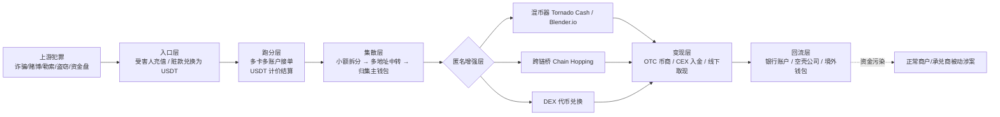
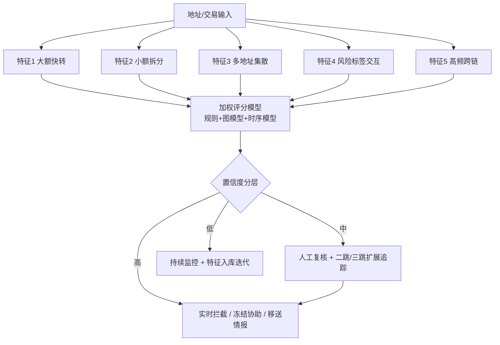

# 异常地址特征

<div class="doc-meta">
  <span class="owner">负责人：@梦幻居士</span>
  <span class="doing">状态：进行中 · 五类特征已成文</span>
</div>

## 结论摘要

1. **五类特征都只是"值得核查"的信号，不是定性结论。** 热钱包调拨、批量提币、空投发薪、做市套利在链上形态相同，单特征不足以区分行为主体。【推断】依据：链上记录只显示资金流向，不显示人。
2. **标签交互（特征四）置信度最高，但前提是标签本身可靠。** 标签不准则结论全废；标签还必须带生效时间，否则会拿 2022 年的制裁快照去判 2026 年的正常交互。【事实】例证：Tornado Cash 2022-08-08 被制裁、2025-03-21 被 OFAC 除名。
3. **组合命中比单特征强得多。** "标签交互 + 任一行为特征"和"快转 + 拆分 + 集散"两类组合可直接跃升高风险；单特征命中只进监控。【推断】
4. **所有数值阈值都是示意值，未经公开数据集实测。** 本页阈值只能作原型阶段的初始参考，不得写成"已验证"。【待验证】
5. **本页只给判据，不做定性。** 个案定性须经人工复核、多源交叉验证与法定程序。【事实】

## 本页怎么读

13 万字的原始研究报告已按主题拆开，本页只留"总览 + 组合 + 评分 + 校准"。逐类特征的六层拆解（机理、信号、口径、示意图、案例、误报）在分论页：

| 分论 | 核心问题 | 一句话识别要点 |
| --- | --- | --- |
| [特征一 · 大额快转](./features/rapid-pass) | 钱进来多久就走？ | 停留时间短于"发现→冻结"的响应周期 |
| [特征二 · 小额拆分](./features/smurfing) | 为什么拆成很多笔？ | 一笔进、多笔出，且收款方多为新建地址 |
| [特征三 · 多地址集散](./features/scatter-gather) | 钱最终汇到哪？ | 星型/树型/环状拓扑，高介数节点是咽喉 |
| [特征四 · 标签地址交互](./features/risk-neighbor) | 对手方是谁？ | 一跳命中官方标签最硬，二跳起必须降权 |
| [特征五 · 高频跨链](./features/chain-hopping) | 为什么频繁换链？ | 换链同时切断图谱、金额、时间、制度四重关联 |

配套页：

- 数据从哪来 → [公开数据集清单](./datasets)
- 真实地址长什么样 → [公开案例地址与链路](./case-addresses)
- 具体场景怎么画 → [重点场景链路画像](./scenarios)
- 用哪些字段算 → 本页"特征工程字段清单"
- 阈值怎么校准 → 本页"阈值校准与特征衰减"
- 术语不认识 → [涉诈行话速查](../glossary/slang)、[术语对照表](../glossary/terms)

## 研究范围

| 类别 | 主要形态 | 典型风险 |
| --- | --- | --- |
| 比特币 BTC | UTXO 链上转账、混币器、找零地址 | 勒索赎金、暗网交易、长链过账 |
| 稳定币 USDT/USDC | TRC20 / ERC20 / BEP20 等多链发行 | 跨境结算、诈骗资金归集、可被发行方冻结 |
| 土狗币 / Meme 币 | 貔貅盘、撤池跑路、增发后门、刷量拉盘 | 合约后门、流动性归零、内部人砸盘 |
| 跑分 / 第四方支付 | USDT 计价 + 银行卡/支付账户"接单" | 帮信罪、掩隐罪、冻卡、资金归集 |
| 资金盘 / 庞氏 | "套利机器人""量化托管""层级计酬" | 借新还旧、拉人头、突然关停 |
| 跨境涉诈链路 | 杀猪盘、东南亚诈骗园区、赌博平台 | 跨境洗钱、电诈赃款、制裁规避 |

这几类形态的黑话释义见 [涉诈行话速查](../glossary/slang)。**识别行话本身就是风险识别的第一步**——正常金融业务不会用"貔貅""跑分""养猪"这类表述。【推断】

### 典型资金链路（抽象模型）



### 研判五步法

"**数据 → 特征 → 评分 → 复核 → 处置**"。【推断】来源：本文框架归纳。

1. **数据**：自托管全节点 + 公开标注 + 社区举报 + 情报通报
2. **特征**：五类核心特征 + 场景特征（见 [重点场景链路画像](./scenarios)）
3. **评分**：规则引擎 + 图模型 + 时序模型，输出风险分与置信度
4. **复核**：置信度分层，高误报项人工复核，避免"命中即定性"
5. **处置**：实时拦截 / 冻结协助 / 情报共享 / 案件移送

## 五类特征速查

阈值均为示意值。【待验证】

| # | 特征 | 一句话定义 | 参考判据 | 主要误报来源 | 证据强度 |
| --- | --- | --- | --- | --- | --- |
| 1 | 大额快转 | 入账后极短时间几乎全额转出 | 停留中位数 < 1h；出入比 0.95–1.05；首笔转出 < 30min | 交易所热钱包、做市商、支付通道 | 中 |
| 2 | 小额拆分 | 单笔压低、靠笔数堆金额 | 扇出比 > 3；低额占比 > 0.8；新地址占比 > 0.7 | 批量提币、空投、发薪 | 中 |
| 3 | 多地址集散 | 一对多扇出 / 多对一收敛 | 合并权重 > 2；路径收敛度 > 5；介数中心性 Top 1% | 矿池、CEX 归集、企业资金池 | 中高 |
| 4 | 标签地址交互 | 与涉赌、涉诈、制裁地址有往来 | 一跳 ≥ 1 即触发；风险资金占比 > 0.3 为高风险 | 标签误报与过期、被动收款、钓鱼污染 | 高（需标签可靠） |
| 5 | 高频跨链 | 短时间在多链间往返 | 跨链 > 3 次/天；金额守恒度 > 0.95；桥合约命中 | 套利、多链 DeFi 操作 | 中 |

给不出量化阈值时写定性判据并注明"无量化阈值，靠人工判"，不伪装成数值规则。【推断】

## 组合特征与交叉命中矩阵

单特征容易误报，**特征共现**才是研判的关键。【推断】

| 组合 | 语义 | 风险等级 | 典型场景 |
| --- | --- | --- | --- |
| 4 + 任一行为特征 | 已确认标签关联 + 异常行为 | 极高 | 赃款转移、制裁规避 |
| 1 + 2 + 3 | 快转 + 拆分 + 集散（完整跑分链） | 极高 | 跑分平台、赌资归集 |
| 2 + 5 | 小额拆分 + 高频跨链 | 高 | 专业化洗钱、CMLN |
| 3 + 5 | 多地址集散 + 跨链 | 高 | 跨境洗钱、黑客赃款 |
| 1 + 3 | 快转 + 集散 | 高 | 赌资归集、OTC 过账 |
| 1 + 2 | 快转 + 拆分 | 中高 | 跑分派单、规避阈值 |
| 仅 4（无行为异常） | 被动污染 | 中 | 需核实是否"零转账钓鱼" |
| 仅 1 / 2 / 3 / 5 | 单一行为异常、无标签佐证 | 中 | 扩展二跳/三跳追踪后再判 |

四条判读原则：

1. **标签交互是放大器，不是独立定论。** 与任何行为特征共现都会使风险跃升一档。
2. **1+2+3 三特征共现**基本可锁定"跑分/集散"业务模式，即使暂无标签也应升级调查。
3. **2+5 或 3+5 共现**指向有组织、专业化跨境洗钱，需启动跨链追踪能力。
4. **仅特征 4 命中**时，优先排查极小金额骚扰与过期标签，不可直接处置。

## 综合评分与决策流程



评分公式（示意，须按业务校准）。【待验证】

```
Score = Σ wᵢ · fᵢ          （fᵢ 为特征标准化后的 0–1 分值）
w₄ = 0.35, w₃ = 0.25, w₁ = 0.20, w₂ = 0.10, w₅ = 0.10
Conf = label_conf × evidence_completeness × exp(−λ · Δt)
```

其中 `exp(−λ·Δt)` 为**时效性衰减**：标签越旧、证据越久远，置信度越低。一级官方标签 λ 取小值（长期有效），三级社区标签 λ 取大值（快速衰减）。【推断】

权重排序的理由：特征 4 是唯一能把伪匿名地址锚定到现实事实的信号；特征 3 的结构性最难伪造；特征 1、2 是时序与金额形态，误报最多；特征 5 依赖桥合约库完备度，当前覆盖最弱。【推断】

## 特征工程字段清单

五类特征的计算依赖以下链上字段。部署前应确认数据源（全节点 / API / 情报库）能否稳定提供。【推断】

| 字段类别 | 具体字段 | 支撑特征 |
| --- | --- | --- |
| 交易级 | `tx_hash`、`block_height`、`timestamp`、`gas_price`、`gas_limit`、nonce | 特征 1（停留时间、Gas 溢价） |
| 资金流级 | 每笔 input/output 的 `address`、`amount`、`asset_id`、UTXO 索引 | 特征 1/2/3（出入比、扇出、合并权重） |
| 地址级 | `first_seen`、`last_active`、余额序列、历史交易数、创建来源交易 | 特征 2/3（新地址占比、节点存活期） |
| 图级 | 入度/出度、邻居集合、介数中心性、社区 ID、路径深度 | 特征 3（枢纽识别、环路） |
| 标签级 | `label_source`、`label_type`、`confidence`、`effective_time`、`evidence_url`、`revoked_time` | 特征 4（全指标） |
| 跨链级 | `chain_id`、桥合约地址、lock/burn tx、mint/unlock tx、配套时间窗 | 特征 5（金额守恒、桥命中） |
| 合约级 | 权限函数列表、owner、LP 锁定状态、持币分布 | 土狗币场景（见 [重点场景链路画像](./scenarios)） |

UTXO 链（BTC）与账户链（ETH/TRON）的"找零"处理不同，计算扇出比与出入比前必须先做 UTXO 聚类与找零识别，否则指标会被系统性放大。【推断】

## 阈值校准与特征衰减

| 环节 | 方法 |
| --- | --- |
| 基线建立 | 按"链 × 币种 × 地址类型"分层，取历史分布的 P95/P99 作相对阈值，而非全局绝对金额 |
| 冷启动 | 无本地历史时，用公开数据集（Elliptic、BitcoinHeist）的分布作初始先验，上线后逐步替换 |
| 漂移监测 | 持续监控特征分布偏移。Elliptic 数据集在 timestep 43 因大型暗网市场关闭出现显著漂移——真实业务中类似事件（交易所被查处、桥被攻击）同样会造成分布突变 |
| 特征衰减 | 对抗适应会使特征有效性随时间下降（如跨链桥命中率在被攻击者替换桥后骤降）。建议定期用最新确认案例回测，更新权重 |
| 可解释性 | 用 SHAP 输出每个特征的贡献度，附在告警中供人工复核；无解释的评分不进入处置流程 |
| 闭环迭代 | 人工复核结论（确认/误报）回流为训练标签，形成"研判—反馈—再训练"闭环 |

以上为方法建议，不是已验证结论。【推断】

## 局限与待验证

- 【待验证】全部数值阈值均为示意值，未用公开数据集实测命中率与误报率，不得写成"已验证"。
- 【待验证】数据集免费档、API Key 需求、许可与时效未逐项实测，见 [公开数据集清单](./datasets)。
- 【待验证】特征四依赖的标签库，其覆盖率与撤销机制尚无本地实测数据。
- 【推断】证据强度排序与权重来自经验归纳，换数据源或换链后需重评。
- 【事实】链上记录只显示资金流向，不显示行为主体；"未发现"不等于"安全"。

## 下一步

- [ ] 用 Elliptic 或 BitcoinHeist 跑一轮基线，记录五类特征各自的命中率与误报率，把验证过的阈值单列并注明数据集版本。
- [ ] 与 [检测模型与原型](../tech/detection-model) 对齐：哪些特征落成代码规则、哪些只能人工判。
- [ ] 与 [链路可视化研究](./visualization) 对齐聚类结果，避免可视化页与特征页使用两套聚类口径。
- [ ] 标签库补"生效时间 + 撤销时间"字段，并做一次历史快照回测，量化过期标签造成的误报。

## 参考

1. Weber M. et al. *Anti-money laundering in bitcoin: Experimenting with graph convolutional networks for financial forensics*. KDD 2019. arXiv:1908.02591.
2. Akcora C.G. et al. *BitcoinHeist: Topological Data Analysis for Ransomware Detection on the Bitcoin Blockchain*. IJCAI-PRICAI 2020.
3. Chainalysis. *The Changing Nature of Crypto Crime (2025 Report)*.
4. FATF · Virtual Assets Red Flag Indicators.
5. OFAC · Sanctions List Service.
6. 站内：[公开数据集清单](./datasets)、[公开案例地址与链路](./case-addresses)、[重点场景链路画像](./scenarios)、[技术研判方法](../tech/forensic-methods)
