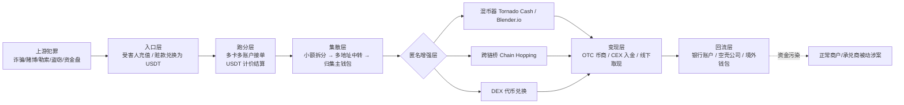
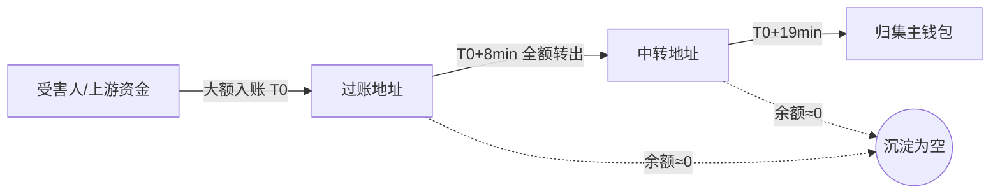
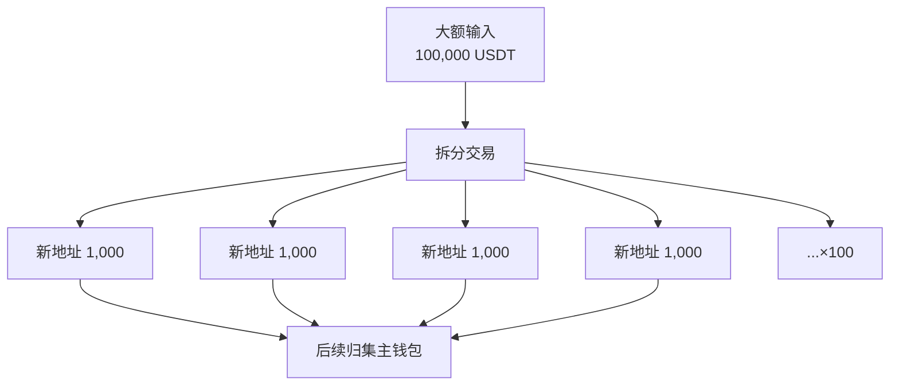
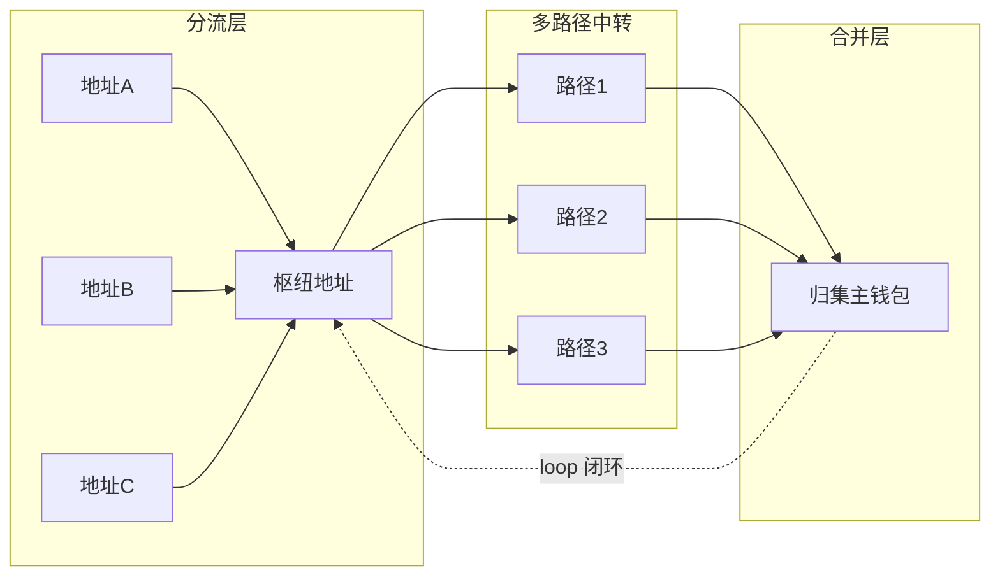
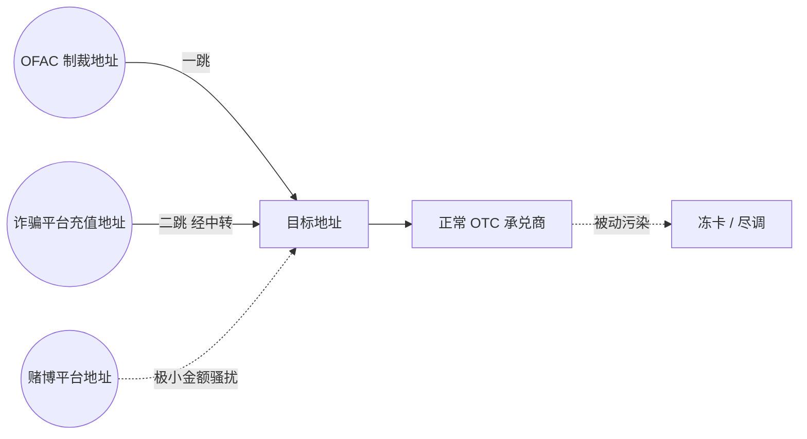
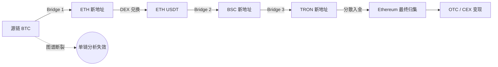
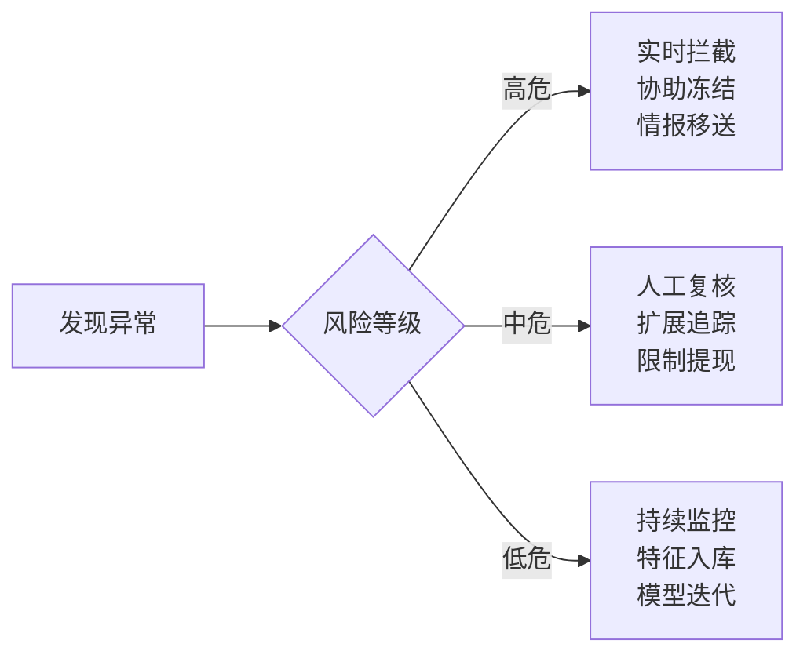

# 异常地址特征

<div class="doc-meta">
  <span class="owner">负责人：@梦幻居士</span>
  <span class="doing">状态：进行中</span>
</div>

> **研究目标**：聚焦比特币、稳定币、各类土狗币（Meme/貔貅盘）、跑分、资金盘、跨境涉诈虚拟币链路，围绕**风险识别、链路特征、治理难点、技术研判、防控对策、宣传预警**六个方面开展研究，并给出可复用的公开数据集、公开案例地址与异常地址判定指标。
>
> **文档性质**： defensive research / 反洗钱（AML）与涉诈资金研判参考。文中所有地址均为区块链公开账本上的伪匿名标识符，仅用于风险识别与防控研究，不含任何个人身份信息（PII）。
>
> **版本**：v1.0 ｜ **编制日期**：2026-11-18 ｜ **适用对象**：风控合规、链上情报分析、反诈宣传、监管研究

---

## 目录

1. [研究范围与总体框架](#一研究范围与总体框架)
2. [公开数据集清单](#二公开数据集清单)
3. [公开案例地址与案例链路](#三公开案例地址与案例链路)
4. [异常地址特征体系（五类核心特征）](#四异常地址特征体系五类核心特征)
5. [重点场景链路画像](#五重点场景链路画像)
6. [治理难点](#六治理难点)
7. [技术研判方法](#七技术研判方法)
8. [防控对策](#八防控对策)
9. [宣传预警](#九宣传预警)
10. [附录：数据源与参考文献](#附录数据源与参考文献)
11. [使用声明与局限](#使用声明与局限)

---

## 一、研究范围与总体框架

### 1.1 对象范围

| 类别 | 主要形态 | 典型风险 |
|---|---|---|
| 比特币 BTC | UTXO 链上转账、混币器、找零地址 | 勒索赎金、暗网交易、长链过账 |
| 稳定币 USDT/USDC | TRC20 / ERC20 / BEP20 等多链发行 | 跨境结算、诈骗资金归集、可被发行方冻结 |
| 土狗币 / Meme 币 | 貔貅盘、撤池跑路、增发后门、刷量拉盘 | 合约后门、流动性归零、内部人砸盘 |
| 跑分 / 第四方支付 | USDT 计价 + 银行卡/支付账户"接单" | 帮信罪、掩隐罪、冻卡、资金归集 |
| 资金盘 / 庞氏 | "套利机器人""量化托管""层级计酬" | 借新还旧、拉人头、突然关停 |
| 跨境涉诈链路 | 杀猪盘、东南亚诈骗园区、赌博平台 | 跨境洗钱、电诈赃款、制裁规避 |

> **备注｜涉诈行话速查**：上表中的"主要形态"多为黑灰产圈子内部用语，在对外宣传时又常被包装成"专业术语"以降低受害人警惕。下表按本文出现顺序给出释义，供非一线读者对照。**识别这些行话本身即是风险识别的第一步**——正常金融业务不会使用"貔貅""跑分""养猪"这类表述。

| 行话 / 黑话 | 释义 | 常见场景 |
|---|---|---|
| 土狗币 / Meme 币 | 无实际业务与价值支撑、靠社区情绪和营销热度发行的代币，生命周期常以小时或天计 | 土狗币 |
| 貔貅盘 | 合约埋"只买不卖"后门（黑名单、白名单、超高卖出税、单笔上限、暂停交易），币只进不出 | 土狗币 |
| 撤池跑路（Rug Pull） | 项目方撤走 DEX 流动性池资金，代币价格瞬间归零 | 土狗币 |
| 增发后门 | 合约保留 `mint` 权限，可随时增发新币砸盘 | 土狗币 |
| 刷量拉盘 | 用机器人对敲、自买自卖，制造交易活跃的虚假繁荣 | 土狗币 |
| 跑分 | 出租本人银行卡、支付账户或交易所账户，替赌博/诈骗团伙代收款并按指令转出，按流水抽佣；本质是未持牌的"第四方支付" | 跑分 |
| 接单 | 跑分平台或即时通讯群组派发给兼职者的具体收款任务 | 跑分 |
| 第四方支付 | 无支付牌照、聚合大量个人账户为黑灰产提供资金结算的非法通道 | 跑分 |
| 两卡 | 原指手机卡与银行卡，引申为支付账户、交易所账户的出租出借 | 跑分 |
| 承兑商 / 币商 | 在 OTC 场外市场买卖 USDT 变现的中间人；异常价差是赃款变现的重要信号 | 变现 |
| 搬砖 | 利用不同平台价差低买高卖。正常套利价差约 0.01–0.02 元，涉案行为常上浮至 0.04–0.1 元 | 变现 |
| 帮信罪 | 帮助信息网络犯罪活动罪。对上游犯罪仅有概括认知的跑分参与者多以此定罪 | 法律定性 |
| 掩隐罪 | 掩饰、隐瞒犯罪所得、犯罪所得收益罪。明知系赃款仍转账兑换者升格适用 | 法律定性 |
| 冻卡 | 银行账户或支付账户因接收涉案资金被司法机关冻结 | 跑分 |
| 资金盘 | 用后加入者的本金支付先加入者收益的"击鼓传花"，即庞氏骗局 | 资金盘 |
| 套利机器人 / 量化托管 | 虚构的"稳赚"话术包装，宣称自动交易或专业托管即可获得高额固定回报 | 资金盘 |
| 层级计酬 / 拉人头 | 传销式多层级返利，收益依赖发展下线而非真实产品服务 | 资金盘 |
| 借新还旧 | 庞氏本质的通俗说法：靠新增资金维持兑付，一旦入金停滞即崩盘 | 资金盘 |
| 杀猪盘 | 长期网聊建立情感或信任关系（"养猪"）后，诱导受害人进入虚假投资平台（"杀猪"） | 跨境涉诈 |
| 东南亚诈骗园区 | 柬埔寨、缅甸等地规模化、公司化运作的诈骗窝点，常与人口贩运、非法拘禁交织 | 跨境涉诈 |
| 电诈 | 电信网络诈骗的简称 | 跨境涉诈 |
| 靓号地址 | 专门定制的特定字符结尾地址，博彩平台用作投注、中转或结算地址 | 网络赌博 |
| 零转账钓鱼 / 同尾号钓鱼 | 向目标发送极小金额转账污染其记录，或伪造与常用对手尾号相同的高仿地址，诱导受害者复制错误地址 | 钓鱼 |
| 资金污染 | 正常地址因收到赃款而被永久留在资金路径上，导致下游账户被冻结或调查 | 全链路 |

### 1.2 典型资金链路（抽象模型）



### 1.3 研判框架

"**数据 → 特征 → 评分 → 复核 → 处置**"五步法：

1. **数据**：自托管全节点 + 公开标注 + 社区举报 + 情报通报
2. **特征**：五类核心异常特征（见第四节）+ 场景特征（见第五节）
3. **评分**：规则引擎 + 图模型 + 时序模型，输出风险分与置信度
4. **复核**：置信度分层，高误报项人工复核，避免"命中即定性"
5. **处置**：实时拦截 / 冻结协助 / 情报共享 / 案件移送

---

## 二、公开数据集清单

> 说明：以下数据集均来自公开渠道。标注质量、时效性、许可协议差异较大，使用前须核验更新时间与授权范围。

### 2.1 学术研究数据集（带标注，可用于建模）

| # | 数据集 | 规模与结构 | 标注内容 | 获取方式 |
|---|---|---|---|---|
| 1 | **Elliptic Data Set** | 203,769 个交易节点、234,355 条有向边、49 个时间片；每节点 166 维特征（94 本地 + 72 一跳聚合） | 非法 4,545（2.2%）、合法 42,019（20.6%）、未知 157,205（77.2%）；非法含暗网市场、诈骗、恶意软件、勒索、庞氏 | [Kaggle](https://www.kaggle.com/ellipticco/elliptic-data-set)；[Hugging Face](https://huggingface.co/datasets/yhoma/elliptic-bitcoin-dataset) |
| 2 | **Elliptic++** | 822,942 个地址节点、2,868,964 条地址-地址边、56 维特征、49 时间片；提供 4 种图视图 | 地址级标注，非法占比约 1.7% | 随 Elliptic 扩展论文发布（ACM 相关研究文献中可获取） |
| 3 | **BitcoinHeist / Bitcoin Heist Ransomware Address** | 2,916,697 条实例、10 个字段；2009-01 至 2018-12，按 24h 快照组织；过滤 < 0.3 BTC 的边 | 24 个勒索软件家族标签；标签来自 Montreal、Princeton、Padua 三项研究 | [UCI ML Repository (id=526)](https://archive.ics.uci.edu/dataset/526/bitcoinheistransomwareaddressdataset)，DOI `10.24432/C5BG8V`；[Kaggle](https://www.kaggle.com/datasets/sapere0/bitcoinheist-ransomware-dataset/data) |
| 4 | **IBM Transactions for AML（HI-Small）** | 约 515,000 账户、500 万笔交易、10 个模拟日；洗钱:合法 ≈ 1:981 | 8 种洗钱类型：fan-out、fan-in、cycle、random、bipartite、stack、scatter-gather、gather-scatter | IBM 研究发布（合成数据，适合模式识别基线） |
| 5 | **CCLT 多链标注库** | 290,000+ 标注地址，覆盖 8 个主流跨链桥 | 跨链洗钱路径标注；案例含 FTX、BNB Bridge、Mad Meerkat Finance | Springer《Cross-Chain Laundering Tracer》论文 |
| 6 | **跨层取证数据集（DID）** | 自托管全节点交易历史；L1/L2 关联事件（Arbitrum、Optimism、zkSync Era、Starknet 等） | 六启发式加权评分模型；含验证交易哈希与脱敏嫌疑地址集 | [GitHub: bertter/DID](https://github.com/bertter/DID) |

**关键提示**：

- Elliptic 数据集在 **timestep 43** 存在显著分布漂移（对应某大型暗网市场关闭），是检验模型时序鲁棒性的天然测试点。
- BitcoinHeist 的 6 个核心拓扑特征与后文特征体系直接对应：
  - `length` → 混币轮次（拆分-转移-合并的深度）
  - `weight` → 合并行为（输入地址数 > 输出地址数）
  - `count` → 合并交易次数
  - `loop` → 拆分→多路径→合并的环路计数
  - `neighbors` → 地址直接连接数
  - `income` → 收入金额（Satoshi）
- IBM 数据集的 `scatter-gather` / `gather-scatter` 是"多地址集散"的标准学术命名。

### 2.2 官方制裁与执法清单（权威标签源）

| 数据源 | 内容 | 地址数量级 | 链接 |
|---|---|---|---|
| **OFAC SDN List**（美国财政部） | 受制裁个人/实体及其加密货币地址标识符 | 持续更新 | https://www.treasury.gov/ofac |
| **OFAC 历史标注汇总**（Chainalysis 整理） | 逐次制裁行动与地址清单：Lazarus Group、Blender.io、Tornado Cash、Hydra、Garantex、Suex、Chatex 等 | 见第三节 | https://www.chainalysis.com/blog/ofac-sanctions/ |
| **FBI IC3 公告** | 重大盗窃案归因与地址通报（如 Bybit 案 I-022625-PSA） | 按案件 | https://www.ic3.gov |
| **美国司法部（DOJ）** | 起诉书与没收令中的涉案钱包路径 | 按案件 | https://www.justice.gov |

> ⚠️ **时效性提醒**：制裁清单会变动。例如 Tornado Cash 于 2022-08-08 被首次制裁（38 个地址）、2022-11-08 重新指定（新增 90 个地址），后因 2024-11 第五巡回法院裁决越权，于 **2025-03-21 正式除名**。研判时须以实时 SDN 为准，不可引用历史快照作为当前结论。

### 2.3 社区举报类标签库（辅助参考，质量参差）

| 平台 | 运营方 | 数据库规模 | 特点 |
|---|---|---|---|
| Chainabuse | TRM Labs | ~220,000 | 多链（BTC/ETH/SOL/ADA），专业团队复核 |
| Bitcoin Abuse DB | BitcoinAbuse.com | ~300,000 | 仅 BTC，举报不可删除/编辑，需甄别误报 |
| Scan Blocks | Clockwork Venture | ~310,000 | 地址查询 + 浏览器插件 |
| Scam Alert | Whale Alert | ~130,000 | 链上分析引擎联动 |
| GreySafe | Blackworks.io | ~131,000 | 社区驱动，强调验证与归因 |
| CryptoScamDB | MyCrypto 社区 | ~9,221 | [GitHub blacklist](https://github.com/orgs/CryptoScamDB/repositories)、[JSON API](https://api.cryptoscamdb.org/v1/addresses)；适合**历史回溯**，不宜当作实时黑名单 |

汇总索引：[Cryptocurrency Theft, Fraud and Scam Reporting Services](https://github.com/Web-n-Composite/crypto-theft-reporting)

**使用原则**：社区标签按"线索"而非"事实"处理；命中后必须回溯原始举报证据（截图、事件链接、时间），并做时间衰减。

---

## 三、公开案例地址与案例链路

### 3.1 已核实公开地址（可直接用于规则/白名单比对）

| 案例 | 链 | 地址 | 来源与说明 |
|---|---|---|---|
| Lazarus Group / Ronin Bridge 主地址 | ETH | `0x098B716B8Aaf21512996dC57EB0615e2383E2f96` | OFAC 2022-04-14 首次列入 SDN；案发时持有约 148,000 ETH。来源：[Federal Register 2022-09073](https://public-inspection.federalregister.gov/2022-09073.pdf) |
| Lazarus Group 关联地址 1 | ETH | `0xa0e1c89Ef1a489c9C7dE96311eD5Ce5D32c20E4B` | OFAC 2022-04-21/22 更新 SDN，来源同上 |
| Lazarus Group 关联地址 2 | ETH | `0x3Cffd56B47B7b41c56258D9C7731ABaDc360E073` | 同上 |
| Lazarus Group 关联地址 3 | ETH | `0x53b6936513e738f44FB50d2b9476730C0Ab3Bfc1` | 同上 |
| CryptoLocker 勒索地址 | BTC | `1LXrSb67EaH1LGc6d6kWHq8rgv4ZBQAcpU` | BitcoinHeist 数据集；在 24h 快照中最多出现 420 次，为出现频次最高的勒索地址之一 |

**Ronin Bridge 案关键数据**（用于链路复盘）：

- 2022-03-23 被盗：173,600 ETH + 25.5M USDC，总值约 6.2 亿美元。
- 资金分流：部分经 **Tornado Cash**（OFAC 2022-08-08 制裁，涉 4.55 亿美元）、部分经 **Blender.io**（首个被制裁的混币器，处理约 2,050 万美元赃款）。
- 2022-04-22 新增制裁的 3 个地址曾合计持有约 50,000 ETH（约 1 亿美元）。
- Binance 冻结了转入平台的 86 个账户，追回约 580 万美元。

> 来源：[GDF《Cryptoassets and Sanctions Compliance》](https://www.gdf.io/wp-content/uploads/2022/07/Cryptoassets-and-Sanctions-Compliance-Report-Final-1.pdf)、[Quadriga Initiative 案例库](https://quadrigainitiative.com/cryptocurrencyhackscamfraudwiki/index.php?title=Axie_Infinity_Ronin_Bridge_Unauthorized_Treasury_Access)。

### 3.2 公开案例链路（地址脱敏或未公开，按资金路径建模）

| 案例 | 时间 | 链路特征 | 来源 |
|---|---|---|---|
| **Zheng Zhao 杀猪盘洗钱案** | 2025 指控，2026-10 引渡 | 174 名美国受害者 → 美国银行账户 → 巴哈马银行账户 → **兑换 USDT** → 柬埔寨控制钱包 → 诈骗园区头目；8 名共谋者认罪 | 美国 DOJ / [扬子晚报·新浪财经](https://finance.sina.com.cn/jjxw/2026-10-26/doc-iniwqpfm5204631.shtml) |
| **Bybit 黑客案** | 2025-02-21 | 约 15 亿美元（史上最大数字资产盗窃）；FBI 归因 DPRK "TraderTraitor"（IC3 公告 I-022625-PSA）；2025 年 DPRK 全年盗窃超 20 亿美元 | [Chainalysis 2025 犯罪报告](https://www.chainalysis.com/blog/report-the-changing-nature-of-cryptocrime/) |
| **A7A5 卢布稳定币制裁规避** | 2025 | 10 个月内处理 933 亿美元；Grinex 至少 47.6 亿、Meer 约 3.05 亿美元 | [Chainalysis 制裁报告](https://www.chainalysis.com/blog/crypto-sanctions-2026/) |
| **太子集团 / 陈志（Prince Group）** | 2025 | 东南亚杀猪盘网络，被制裁；与 Huione Guarantee 担保平台生态关联 | 同上、[CNBC 报道](https://www.cnbc.com/amp/2026/02/02/chinese-money-laundering-networks-crypto-telegram-2025-chainalysis-scam-southeast-asia-cambodia.html) |
| **TRON 哈希博彩靓号地址** | 2022 案例 | 猜尾号玩法；投注地址 `TGV…ds888`（原报告脱敏）；高频、固定金额往来，赌资来自/回流 CEX，造成"资金污染" | [Bitrace / 腾讯新闻](https://news.qq.com/rain/a/20231023A04C9L00) |
| **USDT 跑分案（山东德州/陕西靖边）** | 裁判文书 | 提供银行卡、USDT 管理、交易所账户人脸验证供转移赃款；定性帮信罪/掩隐罪 | [黑灰产 USDT 变现模式分析](https://new.qq.com/rain/a/20261026A0EAF900) |

### 3.3 2025 年宏观态势（研判背景）

据 Chainalysis 2025 犯罪报告：

- 非法地址全年收到至少 **1,540 亿美元**，同比 +162%；其中受制裁实体收到额同比增长 **694%**（约 1,040 亿美元）。
- **稳定币占全部非法交易量的 84%**（早期报告口径为 63%，呈持续上升趋势）。
- 中国语言洗钱网络（CMLN）2025 年流转约 **161 亿美元**，约占全球加密犯罪市场的 20%；主要通过 Telegram"担保平台"撮合。
- 犯罪资金直接转入交易所的比例从 2021–2022 年的 40%+ 降至约 15%——**说明中间"分层"（混币器、跨链桥）环节显著增加**。

---

## 四、异常地址特征体系（五类核心特征）

> 以下指标均为**研判线索**，不是单条即可定性的证据。建议采用"多特征加权 + 人工复核"方式使用；阈值需按链、币种、业务场景校准。
>
> **本节结构**：每类特征按"机理与对抗逻辑 → 链上可观测信号 → 计算口径与参考阈值 → 典型模式示意 → 案例锚点 → 误报/规避/校准"六层展开。所有阈值均为**示意参考值**，实际部署须按 4.8 的方法建立本地基线。

### 4.1 特征一：大额快转（Hot Potato / Rapid Pass-through）

**定义**：资金入账后在极短时间内全额或近全额转出，地址几乎不沉淀余额。该模式又称"热土豆"，核心目的是**压缩资金暴露窗口**——让资金在任一可监控节点上的停留时间短于"采样 → 研判 → 冻结"的响应周期。

#### 4.1.1 机理与对抗逻辑

- **时间维度对抗**：交易所与银行风控多依赖 T+1 对账、批量扫描或人工复核。资金若在数分钟内完成"入—出"，即使事后命中标签，转移也已完成。
- **金额维度对抗**：整笔转出使余额归零，规避"余额阈值告警"与事后资产查封。
- **链路维度对抗**：快转常与"新地址 + 非固定对手"配合，避免形成稳定、可聚类的交易图谱。
- **成本容忍**：团伙愿意支付更高 Gas 抢先确认，因此 **Gas 价格偏高、nonce 连续、交易在区块内排序靠前**是常见伴随信号。

#### 4.1.2 链上可观测信号

| 维度 | 内容 |
|---|---|
| 链上可观测信号 | 入账与出账时间间隔极短；出入金额高度匹配（差额≈手续费）；日终余额长期为零 |
| 伴随信号 | Gas 价高于同期中位数；EOA 发起而非合约钱包；同一控制者在多个地址上同步快转；入账区块高度与出账区块高度差 ≤ 1–3 |
| 典型场景 | 跑分过账、赌资归集、盗窃资金分流、OTC 承兑短停 |
| 误报来源 | 交易所热钱包、做市商、支付通道节点本身即高频快转 |
| 规避方式 | 故意跨日间隔、拆分后错峰转出、保留 1%–3%"磨损"使金额不完全匹配 |
| 建议处置 | 结合地址身份标签与业务白名单排除；命中后升级到二跳分析 |

#### 4.1.3 计算口径与参考阈值

| 指标 | 计算公式 | 参考阈值（示意） | 所需字段 |
|---|---|---|---|
| 资金停留时间 | `dwell = t_out − t_in`（按 UTXO / 转账级配对） | 中位数 < 1h；P90 < 6h | tx timestamp、amount、from/to |
| 出入比 | `ratio = Σout / Σin`（扣除手续费后） | 0.95–1.05 | 地址级流入/流出总额 |
| 余额归零率 | `zero_ratio = 日终余额≤ε 的天数 / 活跃天数` | > 0.8 | 每日余额快照 |
| 金额偏离度 | `z = (x − μ_baseline) / σ_baseline` | P95 > μ + 3σ | 同链同币种历史分布 |
| 首笔转出延迟 | `first_out_delay = t_first_out − t_large_in` | < 30 min（大额入账后） | 入账与首笔出账时间 |
| 手续费溢价 | `fee_premium = 实际 gas 价 / 同期区块中位数` | > 1.5 | gas price、区块中位数 |

#### 4.1.4 典型模式示意



#### 4.1.5 案例锚点

- **Ronin Bridge 案**：被盗 ETH 于 2022-04-22 开始移动，部分资金转入 Binance 后**分散到 86 个账户**，是"快转 + 分散入金"的典型组合。
- **跑分案例**：兼职者收款后"按指令转入指定账户或兑换成 USDT 转出"，停留时间以分钟计，且资金不在本人账户沉淀。

#### 4.1.6 误报、规避与校准

- **误报**：CEX 热钱包、做市商、支付通道在业务上天然高频快转，须先用实体标签与业务白名单剔除。
- **对抗演化**：跨日错峰、金额随机化磨损、利用闪电贷在同一区块内完成借—转—还，制造"零停留"假象。
- **校准方法**：按地址类型分别建基线（个人地址 vs 机构地址），优先使用相对阈值（P95）而非绝对金额。

### 4.2 特征二：小额拆分（Smurfing / Fan-out）

**定义**：将大额资金拆为大量小额，分散转入多个（常为新生成的）地址，以规避阈值监测或增加追踪成本。该手法源自现金时代的"化整为零"（structuring），在链上表现为一笔输入对应大量输出。

#### 4.2.1 机理与对抗逻辑

- **规避申报阈值**：把单笔金额压到风控阈值（如 1,000 USDT）以下，使每笔都不触发告警。
- **放大追踪成本**：1 笔变 N 笔，交易图规模呈指数膨胀，人工溯源难以为继。
- **制造噪声**：在大量正常小额交易掩护下混入赃款，降低异常交易的信噪比。
- **为归集备料**：拆分后的小额地址是后续 fan-in（特征三）的"原料"，二者常成对出现构成 scatter-gather。

#### 4.2.2 链上可观测信号

| 维度 | 内容 |
|---|---|
| 链上可观测信号 | 输出地址数远大于输入地址数；单笔金额集中在低区间且金额相近；新地址占比高 |
| 伴随信号 | 子地址多为当批次新建、无历史交易；拆分金额呈等差数列或固定倍数；拆分后短时间内出现归集动作 |
| 学术对应 | IBM 数据集 `fan-out`、`scatter-gather`；BitcoinHeist `length`、`loop` |
| 典型场景 | 跑分派单、赌资上下分、规避大额申报、勒索赎金分发 |
| 误报来源 | 交易所批量提币、工资/空投发放、游戏奖励、项目方空投 |
| 建议处置 | 与资金最终去向联动判断：若拆分后最终归集至少数地址，风险显著上升 |

#### 4.2.3 计算口径与参考阈值

| 指标 | 计算公式 | 参考阈值（示意） | 所需字段 |
|---|---|---|---|
| 扇出比 | `fanout = 唯一输出地址数 / 唯一输入地址数` | > 3（UTXO 链需排除找零） | 交易输入/输出地址集合 |
| 低额占比 | `low_share = 金额<阈值的输出笔数 / 总输出笔数` | > 0.8 | 每笔输出金额 |
| 金额集中度 | `CV = σ / μ`（CV 越低越接近等额拆分） | < 0.3 | 输出金额分布 |
| 新地址占比 | `fresh = 首次出现的输出地址 / 总输出地址` | > 0.7 | 地址 first_seen |
| 拆分层数 | `max_path_depth`（对应 BitcoinHeist `length`） | ≥ 3 | 多跳路径深度 |
| 拆分—归集比 | `fanout / fanin`（若后续归集，比值接近 1 提示 scatter-gather） | 0.8–1.2 | 相邻两跳地址数 |
| 金额熵 | `H = −Σ p_i log p_i`（p_i 为第 i 笔金额占比） | 低熵=等额拆分 | 输出金额分布 |

#### 4.2.4 典型模式示意



#### 4.2.5 案例锚点

- **USDT 跑分**：以 USDT 作为佣金结算与资金归集介质，兼职者"接单"收款后按指令拆分转出，按流水抽成。
- **BitcoinHeist**：CryptoLocker 等勒索家族的赎金经多地址拆分后进入混币流程，`length` 与 `loop` 特征显著高于普通地址。
- **网络赌博**：公开安全分析指出网赌地址典型特征为"分散转入、集中转出"，即拆分与归集的组合。

#### 4.2.6 误报、规避与校准

- **误报**：交易所批量提币、工资发放、空投、游戏奖励均天然扇出，需结合地址身份与金额分布区分。
- **对抗演化**：随机化拆分金额（规避等额 CV 检测）、混入正常小额地址、跨多日分批拆分（规避时间窗检测）。
- **校准方法**：UTXO 链必须先剔除找零输出，否则 fanout 指标会被放大；建议同时观察"金额熵"与"新地址占比"两个独立信号。

### 4.3 特征三：多地址集散（Scatter-Gather / Fan-in）

**定义**：多个地址汇入少数主地址（fan-in），或主地址分发至多地址后再回收（scatter-gather），形成星型、树型或环状拓扑。这是链上洗钱最核心的结构特征，BitcoinHeist 数据集的 `weight`、`count`、`loop` 三个特征正是为量化它而设计。

#### 4.3.1 机理与对抗逻辑

- **fan-in（归集）**：把分散在数百个"跑分卡"地址中的赃款集中到少数主钱包，便于统一变现与控制。
- **scatter-gather（分流再聚合）**：先拆分到多条路径，再在终点合并，使"资金来源—去向"的对应关系被打乱，单笔追踪无法还原全貌。
- **cycle（环路）**：制造自我循环交易，虚增交易量与地址活跃度，干扰基于图统计的异常检测。
- **枢纽价值**：高介数中心性的中转节点是整个网络的"咽喉"，识别一个枢纽即可顺藤摸瓜还原整条链路——这也是执法优先打击对象。

#### 4.3.2 链上可观测信号

| 维度 | 内容 |
|---|---|
| 链上可观测信号 | 一地址入度/出度异常高；多层中转后归集到同一终点；存在"拆分→多路径→合并"闭环 |
| 伴随信号 | 中转地址生命周期短（建后即用、用完即弃）；多路径的跳数与金额高度对称；终点地址与 CEX 充值地址交互 |
| 学术对应 | IBM `gather-scatter`、`scatter-gather`、`cycle`；BitcoinHeist `weight`、`count`、`loop` |
| 典型场景 | 跑分平台归集钱包、资金盘入口、赌资结算主钱包 |
| 误报来源 | 矿池、交易所归集钱包、正规企业资金归集 |
| 建议处置 | 用"是否缺乏公开实体标签 + 资金是否来自标签地址"双重条件过滤 |

#### 4.3.3 计算口径与参考阈值

| 指标 | 计算公式 | 参考阈值（示意） | 所需字段 |
|---|---|---|---|
| 入度 / 出度 | `in_deg(v)`、`out_deg(v)` | 显著高于同链地址 P99 | 地址交易图 |
| 合并权重 | `weight = 输入地址数 / 输出地址数`（>1 为合并行为，BitcoinHeist 定义） | > 2 | 交易输入输出地址数 |
| 合并次数 | `count`（量化合并模式的交易笔数） | 高于基线 3σ | 地址级合并交易计数 |
| 环路计数 | `loop`（拆分→多路径→合并的闭环数） | ≥ 1 即重点关注 | 多跳路径检测 |
| 介数中心性 | `betweenness(v) = Σ σ_s_t(v)/σ_s_t` | 处于全图 Top 1% | 全图最短路径 |
| 路径收敛度 | `convergence = 起点地址数 / 终点唯一地址数` | > 5 | 多跳路径起终点 |
| 标签邻居数 | `labeled_neighbors = \|N(v) ∩ L\|`（一跳/二跳） | ≥ 1（二跳需降权） | 风险标签库 |
| 节点存活期 | `lifetime = last_seen − first_seen` | 中转地址 < 7 天 | 地址活跃时间 |

#### 4.3.4 典型模式示意



#### 4.3.5 案例锚点

- **网赌自建结算系统**：平台为每个用户分配独立充值地址，表面分散，实际最终汇集到少数由平台控制的主钱包——教科书式 fan-in。
- **资金盘入口**：参与者入金地址分散，返利地址呈 fan-out，形成"入金—返利"双向集散结构。
- **CMLN 担保平台**：Telegram 担保平台作为资金与服务的撮合枢纽，连接洗钱方、诈骗园区与制裁主体，在图上是典型高介数中心性节点。
- **CCLT 研究结论**：无论资金来自 FTX、BNB Bridge 还是 Mad Meerkat Finance 事件，非法资金均系统性地在 **Ethereum 网络做最终归集**——这是跨链场景下的"终点枢纽"特征。

#### 4.3.6 误报、规避与校准

- **误报**：矿池、CEX 归集钱包、代发工资与正规资金池同样高入度，必须靠实体标签与业务白名单剔除。
- **对抗演化**：增加中转层数、每站只做一次中转、刻意保持路径跳数不等以破坏对称性、使用隐私币切断图关联。
- **校准方法**：先用 `weight`/`count` 粗筛，再用介数中心性定位枢纽，最后用标签邻居与节点存活期做二次过滤；三层串联可显著降低误报。

### 4.4 特征四：与赌博/诈骗标签地址交互（Risk-neighbor Exposure）

**定义**：目标地址与已知赌博、诈骗、制裁、暗网等标签地址存在直接或近邻交易关系，形成"资金污染"。这是五类特征中**置信度最高**的一类，因为标签是把链上 pseudonymous 地址锚定到现实世界事实的唯一桥梁。

#### 4.4.1 机理与对抗逻辑

- **资金污染的不可逆性**：区块链交易不可撤销。一旦收到赃款，该地址即永久留在赃款路径上，后续任何转出都会把污染向下游扩散——这正是 OTC 承兑商"冻卡"的根源。
- **标签的锚定价值**：OFAC SDN 等官方标签提供了"已知恶意"的确定性锚点，无需再推断行为意图。
- **标签的天然滞后**：从案发到标签发布通常需要数周至数月，且社区标签依赖举报，存在误报与过期问题。因此标签必须带**生效时间戳**与**置信度**。
- **零成本污染攻击**：攻击者可主动向目标地址发送 1 聪/极小金额，制造虚假关联（"零转账钓鱼"），使干净地址被误标。

#### 4.4.2 链上可观测信号

| 维度 | 内容 |
|---|---|
| 链上可观测信号 | 交易对手命中风险标签库；资金来自/流向已知平台充值地址；初始 Gas 费来自匿名或非法实体 |
| 伴随信号 | 与标签地址存在多笔、周期性往来；资金 entering 后很快转出；同批地址共享 Gas 来源或创建来源 |
| 标签源 | OFAC SDN（权威）、Chainabuse / Bitcoin Abuse / CryptoScamDB（社区，带时间戳）、执法通报 |
| 典型场景 | OTC 承兑商被动收到赃款导致冻卡；正常企业地址被"零转账钓鱼"污染 |
| 误报来源 | 社区标签误报、过期标签、同尾号钓鱼制造的虚假关联 |
| 建议处置 | 标签必须带时间戳与置信度；命中后回溯原始证据；禁止"历史命中=当前有罪" |

#### 4.4.3 计算口径与参考阈值

| 指标 | 计算公式 | 参考阈值（示意） | 所需字段 |
|---|---|---|---|
| 一跳命中数 | `h1 = \|N¹(v) ∩ L\|` | ≥ 1 即触发 | 直接交易对手集合 |
| 二跳命中数 | `h2 = \|N²(v) ∩ L\|` | ≥ 2（须降权） | 二跳邻居集合 |
| 风险资金占比 | `exposure = Σ amount(L↔v) / total_volume(v)` | > 0.3 高风险；> 0.05 关注 | 按对手标注的金额流水 |
| 跳数衰减分 | `R = Σ_{h=1..3} w_h · hit_h / h`，w1>w2>w3 | 越高越危险 | 分层邻居命中 |
| 时间邻近性 | `Δt = t_interaction − t_label_effective` | Δt ≥ 0 才计入（标签生效后交互） | 标签生效时间、交互时间 |
| 标签置信加权 | `conf_sum = Σ conf_i`（官方=1.0，商业=0.7，社区=0.4） | > 0.7 高置信 | 标签来源与置信度 |
| 初始 Gas 同源 | 首笔 Gas 提供者是否在风险集 | 命中即高危 | 地址创建交易、Gas payer |
| 污染金额下限 | 极小金额（< 1 USD）单独标记 | 不计入 exposure，标记为骚扰 | 单笔金额 |

#### 4.4.4 典型模式示意



#### 4.4.5 案例锚点

- **OFAC 追加制裁逻辑**：2022-04-22 新增的 3 个 Lazarus 地址，其制裁依据正是"**曾与原始制裁地址交互**"并合计持有约 50,000 ETH——监管实践本身就采用"一跳命中"作为认定标准。
- **TRON 赌客地址**：赌资来自某 CEX，先后与 4 个博彩靓号地址交互，最终回流 CEX——造成对 CEX 业务地址的资金污染，是"标签交互+回流"的完整案例。
- **同尾号钓鱼**：攻击者监控链上大额转账，生成与受害者常用交易对手尾号相同的高仿地址，发送小额转账污染记录，诱导受害者复制错误地址。
- **零转账钓鱼**：向大量不特定地址发送极小金额，制造虚假关联，使合规系统误判。

#### 4.4.6 误报、规避与校准

- **时效性陷阱**：Tornado Cash 于 2022-08-08 被制裁、2025-03-21 被 OFAC 除名。若系统仍使用 2022 年快照，会把当前正常交互误判为高风险。**标签必须实时同步并支持撤销**。
- **误报控制**：极小金额往来单独归类为"骚扰/污染尝试"，不按等权计入 exposure；社区举报须回溯原始证据（截图、事件链接、举报时间）。
- **对抗演化**：攻击者通过多跳中转（≥3 跳）稀释关联、使用新地址隔离、主动向合规地址发送小额污染以制造"对等关联"假象。
- **校准方法**：建立标签分级制度（官方/商业/社区三级），配置不同的时间衰减系数 λ；一级标签长期有效，三级标签建议 90 天后自动降权复核。

### 4.5 特征五：高频跨链（Chain Hopping）

**定义**：资产在多条链之间频繁通过跨链桥/DEX 转移，每次换链伴随地址更换与代币转换，以切断单链追踪路径。这是近年增长最快、制度覆盖最薄弱的一类特征。

#### 4.5.1 机理与对抗逻辑

跨链之所以有效，是因为它**同时切断了四种追踪关联**：

| 被切断的关联 | 机制 | 对应检测指标 |
|---|---|---|
| 图谱关联 | 跨链后使用全新地址，原链交易图与目标链交易图不连通 | 跨链后地址新鲜度 |
| 金额关联 | 代币转换导致金额变化（BTC→ETH→USDT），无法直接比对 | 两端金额守恒度 |
| 时间关联 | 人为设置不均匀等待，打破时间戳匹配 | 间隔时间变异系数 |
| 制度关联 | 桥与 Rollup 常不在 VASP 申报义务内，Travel Rule 不覆盖 | 桥合约命中 + 制度缺口标记 |

- **最终归集倾向**：CCLT 对 FTX、BNB Bridge、Mad Meerkat Finance 三起案例的研究发现，无论资金源自哪条链，均系统性在 **Ethereum 做最终清洗**——这为"终点链监控"提供了依据。
- **成本考量**：跨链桥费与滑点可接受，因为相比被冻结的赃款，这些是必要成本。

#### 4.5.2 链上可观测信号

| 维度 | 内容 |
|---|---|
| 链上可观测信号 | 与已知桥合约高频交互；跨链后使用全新地址；跨链时间间隔不均匀；代币种类连续切换 |
| 伴随信号 | 桥操作在时间上"锁仓→ mint/unlock"成对出现；使用多个不同桥分散；跨链后立即进入 DEX 兑换或混币器 |
| 学术与监管依据 | CCLT 跨链追踪框架覆盖 8 大桥、29 万+ 标注地址；FATF 2024–2025 更新明确将跨链桥与 L2 列为高风险领域；FinCEN 将"跨多链转移以稀释交易轨迹"列为洗钱类型 |
| 典型场景 | 朝鲜黑客赃款、CMLN、规避单链监控 |
| 误报来源 | 正常跨链套利、DeFi 用户多链操作 |
| 制度缺口 | 部分国家（如韩国）仍以 L1 语义定义虚拟资产转移，桥与 rollup 不在申报义务内，Travel Rule 不覆盖跨链转移 |

#### 4.5.3 计算口径与参考阈值

| 指标 | 计算公式 | 参考阈值（示意） | 所需字段 |
|---|---|---|---|
| 跨链频率 | `hops/day = 跨链操作次数 / 活跃天数` | > 3 次/天（个人地址） | chain_id、bridge tx |
| 桥合约命中 | `bridge_hit = 交互桥合约数 / 总跨链次数` | 命中已知高风险桥即加权 | 桥合约地址库 |
| 地址新鲜度 | `freshness = 跨链后首次出现地址 / 跨链次数` | > 0.8 | 目标链地址 first_seen |
| 金额守恒度 | `match = 1 − \|amt_out − amt_in·rate − fee\| / amt_in` | > 0.95 判定为同一笔资金 | 两端金额、汇率、桥费 |
| 间隔变异系数 | `CV_t = σ(t_interval) / μ(t_interval)` | > 1.0（刻意不规则） | 跨链时间戳 |
| 链多样性 | `chain_entropy = −Σ p_i log p_i` | 熵越高越可疑 | 各链操作占比 p_i |
| 代币切换次数 | `token_switches` | ≥ 2 次/链路 | 每次跨链前后代币 |
| 终点链标记 | 资金是否在 Ethereum 最终归集 | 命中即高权重 | 全链路终点地址 |
| L1–L2 关联 | 桥充提 / rollup batch 与 L1 结算的关联记录 | 可关联即补单成功 | L1/L2 全节点数据 |

#### 4.5.4 典型模式示意



#### 4.5.5 案例锚点

- **Ronin Bridge 案**：ETH 经 Tornado Cash（同链混币）与 Blender.io（BTC 链混币）双路径清洗，是"混币 + 跨链"组合的早期代表。
- **CCLT 三案例**：FTX、BNB Bridge、Mad Meerkat Finance 事件的非法资金均跨越多个桥，最终在 Ethereum 归集。
- **A7A5 卢布稳定币**：2025 年 10 个月处理 933 亿美元，配合 Grinex、Meer 交易所形成制裁规避的跨链结算网络。
- **DPRK 2025 年盗窃**：全年超 20 亿美元，Bybit 单案约 15 亿美元，跨链是其标准清洗环节。

#### 4.5.6 误报、规避与校准

- **误报**：正常跨链套利、多链 DeFi 用户、跨链桥做市商均高频跨链，须结合标签交互与资金最终去向判断。
- **对抗演化**：使用多个桥交替（规避单桥合约命中）、控制跨链金额不完全等值、跨链后长期静置再激活、利用新的无标签桥。
- **技术前提**：跨链追踪依赖**桥合约地址库**与 **L1–L2 事件关联能力**。自托管全节点 + 协议特定的关联程序是补单关键（参考 MDPI DID 框架对 Arbitrum、Optimism、zkSync Era、Starknet 的处理）。
- **校准方法**：从"已知非法资金样本"反推典型跨链路径特征，建立桥风险分级；对新桥设置观察期，避免漏报。

### 4.6 组合特征与交叉命中矩阵

单特征容易误报，**特征共现**才是研判的关键。下表给出常见组合及其语义：

| 组合 | 语义 | 风险等级 | 典型场景 |
|---|---|---|---|
| **4 + 任一行为特征** | 已确认标签关联 + 异常行为 | **极高** | 赃款转移、制裁规避 |
| 1 + 2 + 3 | 快转 + 拆分 + 集散（完整跑分链） | **极高** | 跑分平台、赌资归集 |
| 2 + 5 | 小额拆分 + 高频跨链 | **高** | 专业化洗钱、CMLN |
| 3 + 5 | 多地址集散 + 跨链 | **高** | 跨境洗钱、黑客赃款 |
| 1 + 3 | 快转 + 集散 | **高** | 赌资归集、OTC 过账 |
| 1 + 2 | 快转 + 拆分 | 中高 | 跑分派单、规避阈值 |
| 仅 4（无行为异常） | 被动污染 | 中 | 需人工核实是否"零转账钓鱼" |
| 仅 1 / 2 / 3 / 5 | 单一行为异常、无标签佐证 | 中 | 扩展二跳/三跳追踪后再判 |

**组合判读原则**：

1. **标签交互（特征 4）是放大器**，不是独立定论。它与任何行为特征共现都会使风险等级跃升一档。
2. **1+2+3 三特征共现**基本可锁定"跑分/集散"业务模式，即使暂无标签也应升级调查。
3. **2+5 或 3+5 共现**指向有组织、专业化的跨境洗钱，需启动跨链追踪能力（见 7.3）。
4. **仅特征 4 命中**时，优先排查极小金额骚扰与过期标签，不可直接处置。

### 4.7 综合评分与决策流程

```mermaid
flowchart TD
    S[地址/交易输入] --> F1[特征1 大额快转]
    S --> F2[特征2 小额拆分]
    S --> F3[特征3 多地址集散]
    S --> F4[特征4 风险标签交互]
    S --> F5[特征5 高频跨链]
    F1 --> W[加权评分模型<br/>规则+图模型+时序模型]
    F2 --> W
    F3 --> W
    F4 --> W
    F5 --> W
    W --> C{置信度分层}
    C -->|高| A[实时拦截 / 冻结协助 / 移送情报]
    C -->|中| R[人工复核 + 二跳/三跳扩展追踪]
    C -->|低| M[持续监控 + 特征入库迭代]
    R --> A
```



**评分公式（示意，需按业务校准）**：

```
Score = Σ wᵢ · fᵢ          （fᵢ 为特征标准化后的 0–1 分值）
w₄ = 0.35, w₃ = 0.25, w₁ = 0.20, w₂ = 0.10, w₅ = 0.10
Conf = label_conf × evidence_completeness × exp(−λ · Δt)
```

其中 `exp(−λ·Δt)` 为**时效性衰减**：标签越旧、证据越久远，置信度越低。一级官方标签 λ 取小值（长期有效），三级社区标签 λ 取大值（快速衰减）。

**评分建议**：

- 特征 4（标签交互）权重最高，但必须使用**带时间戳的置信标签**；
- 特征 1+3 同时命中（快转+集散）是跑分/赌资归集的强信号；
- 特征 2+5 同时命中（拆分+跨链）是专业化洗钱的强信号；
- 任一特征单独命中且无其他佐证 → 仅进入监控，不直接处置。

### 4.8 特征工程字段清单

五类特征的计算依赖以下链上字段。部署前应确认数据源（全节点 / API / 情报库）能否稳定提供：

| 字段类别 | 具体字段 | 支撑特征 |
|---|---|---|
| 交易级 | `tx_hash`、`block_height`、`timestamp`、`gas_price`、`gas_limit`、nonce | 特征 1（停留时间、Gas 溢价） |
| 资金流级 | 每笔 input/output 的 `address`、`amount`、`asset_id`、UTXO 索引 | 特征 1/2/3（出入比、扇出、合并权重） |
| 地址级 | `first_seen`、`last_active`、余额序列、历史交易数、创建来源交易 | 特征 2/3（新地址占比、节点存活期） |
| 图级 | 入度/出度、邻居集合、介数中心性、社区 ID、路径深度 | 特征 3（枢纽识别、环路） |
| 标签级 | `label_source`、`label_type`、`confidence`、`effective_time`、`evidence_url`、`revoked_time` | 特征 4（全指标） |
| 跨链级 | `chain_id`、桥合约地址、lock/burn tx、mint/unlock tx、配套时间窗 | 特征 5（金额守恒、桥命中） |
| 合约级 | 权限函数列表、owner、LP 锁定状态、持币分布 | 土狗币场景（见 5.3） |

> **提示**：UTXO 链（BTC）与账户链（ETH/TRON）的"找零"处理不同，计算扇出比与出入比前必须先做 UTXO 聚类与找零识别，否则指标会被系统性放大。

### 4.9 阈值校准与特征衰减

| 环节 | 方法 |
|---|---|
| **基线建立** | 按"链 × 币种 × 地址类型"分层，取历史分布的 P95/P99 作相对阈值，而非全局绝对金额 |
| **冷启动** | 无本地历史时，用公开数据集（Elliptic、BitcoinHeist）的分布作初始先验，上线后逐步替换 |
| **漂移监测** | 持续监控特征分布偏移。Elliptic 数据集在 timestep 43 因大型暗网市场关闭出现显著漂移——真实业务中类似事件（交易所被查处、桥被攻击）同样会造成分布突变 |
| **特征衰减** | 对抗适应会使特征有效性随时间的推移下降（如跨链桥命中率在被攻击者替换桥后骤降）。建议定期用最新确认案例回测，更新权重 |
| **可解释性** | 用 SHAP 输出每个特征的贡献度，附在告警中供人工复核；无解释的评分不进入处置流程 |
| **闭环迭代** | 人工复核结论（确认/误报）回流为训练标签，形成"研判—反馈—再训练"闭环 |

---

## 五、重点场景链路画像

### 5.1 跑分（第四方支付结算）

**链路**：兼职者提供银行卡/支付账户/交易所账户 → 接收受害人资金 → 按指令转出或兑换 USDT → 按流水抽成。

**特征组合**：特征 1（快转）+ 特征 2（小额拆分）+ 特征 3（多地址集散）+ 特征 4（与诈骗标签交互）。

**法律定性参考**：行为人通常对上游犯罪仅有概括认知 → 以帮助信息网络犯罪活动罪为主；明知系犯罪所得仍转账兑换 → 升格为掩饰、隐瞒犯罪所得罪。单纯提供支付宝账户及密码者可能仅构成帮信罪，同一链条可分层评价（陕西西安中院、河南焦作中院案例）。

**异常交易价格线索**：正常平台 USDT 买卖价差约 0.01–0.02 元，涉案行为普遍上浮至 **0.04–0.1 元**，甚至收取 4% 手续费——**明显异常价差是推定主观明知的核心事实之一**。

### 5.2 资金盘 / 庞氏

**包装话术**：区块链、智能合约、去中心化、套利机器人、量化交易、深海开采、外汇托管。

**链上特征**：资金盘内部以虚拟币作为结算、返利、分账工具；配合"拉人头""层级计酬"形成投资-拉新-获客-分利闭环；入口地址呈 fan-in，返利地址呈 fan-out；节假日或大额入金后突然停止提现。

**治理难点**：服务器境外、链上地址匿名、资金流向复杂、混币器/隐私币/分层转账增加溯源难度。

### 5.3 土狗币 / 貔貅盘（合约层风险）

| 类型 | 表面现象 | 背后机制 | 可提前发现 |
|---|---|---|---|
| 貔貅盘 | 价格只涨不跌，卖出失败 | 合约限制卖出（黑名单/白名单/极高卖出税/单笔上限/暂停交易） | 模拟买卖 + 读合约 |
| 撤池跑路 | 价格突然归零 | LP 未锁定，项目方撤走流动性 | 查 LP 锁定状态与期限 |
| 增发砸盘 | 供应量暴增、价格被砸穿 | `mint` 权限未撤销 | 查 mint 权限是否撤销 |
| 慢速出货 | 价格长期阴跌 | 内部人分散钱包持续卖出 | 查持币集中度与开发者钱包 |
| 刷量拉盘 | 交易量高、买入后无人接盘 | 机器人对敲、捆绑钱包制造假繁荣 | 看持币人数与交易结构 |

**EVM 链检查项**：合约是否开源验证；`mint` / `setFee` / `setTax` / `blacklist` / `pause` / `setMaxTx` 等函数权限；owner 是否归零；是否为代理合约（可升级合约即使放弃所有权也可能替换逻辑）。

**Solana 链检查项**：Mint Authority 是否撤销；Freeze Authority 是否撤销（未撤销即可能形成貔貅）；LP 是否烧毁或锁定；内部人钱包集中度；部署者历史。

**时效数据**：对 640 万 Solana 代币的分析显示，多数 rug pull 发生在代币上线后**第一小时内**，中位存活时间 **< 36 分钟**——事前检查比事后反应更关键。

### 5.4 跨境赌博

**三种形态**：① 虚拟货币作充值提现工具；② 哈希值博彩（区块哈希开奖，猜大小/单双/庄闲）；③ 事件预测对赌平台。

**链上识别特征**（来自公开安全分析）：

- **快进快出**：资金停留极短，几乎不过夜，每日余额基本为零；
- **分散转入、集中转出**：大量小额从不同地址汇入，一次性大额转出；
- **地址聚类异常**：表面独立的地址在交易时间、金额分布、交互对手上高度一致；
- **Gas 费一致性**：同一团伙地址在 Gas 价格选择、交易时间分布、Gas 限额设置上呈"同一操作者"特征；
- **靓号地址**：哈希类博彩平台常用定制靓号作为投注/中转/结算地址，并与靓号生成服务商的固定收款地址交互，造成资金污染。

**四类结算模式**（技术人员/钱包公司如何被卷入）：自建系统（归集地址设计）、API 接入第三方钱包公司、OTC 承兑、普通炒币者被动卖出涉案币——参与者常只接触单一环节，难以认识全链条。

### 5.5 稳定币跨境洗钱（CMLN）

**运作**：以 USDT/USDC 为媒介，通过 Telegram"担保平台"撮合，提供 laundering-as-a-service；东南亚诈骗园区为基地；服务客户涵盖勒索、DPRK 赃款、制裁规避、恐怖融资。

**稳定币特有风险**：发行方可冻结地址 → 犯罪分子采取"分散持仓"策略降低单点损失，导致稳定币持仓集中度低于 BTC/ETH；同时倾向转换为法币或无许可资产（如 BTC）。

---

## 六、治理难点

| # | 难点 | 具体表现 |
|---|---|---|
| 1 | **地址 ≠ 身份** | 地址是伪匿名标识符，聚类到实体需依赖标签与启发式，存在误聚与漏聚 |
| 2 | **跨链/跨层断裂** | 单链分析在桥、Rollup、L2 处失效；各国仍以 L1 语义定义申报义务，Travel Rule 不覆盖跨链转移 |
| 3 | **匿名增强工具** | 混币器、隐私币、去中心化钱包、Tor/加密通讯增加溯源难度 |
| 4 | **司法管辖冲突** | 服务器境外、诈骗园区位于法律薄弱地区、资金多国流转、证据分散在多个主体 |
| 5 | **标签数据质量** | 官方标签覆盖有限；社区举报误报多、时效差；历史命中不能等同于当前风险 |
| 6 | **稳定币双刃剑** | 可冻结但也可通过分散持仓规避；发行方冻结权本身引发中心化争议 |
| 7 | **主观明知认定难** | 跑分参与者常辩称"仅赚佣金"，帮信罪与掩隐罪界限需结合价差、行为模式等客观事实推定 |
| 8 | **合约权限可变** | 土狗币的 `mint`/税率/黑名单权限可随时变更，链上快照只能证明当时状态 |
| 9 | **数据稀缺与时效差** | 带标注的真实链上公开数据集以 BTC 为主且时间较早（2009–2018），稳定币与多链场景标注不足 |
| 10 | **产业链专业化** | "全栈式"非法基础设施（域名注册、防弹主机、担保平台）支撑犯罪规模化 |

---

## 七、技术研判方法

### 7.1 数据层

- **自托管全节点**：去除第三方依赖，保证证据链完整性（参考 MDPI 跨层取证框架）。
- **多源融合**：链上数据 + OFAC/执法通报 + 商业分析标签 + 社区举报 + 本地设备痕迹（桥接服务检测的浏览器 artifact 分析）。
- **时间维度**：所有标签与特征带时间戳，支持时间衰减与历史回溯。

### 7.2 分析层

| 方法 | 用途 | 代表技术 |
|---|---|---|
| 图分析 | 地址聚类、社区发现、中心性识别 | 交易图、地址图、地址-交易-地址多重图（Elliptic++ 四种视图） |
| 启发式规则 | 实体归因、风险评分 | 六启发式加权评分模型（MDPI DID） |
| 机器学习 | 异常检测与分类 | XGBoost、随机森林、LSTM（时序）、GNN/GCN（关系） |
| 跨链追踪 | 桥接路径重建 | CCLT 递归框架、金额/时间/代币匹配、L1-L2 关联 |
| 合约静态分析 | 土狗币风险识别 | 权限函数扫描、代理合约识别、LP 锁定验证、持币集中度 |
| 模拟交易 | 貔貅盘识别 | 微额买入 + 微额卖出测试，测量真实卖出税 |
| 可解释性 | 支撑人工复核 | SHAP 值解释模型判定依据 |

### 7.3 模型选择参考

- Elliptic 原始论文中，随机森林（RF）因数据集已含聚合特征而表现优于标准 GCN；Skip-GCN 通过保留原始特征显著优于标准 GCN。
- 跨链场景研究表明，融合 LSTM 时序嵌入与图结构特征的模型在跨链洗钱识别上优于单一基线；SHAP 分析显示**时间线索与地址级行为**贡献最大。
- 重要提醒：合成数据集上的"完美分类"结果不可直接外推到真实场景，需在不同链、不同时间窗做分布漂移测试。

### 7.4 误报控制

1. 标签置信度分层 + 时间衰减
2. 多特征联合判定，禁止单特征定性
3. 业务白名单（交易所、做市商、矿池、正规支付）
4. 人工复核闭环，复核结果回流训练
5. 输出"风险分 + 判定依据 + 置信度"三元组，而非单一结论

---

## 八、防控对策

### 8.1 机构侧（交易所 / 钱包 / 支付 / 承兑商）

- **KYT 实时监控**：对入金地址做制裁筛查与风险评分，异常入金延迟到账并人工复核。
- **Gas 费来源检查**：地址初始手续费来自非法实体或匿名渠道 → 提升风险等级。
- **风险资金占比监控**：设置来自标签地址的资金占比阈值，超限触发尽调。
- **充值地址聚类**：识别同一实体的多充值地址，防止"分散转入、集中转出"绕过单地址阈值。
- **OTC 风控**：对异常价差（如 USDT 价差 > 0.04 元）、异常手续费（4%）保持警觉。
- **合约上架审核**：对 Meme/土狗币执行权限扫描、LP 锁定验证、持仓集中度检查，并要求模拟买卖测试。

### 8.2 行业与监管侧

- **桥与 L2 纳入监测**：推动将跨链桥、Rollup 运营方纳入 VASP 定义（FATF 2024–2025 已朝功能化、技术中立的解释演进）。
- **Travel Rule 跨链扩展**：解决跨链转移中交易双方信息断链问题。
- **稳定币冻结协作**：建立发行方 - 执法 - 交易所的快速冻结与情报共享机制（Tether/Circle 已有实践）。
- **制裁清单实时同步**：机构系统对接实时 SDN，避免引用历史快照。
- **跨部门/跨国协作**：公安、央行、外汇、网信、司法协同；加强国际执法合作（参考 DOJ 引渡案例）。

### 8.3 技术侧

- 建设行业共享的**带时间戳标签库**，降低社区举报误报。
- 部署**跨链追踪能力**，补单单链分析盲区。
- 用**全节点 + 标准化机器可读记录**固化证据，支撑 FIU 报告与案件移送。
- 对**本地设备痕迹**（浏览器历史、钱包扩展缓存）做取证，延续因跨链中断的资金流。

### 8.4 处置分层



---

## 九、宣传预警

### 9.1 面向公众的"话术—真相"对照

| 常见话术 | 真相 |
|---|---|
| "链上公开透明、去中心化公平开奖" | 多数平台仅借链上数据做开奖幌子，赌资存于普通钱包，平台掌握私钥可随时卷走 |
| "匿名参与，不留痕迹" | 所有转账均留在区块链上，可溯源，是公安机关重要证据 |
| "高赔率、稳赚、低门槛小额投注" | 平台内置抽水，长期必亏；"先赢后输"是诱饵，大额投入后限制提现或跑路 |
| "链上下注，无需实名，不受监管" | 本质仍是网络赌博，涉嫌开设赌场罪、赌博罪、组织参与国（境）外赌博罪 |
| "套利机器人 / 量化托管，日赚 1%" | 资金来自后来者本金即庞氏；真能稳定套利无需向公众募资 |

### 9.2 土狗币参与前自检清单（3 分钟版）

1. 在区块浏览器验证合约是否开源；扫描 `mint` / `blacklist` / `setTax` / `pause` 等权限函数。
2. 确认 LP 是否锁定、锁定比例与期限（短锁或部分锁是典型撤池前兆）。
3. 检查持币集中度：前 5/10 名地址（排除 LP）占比过高即高度控盘。
4. 做微额买入 + 微额卖出模拟测试，确认能否卖出、真实税率多少。
5. 查 Mint/Freeze Authority 是否撤销（Solana）；确认是否代理合约（EVM）。

> 提示：清单能排除"硬 rug"（瞬时撤池、增发攻击），但不能排除"慢 rug"（内部人持续出货），更不能验证社交热度真伪。

### 9.3 反诈提示

- **不出租、出借、出售**银行卡、支付账户、交易所账户——可能构成帮信罪，情节严重可升格为掩隐罪或上游共犯。
- **不参与"跑分兼职"**——以 USDT 结算的兼职是典型洗钱通道，学生群体是被重点招募对象。
- **警惕"零转账钓鱼"与"同尾号钓鱼"**——复制上一笔交易收款地址的习惯极易导致资金错转。
- **遭遇冻卡先核查资金来源**——若曾向不明地址收款或参与 OTC，应主动配合调查。

### 9.4 宣传渠道与形式

反洗钱宣传月、社区宣讲、平台弹窗与风险提示、短视频科普、案例通报（如 Ronin 案、Bybit 案、杀猪盘引渡案）、行业承诺书等。

---

## 附录：数据源与参考文献

### A. 数据集与工具

| 名称 | 链接 |
|---|---|
| Elliptic Data Set (Kaggle) | https://www.kaggle.com/ellipticco/elliptic-data-set |
| Elliptic Bitcoin Dataset (Hugging Face) | https://huggingface.co/datasets/yhoma/elliptic-bitcoin-dataset |
| Bitcoin Heist Ransomware Address (UCI) | https://archive.ics.uci.edu/dataset/526/bitcoinheistransomwareaddressdataset |
| BitcoinHeist (Kaggle) | https://www.kaggle.com/datasets/sapere0/bitcoinheist-ransomware-dataset/data |
| OFAC SDN List | https://www.treasury.gov/ofac |
| Chainalysis OFAC 汇总 | https://www.chainalysis.com/blog/ofac-sanctions/ |
| 社区举报平台汇总 | https://github.com/Web-n-Composite/crypto-theft-reporting |
| CryptoScamDB blacklist | https://github.com/orgs/CryptoScamDB/repositories |
| CryptoScamDB API | https://api.cryptoscamdb.org/v1/addresses |
| 跨层取证框架 DID | https://github.com/bertter/DID |
| OSINT 区块链资源索引 | https://github.com/alphaRed03/awesome_osint_blockchain_analysis |

### B. 论文与报告

1. Weber M. et al. *Anti-money laundering in bitcoin: Experimenting with graph convolutional networks for financial forensics*. KDD 2019, pp.1954–1964. arXiv:1908.02591.
2. Akcora C.G., Li Y., Gel Y.R., Kantarcioglu M. *BitcoinHeist: Topological Data Analysis for Ransomware Detection on the Bitcoin Blockchain*. IJCAI-PRICAI 2020.
3. *Evaluating Temporal and Heterogeneous Graph Methods for Anti-Money Laundering*（Elliptic / Elliptic++ / IBM 数据集对比），ACM DOI 10.1145/3844275.3844324.
4. *Cross-Chain Laundering Tracer: Activity Tracking Methodology for Cryptocurrency Laundering*, Springer, DOI 10.1007/978-981-92-2973-4_15.
5. *A Full-Node Blockchain Forensic Framework for Cross-Layer Virtual Asset Tracking*, MDPI Electronics, 2026, DOI 10.3390/electronics15173849.
6. *Detecting Illicit Cross-Chain Fund Movement: Behavioral Machine Learning Models for Bridge-Based Laundering Patterns*, IJAM 2025, Vol.38 No.12s.
7. Chainalysis. *The Changing Nature of Crypto Crime (2025 Report)*. https://www.chainalysis.com/blog/report-the-changing-nature-of-cryptocrime/
8. Chainalysis. *Crypto Sanctions 2026*. https://www.chainalysis.com/blog/crypto-sanctions-2026/
9. GDF. *Cryptoassets and Sanctions Compliance: A Primer*, 2022.
10. Federal Register. *Notice of OFAC Sanctions Actions* (2022-09073), 2022-04-28.

### C. 国内案例与实务资料

- 黑灰产利用虚拟货币（USDT 等）变现的模式分析：https://new.qq.com/rain/a/20261026A0EAF900
- 人民网：虚拟货币成洗钱工具，谁在扮演"白手套"：https://yn.people.com.cn/BIG5/n2/2022/0518/c361322-35273638.html
- Bitrace：波场靓号地址风险评估：https://news.qq.com/rain/a/20231023A04C9L00
- 反洗钱宣传·虚拟货币犯罪警示（跨境赌博）：https://finance.sina.com.cn/money/fund/jjzl/2026-09-14/doc-inirutnu9461097.shtml
- 网赌平台利用虚拟货币结算的 4 种模式：https://news.qq.com/rain/a/20260323A02K2Y00
- 杀猪盘洗钱 3690 万美元引渡案：https://finance.sina.com.cn/jjxw/2026-10-26/doc-iniwqpfm5204631.shtml
- 虚拟货币资金盘风险分析：https://www.163.com/dy/article/KO3MO5C30519DDQ2.html
- 土狗币识别（貔貅盘/增发后门）：https://blog.fizen.io/crypto-rug-pull-honeypot-scam-zh-2026

---

## 使用声明与局限

1. **用途限定**：本文档仅用于反洗钱、反诈风控、安全研究与宣传教育。所有地址均为公开链上标识符，不构成对任何实体的指控。
2. **非定性结论**：文中特征与指标为研判线索，任何个体地址的定性必须经人工复核、多源证据交叉验证与法定程序。
3. **时效性**：制裁清单、社区标签、合约权限均可能变化；引用时须核验最新状态。Tornado Cash 于 2025-03-21 被 OFAC 除名即为典型例证。
4. **数据偏差**：公开数据集以比特币为主且时间较早（多为 2009–2018），对稳定币、多链、L2 场景覆盖不足；合成数据集结果不可直接外推。
5. **社区标签风险**：举报类数据库存在误报、过期、恶意举报可能，须带时间戳与置信度使用，并按"线索"而非"事实"处理。
6. **合规要求**：使用相关数据须遵守所在司法辖区的数据保护、反洗钱与执法协作规定；不得将地址特征用于骚扰、定向针对个人或未经授权的攻击性用途。
