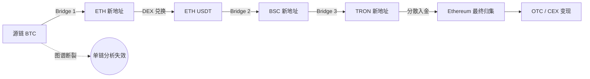

# 特征五 · 高频跨链

  负责人：@梦幻居士
  状态：进行中
  Chain Hopping

> 本页是 [异常地址特征](../address-features) 的分论之一。阈值全部为示意参考值。【待验证】

## 一句话定义

资产在多条链之间频繁通过跨链桥/DEX 转移，每次换链伴随地址更换与代币转换，以切断单链追踪路径。

这是近年增长最快、制度覆盖最薄弱的一类特征。【推断】

## 机理与对抗逻辑

跨链之所以有效，是因为它**同时切断了四种追踪关联**：

| 被切断的关联 | 机制 | 对应检测指标 |
| --- | --- | --- |
| 图谱关联 | 跨链后使用全新地址，原链交易图与目标链交易图不连通 | 跨链后地址新鲜度 |
| 金额关联 | 代币转换导致金额变化（BTC→ETH→USDT），无法直接比对 | 两端金额守恒度 |
| 时间关联 | 人为设置不均匀等待，打破时间戳匹配 | 间隔时间变异系数 |
| 制度关联 | 桥与 Rollup 常不在 VASP 申报义务内，Travel Rule 不覆盖 | 桥合约命中 + 制度缺口标记 |

- **最终归集倾向**：CCLT 对 FTX、BNB Bridge、Mad Meerkat Finance 三起案例的研究发现，无论资金源自哪条链，均系统性在 **Ethereum 做最终清洗**——这为"终点链监控"提供了依据。【事实】来源：*Cross-Chain Laundering Tracer*, Springer, DOI 10.1007/978-981-92-2973-4_15
- **成本考量**：跨链桥费与滑点可接受，因为相比被冻结的赃款，这些是必要成本。【推断】

## 链上可观测信号

| 维度 | 内容 |
| --- | --- |
| 可观测信号 | 与已知桥合约高频交互；跨链后使用全新地址；跨链时间间隔不均匀；代币种类连续切换 |
| 伴随信号 | 桥操作在时间上"锁仓→ mint/unlock"成对出现；使用多个不同桥分散；跨链后立即进入 DEX 兑换或混币器 |
| 学术与监管依据 | CCLT 跨链追踪框架覆盖 8 大桥、29 万+ 标注地址；FATF 2024–2025 更新明确将跨链桥与 L2 列为高风险领域；FinCEN 将"跨多链转移以稀释交易轨迹"列为洗钱类型 |
| 典型场景 | 朝鲜黑客赃款、CMLN、规避单链监控 |
| 误报来源 | 正常跨链套利、DeFi 用户多链操作 |
| 制度缺口 | 部分国家仍以 L1 语义定义虚拟资产转移，桥与 rollup 不在申报义务内，Travel Rule 不覆盖跨链转移 |

## 计算口径与参考阈值

| 指标 | 计算公式 | 参考阈值（示意） | 所需字段 |
| --- | --- | --- | --- |
| 跨链频率 | `hops/day = 跨链操作次数 / 活跃天数` | > 3 次/天（个人地址） | chain_id、bridge tx |
| 桥合约命中 | `bridge_hit = 交互桥合约数 / 总跨链次数` | 命中已知高风险桥即加权 | 桥合约地址库 |
| 地址新鲜度 | `freshness = 跨链后首次出现地址 / 跨链次数` | > 0.8 | 目标链地址 first_seen |
| 金额守恒度 | `match = 1 − abs(amt_out − amt_in·rate − fee) / amt_in` | > 0.95 判定为同一笔资金 | 两端金额、汇率、桥费 |
| 间隔变异系数 | `CV_t = σ(t_interval) / μ(t_interval)` | > 1.0（刻意不规则） | 跨链时间戳 |
| 链多样性 | `chain_entropy = −Σ p_i log p_i` | 熵越高越可疑 | 各链操作占比 p_i |
| 代币切换次数 | `token_switches` | ≥ 2 次/链路 | 每次跨链前后代币 |
| 终点链标记 | 资金是否在 Ethereum 最终归集 | 命中即高权重 | 全链路终点地址 |
| L1–L2 关联 | 桥充提 / rollup batch 与 L1 结算的关联记录 | 可关联即补单成功 | L1/L2 全节点数据 |

## 典型模式示意

## 案例锚点

- **Ronin Bridge 案**：ETH 经 Tornado Cash（同链混币）与 Blender.io（BTC 链混币）双路径清洗，是"混币 + 跨链"组合的早期代表。【事实】
- **CCLT 三案例**：FTX、BNB Bridge、Mad Meerkat Finance 事件的非法资金均跨越多个桥，最终在 Ethereum 归集。【事实】
- **A7A5 卢布稳定币**：2025 年 10 个月处理约 933 亿美元，配合 Grinex、Meer 交易所形成制裁规避的跨链结算网络。【事实】来源：[Chainalysis 制裁报告](https://www.chainalysis.com/blog/crypto-sanctions-2026/)
- **DPRK 2025 年盗窃**：全年超 20 亿美元，Bybit 单案约 15 亿美元，跨链是其标准清洗环节。【事实】来源：[Chainalysis 2025 犯罪报告](https://www.chainalysis.com/blog/report-the-changing-nature-of-cryptocrime/)

## 误报、对抗演化与校准

- **误报**：正常跨链套利、多链 DeFi 用户、跨链桥做市商均高频跨链，须结合标签交互与资金最终去向判断。
- **对抗演化**：会使用多个桥交替（规避单桥合约命中）、控制跨链金额不完全等值、跨链后长期静置再激活、利用新上线的无标签桥。**因此桥合约库的更新频率直接决定这条特征的有效期。**
- **技术前提**：跨链追踪依赖**桥合约地址库**与 **L1–L2 事件关联能力**。自托管全节点 + 协议特定的关联程序是补单关键（参考 MDPI 框架对 Arbitrum、Optimism、zkSync Era、Starknet 的处理）。【事实】DOI 10.3390/electronics15173849
- **校准方法**：从"已知非法资金样本"反推典型跨链路径特征，建立桥风险分级；对新桥设置观察期，避免漏报。

以上为研判经验，未经实测验证。【推断】

## 参考

1. *Cross-Chain Laundering Tracer: Activity Tracking Methodology for Cryptocurrency Laundering*, Springer, DOI 10.1007/978-981-92-2973-4_15.
2. *A Full-Node Blockchain Forensic Framework for Cross-Layer Virtual Asset Tracking*, MDPI Electronics, 2026, DOI 10.3390/electronics15173849.
3. [Chainalysis · Crypto Sanctions 2026](https://www.chainalysis.com/blog/crypto-sanctions-2026/)
4. 站内：[异常地址特征](../address-features)、[公开案例地址与链路](../case-addresses)、[技术研判方法](../../tech/forensic-methods)
