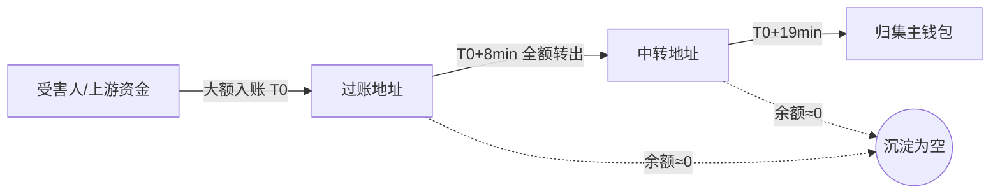

# 特征一 · 大额快转

  负责人：@梦幻居士
  状态：进行中
  Hot Potato / Rapid Pass-through

> 本页是 [异常地址特征](../address-features) 的分论之一。阈值全部为示意参考值。【待验证】

## 一句话定义

资金入账后在极短时间内全额或近全额转出，地址几乎不沉淀余额。

该模式又称"热土豆"，核心目的是**压缩资金暴露窗口**——让资金在任一可监控节点上的停留时间短于"采样 → 研判 → 冻结"的响应周期。【推断】

## 机理与对抗逻辑

- **时间维度**：交易所与银行风控多依赖 T+1 对账、批量扫描或人工复核。资金若在数分钟内完成"入—出"，即使事后命中标签，转移也已完成。
- **金额维度**：整笔转出使余额归零，规避"余额阈值告警"与事后资产查封。
- **链路维度**：快转常与"新地址 + 非固定对手"配合，避免形成稳定、可聚类的交易图谱。
- **成本容忍**：团伙愿意支付更高 Gas 抢先确认，因此 Gas 价格偏高、nonce 连续、交易在区块内排序靠前是常见伴随信号。

以上为行为逻辑推演，不是已证实的作案流程。【推断】

## 链上可观测信号

| 维度 | 内容 |
| --- | --- |
| 可观测信号 | 入账与出账时间间隔极短；出入金额高度匹配（差额≈手续费）；日终余额长期为零 |
| 伴随信号 | Gas 价高于同期中位数；EOA 发起而非合约钱包；同一控制者在多个地址上同步快转；入账与出账区块高度差 ≤ 1–3 |
| 典型场景 | 跑分过账、赌资归集、盗窃资金分流、OTC 承兑短停 |
| 误报来源 | 交易所热钱包、做市商、支付通道节点本身即高频快转 |

## 计算口径与参考阈值

| 指标 | 计算公式 | 参考阈值（示意） | 所需字段 |
| --- | --- | --- | --- |
| 资金停留时间 | `dwell = t_out − t_in`（按 UTXO / 转账级配对） | 中位数 < 1h；P90 < 6h | tx timestamp、amount、from/to |
| 出入比 | `ratio = Σout / Σin`（扣除手续费后） | 0.95–1.05 | 地址级流入/流出总额 |
| 余额归零率 | `zero_ratio = 日终余额≤ε 的天数 / 活跃天数` | > 0.8 | 每日余额快照 |
| 金额偏离度 | `z = (x − μ_baseline) / σ_baseline` | P95 > μ + 3σ | 同链同币种历史分布 |
| 首笔转出延迟 | `first_out_delay = t_first_out − t_large_in` | < 30 min（大额入账后） | 入账与首笔出账时间 |
| 手续费溢价 | `fee_premium = 实际 gas 价 / 同期区块中位数` | > 1.5 | gas price、区块中位数 |

阈值来自经验设定，须按链、币种、地址类型分层重新校准。【待验证】

## 典型模式示意

## 案例锚点

- **Ronin Bridge 案**：被盗 ETH 于 2022-04-22 开始移动，部分资金转入 Binance 后**分散到 86 个账户**，是"快转 + 分散入金"的典型组合。【事实】来源：[Federal Register 2022-09073](https://public-inspection.federalregister.gov/2022-09073.pdf)、[GDF 报告](https://www.gdf.io/wp-content/uploads/2022/07/Cryptoassets-and-Sanctions-Compliance-Report-Final-1.pdf)
- **跑分案例**：兼职者收款后"按指令转入指定账户或兑换成 USDT 转出"，停留时间以分钟计，资金不在本人账户沉淀。【事实】来源：[黑灰产 USDT 变现模式分析](https://new.qq.com/rain/a/20261026A0EAF900)

地址与完整链路见 [公开案例地址与链路](../case-addresses)。

## 误报、对抗演化与校准

- **误报**：CEX 热钱包、做市商、支付通道在业务上天然高频快转，须先用实体标签与业务白名单剔除。
- **对抗演化**：会通过拉长时间窗、打散金额、利用闪电贷在同一区块内完成借—转—还等方式，让指标落在阈值内。**识别时应看组合特征，不要指望单指标稳定命中。**
- **校准方法**：按地址类型分别建基线（个人地址 vs 机构地址），优先使用相对阈值（P95）而非绝对金额。

以上为研判经验，未经实测验证。【推断】

## 参考

1. [Federal Register · Notice of OFAC Sanctions Actions (2022-09073)](https://public-inspection.federalregister.gov/2022-09073.pdf)
2. GDF. *Cryptoassets and Sanctions Compliance: A Primer*, 2022.
3. 站内：[异常地址特征](../address-features)、[公开案例地址与链路](../case-addresses)、[重点场景链路画像](../scenarios)
