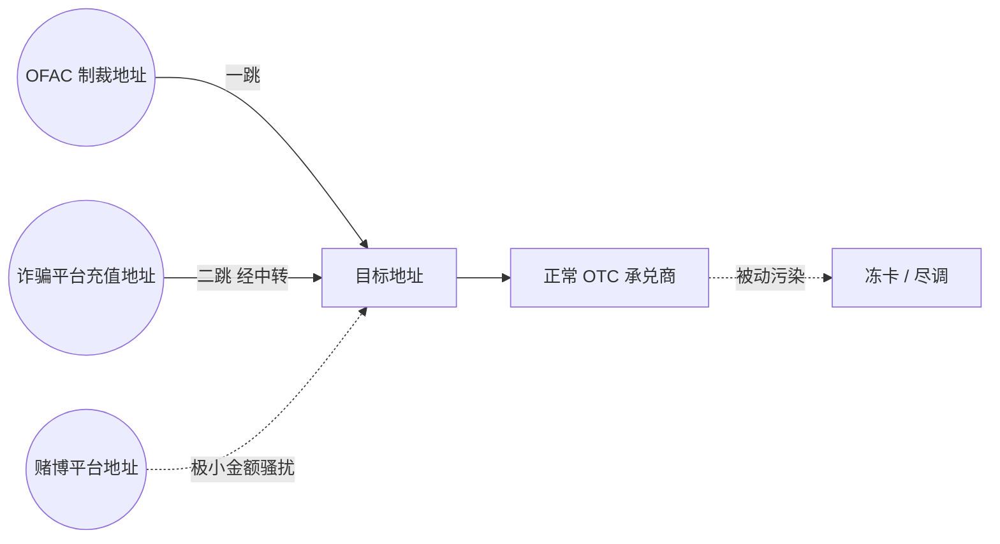

# 特征四 · 标签地址交互

  负责人：@梦幻居士
  状态：进行中
  Risk-neighbor Exposure

> 本页是 [异常地址特征](../address-features) 的分论之一。阈值全部为示意参考值。【待验证】

## 一句话定义

目标地址与已知赌博、诈骗、制裁、暗网等标签地址存在直接或近邻交易关系，形成"资金污染"。

这是五类特征中**置信度最高**的一类，因为标签是把链上伪匿名地址锚定到现实世界事实的唯一桥梁。【推断】

## 机理与对抗逻辑

- **资金污染的不可逆性**：区块链交易不可撤销。一旦收到赃款，该地址即永久留在赃款路径上，后续任何转出都会把污染向下游扩散——这正是 OTC 承兑商"冻卡"的根源。
- **标签的锚定价值**：OFAC SDN 等官方标签提供了"已知恶意"的确定性锚点，无需再推断行为意图。
- **标签的天然滞后**：从案发到标签发布通常需要数周至数月，且社区标签依赖举报，存在误报与过期问题。因此标签必须带**生效时间戳**与**置信度**。
- **零成本污染攻击**：攻击者可主动向目标地址发送 1 聪/极小金额，制造虚假关联（"零转账钓鱼"），使干净地址被误标。

## 链上可观测信号

| 维度 | 内容 |
| --- | --- |
| 可观测信号 | 交易对手命中风险标签库；资金来自/流向已知平台充值地址；初始 Gas 费来自匿名或非法实体 |
| 伴随信号 | 与标签地址存在多笔、周期性往来；资金进入后很快转出；同批地址共享 Gas 来源或创建来源 |
| 标签源 | OFAC SDN（权威）、Chainabuse / Bitcoin Abuse / CryptoScamDB（社区，带时间戳）、执法通报 |
| 典型场景 | OTC 承兑商被动收到赃款导致冻卡；正常企业地址被"零转账钓鱼"污染 |
| 误报来源 | 社区标签误报、过期标签、同尾号钓鱼制造的虚假关联 |

标签源的完整清单与质量评估见 [公开数据集清单](../datasets)。

## 计算口径与参考阈值

| 指标 | 计算公式 | 参考阈值（示意） | 所需字段 |
| --- | --- | --- | --- |
| 一跳命中数 | `h1 = \|N¹(v) ∩ L\|` | ≥ 1 即触发 | 直接交易对手集合 |
| 二跳命中数 | `h2 = \|N²(v) ∩ L\|` | ≥ 2（须降权） | 二跳邻居集合 |
| 风险资金占比 | `exposure = Σ amount(L↔v) / total_volume(v)` | > 0.3 高风险；> 0.05 关注 | 按对手标注的金额流水 |
| 跳数衰减分 | `R = Σ_h w_h · hit_h / h`，w1>w2>w3 | 越高越危险 | 分层邻居命中 |
| 时间邻近性 | `Δt = t_interaction − t_label_effective` | Δt ≥ 0 才计入（标签生效后交互） | 标签生效时间、交互时间 |
| 标签置信加权 | `conf_sum = Σ conf_i`（官方=1.0，商业=0.7，社区=0.4） | > 0.7 高置信 | 标签来源与置信度 |
| 初始 Gas 同源 | 首笔 Gas 提供者是否在风险集 | 命中即高危 | 地址创建交易、Gas payer |
| 污染金额下限 | 极小金额（< 1 USD）单独标记 | 不计入 exposure，标记为骚扰 | 单笔金额 |

置信度权重（1.0 / 0.7 / 0.4）为经验赋值，须按实际标签源质量校准。【待验证】

## 典型模式示意

## 案例锚点

- **OFAC 追加制裁逻辑**：2022-04-22 新增的 3 个 Lazarus 地址，其制裁依据正是"曾与原始制裁地址交互"并合计持有约 50,000 ETH——监管实践本身就采用"一跳命中"作为认定标准。【事实】来源：[Federal Register 2022-09073](https://public-inspection.federalregister.gov/2022-09073.pdf)
- **TRON 赌客地址**：赌资来自某 CEX，先后与 4 个博彩靓号地址交互，最终回流 CEX——造成对 CEX 业务地址的资金污染。【事实】来源：[Bitrace 靓号地址分析](https://news.qq.com/rain/a/20231023A04C9L00)
- **同尾号钓鱼**：攻击者监控链上大额转账，生成与受害者常用交易对手尾号相同的高仿地址，发送小额转账污染记录，诱导受害者复制错误地址。【事实】来源：[反诈宣传·虚拟货币犯罪警示](https://finance.sina.com.cn/money/fund/jjzl/2026-09-14/doc-inirutnu9461097.shtml)
- **零转账钓鱼**：向大量不特定地址发送极小金额，制造虚假关联，使合规系统误判。【推断】

真实地址列表见 [公开案例地址与链路](../case-addresses)。

## 误报、对抗演化与校准

- **时效性陷阱**：Tornado Cash 于 2022-08-08 被制裁、2025-03-21 被 OFAC 除名。【事实】若系统仍使用 2022 年快照，会把当前正常交互误判为高风险。**标签必须实时同步并支持撤销。**
- **误报控制**：极小金额往来单独归类为"骚扰/污染尝试"，不按等权计入 exposure；社区举报须回溯原始证据（截图、事件链接、举报时间）。
- **对抗演化**：会通过多跳中转（≥3 跳）稀释关联、使用新地址隔离、主动向合规地址发送小额污染以制造"对等关联"假象。**因此二跳以上必须降权，"被污染"与"主动交互"要分开算。**
- **校准方法**：建立标签分级制度（官方/商业/社区三级），配置不同的时间衰减系数 λ；一级标签长期有效，三级标签建议 90 天后自动降权复核。

以上为研判经验，未经实测验证。【推断】

## 参考

1. [Federal Register · Notice of OFAC Sanctions Actions (2022-09073)](https://public-inspection.federalregister.gov/2022-09073.pdf)
2. [OFAC Sanctions List Search](https://sanctionssearch.ofac.treas.gov/)
3. [Chainalysis · OFAC 制裁行动汇总](https://www.chainalysis.com/blog/ofac-sanctions/)
4. 站内：[公开数据集清单](../datasets)、[公开案例地址与链路](../case-addresses)、[涉诈行话速查](../../glossary/slang)
