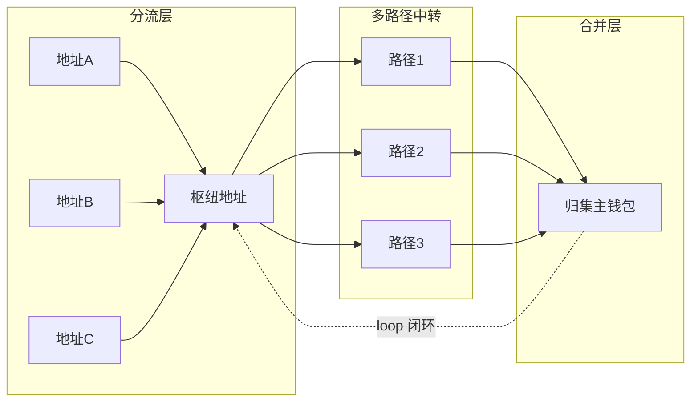

# 特征三 · 多地址集散

  负责人：@梦幻居士
  状态：进行中
  Scatter-Gather / Fan-in

> 本页是 [异常地址特征](../address-features) 的分论之一。阈值全部为示意参考值。【待验证】

## 一句话定义

多个地址汇入少数主地址（fan-in），或主地址分发至多地址后再回收（scatter-gather），形成星型、树型或环状拓扑。

这是链上洗钱最核心的结构特征。BitcoinHeist 数据集的 `weight`、`count`、`loop` 三个特征正是为量化它而设计。【事实】来源：Akcora et al., IJCAI-PRICAI 2020。

## 机理与对抗逻辑

- **fan-in（归集）**：把分散在数百个"跑分卡"地址中的赃款集中到少数主钱包，便于统一变现与控制。
- **scatter-gather（分流再聚合）**：先拆分到多条路径，再在终点合并，使"资金来源—去向"的对应关系被打乱，单笔追踪无法还原全貌。
- **cycle（环路）**：制造自我循环交易，虚增交易量与地址活跃度，干扰基于图统计的异常检测。
- **枢纽价值**：高介数中心性的中转节点是整个网络的"咽喉"。识别一个枢纽即可还原整条链路——这也是执法优先打击对象。

## 链上可观测信号

| 维度 | 内容 |
| --- | --- |
| 可观测信号 | 一地址入度/出度异常高；多层中转后归集到同一终点；存在"拆分→多路径→合并"闭环 |
| 伴随信号 | 中转地址生命周期短（建后即用、用完即弃）；多路径的跳数与金额高度对称；终点地址与 CEX 充值地址交互 |
| 学术对应 | IBM `gather-scatter`、`scatter-gather`、`cycle`；BitcoinHeist `weight`、`count`、`loop` |
| 典型场景 | 跑分平台归集钱包、资金盘入口、赌资结算主钱包 |
| 误报来源 | 矿池、交易所归集钱包、正规企业资金归集 |

## 计算口径与参考阈值

| 指标 | 计算公式 | 参考阈值（示意） | 所需字段 |
| --- | --- | --- | --- |
| 入度 / 出度 | `in_deg(v)`、`out_deg(v)` | 显著高于同链地址 P99 | 地址交易图 |
| 合并权重 | `weight = 输入地址数 / 输出地址数`（>1 为合并行为） | > 2 | 交易输入输出地址数 |
| 合并次数 | `count`（量化合并模式的交易笔数） | 高于基线 3σ | 地址级合并交易计数 |
| 环路计数 | `loop`（拆分→多路径→合并的闭环数） | ≥ 1 即重点关注 | 多跳路径检测 |
| 介数中心性 | `betweenness(v) = Σ σ_st(v)/σ_st` | 处于全图 Top 1% | 全图最短路径 |
| 路径收敛度 | `convergence = 起点地址数 / 终点唯一地址数` | > 5 | 多跳路径起终点 |
| 标签邻居数 | `labeled_neighbors = \|N(v) ∩ L\|`（一跳/二跳） | ≥ 1（二跳需降权） | 风险标签库 |
| 节点存活期 | `lifetime = last_seen − first_seen` | 中转地址 < 7 天 | 地址活跃时间 |

## 典型模式示意

## 案例锚点

- **网赌自建结算系统**：平台为每个用户分配独立充值地址，表面分散，实际最终汇集到少数由平台控制的主钱包——教科书式 fan-in。【事实】来源：[网赌平台虚拟货币结算的 4 种模式](https://news.qq.com/rain/a/20260323A02K2Y00)
- **资金盘入口**：参与者入金地址分散，返利地址呈 fan-out，形成"入金—返利"双向集散结构。【推断】
- **CMLN 担保平台**：Telegram 担保平台作为资金与服务的撮合枢纽，连接洗钱方、诈骗园区与制裁主体，在图上是典型高介数中心性节点。【事实】来源：[Chainalysis 2025 犯罪报告](https://www.chainalysis.com/blog/report-the-changing-nature-of-cryptocrime/)
- **CCLT 研究结论**：无论资金来自 FTX、BNB Bridge 还是 Mad Meerkat Finance 事件，非法资金均系统性地在 **Ethereum 网络做最终归集**——这是跨链场景下的"终点枢纽"特征。【事实】来源：*Cross-Chain Laundering Tracer*, Springer, DOI 10.1007/978-981-92-2973-4_15

## 误报、对抗演化与校准

- **误报**：矿池、CEX 归集钱包、代发工资与正规资金池同样高入度，必须靠实体标签与业务白名单剔除。
- **对抗演化**：会增加中转层数、每站只做一次中转、刻意保持路径跳数不等以破坏对称性、使用隐私币切断图关联。**结构对称性被破坏后，`weight`/`count` 会失效，需回退到介数中心性与标签邻居。**
- **校准方法**：先用 `weight`/`count` 粗筛，再用介数中心性定位枢纽，最后用标签邻居与节点存活期做二次过滤；三层串联可显著降低误报。

以上为研判经验，未经实测验证。【推断】

## 参考

1. Akcora C.G., Li Y., Gel Y.R., Kantarcioglu M. *BitcoinHeist: Topological Data Analysis for Ransomware Detection on the Bitcoin Blockchain*. IJCAI-PRICAI 2020.
2. *Cross-Chain Laundering Tracer*, Springer, DOI 10.1007/978-981-92-2973-4_15.
3. 站内：[异常地址特征](../address-features)、[链路可视化研究](../visualization)、[重点场景链路画像](../scenarios)
