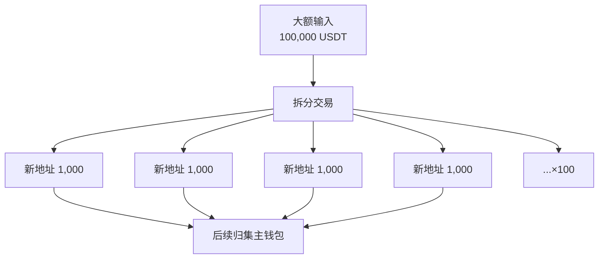

# 特征二 · 小额拆分

  负责人：@梦幻居士
  状态：进行中
  Smurfing / Fan-out

> 本页是 [异常地址特征](../address-features) 的分论之一。阈值全部为示意参考值。【待验证】

## 一句话定义

将大额资金拆为大量小额，分散转入多个（常为新生成的）地址，以规避阈值监测或增加追踪成本。

该手法源自现金时代的"化整为零"（structuring），在链上表现为一笔输入对应大量输出。【推断】

## 机理与对抗逻辑

- **规避申报阈值**：把单笔金额压到风控阈值（如 1,000 USDT）以下，使每笔都不触发告警。
- **放大追踪成本**：1 笔变 N 笔，交易图规模呈指数膨胀，人工溯源难以为继。
- **制造噪声**：在大量正常小额交易掩护下混入赃款，降低异常交易的信噪比。
- **为归集备料**：拆分后的小额地址是后续归集的"原料"，二者常成对出现构成 scatter-gather。

## 链上可观测信号

| 维度 | 内容 |
| --- | --- |
| 可观测信号 | 输出地址数远大于输入地址数；单笔金额集中在低区间且金额相近；新地址占比高 |
| 伴随信号 | 子地址多为当批次新建、无历史交易；拆分金额呈等差数列或固定倍数；拆分后短时间内出现归集动作 |
| 学术对应 | IBM AML 数据集 `fan-out`、`scatter-gather`；BitcoinHeist `length`、`loop` |
| 典型场景 | 跑分派单、赌资上下分、规避大额申报、勒索赎金分发 |
| 误报来源 | 交易所批量提币、工资/空投发放、游戏奖励、项目方空投 |

## 计算口径与参考阈值

| 指标 | 计算公式 | 参考阈值（示意） | 所需字段 |
| --- | --- | --- | --- |
| 扇出比 | `fanout = 唯一输出地址数 / 唯一输入地址数` | > 3（UTXO 链需排除找零） | 交易输入/输出地址集合 |
| 低额占比 | `low_share = 金额<阈值的输出笔数 / 总输出笔数` | > 0.8 | 每笔输出金额 |
| 金额集中度 | `CV = σ / μ`（CV 越低越接近等额拆分） | < 0.3 | 输出金额分布 |
| 新地址占比 | `fresh = 首次出现的输出地址 / 总输出地址` | > 0.7 | 地址 first_seen |
| 拆分层数 | `max_path_depth`（对应 BitcoinHeist `length`） | ≥ 3 | 多跳路径深度 |
| 拆分—归集比 | `fanout / fanin`（比值接近 1 提示 scatter-gather） | 0.8–1.2 | 相邻两跳地址数 |
| 金额熵 | `H = −Σ p_i log p_i`（p_i 为第 i 笔金额占比） | 低熵 = 等额拆分 | 输出金额分布 |

UTXO 链必须先剔除找零输出，否则扇出比会被系统性放大。【推断】

## 典型模式示意

## 案例锚点

- **USDT 跑分**：以 USDT 作为佣金结算与资金归集介质，兼职者"接单"收款后按指令拆分转出，按流水抽成。【事实】来源：[黑灰产 USDT 变现模式分析](https://new.qq.com/rain/a/20261026A0EAF900)
- **BitcoinHeist**：CryptoLocker 等勒索家族的赎金经多地址拆分后进入混币流程，`length` 与 `loop` 特征显著高于普通地址。【事实】来源：[UCI id=526](https://archive.ics.uci.edu/dataset/526/bitcoinheistransomwareaddressdataset)
- **网络赌博**：公开安全分析指出网赌地址典型特征为"分散转入、集中转出"，即拆分与归集的组合。【事实】来源：[Bitrace 靓号地址分析](https://news.qq.com/rain/a/20231023A04C9L00)

## 误报、对抗演化与校准

- **误报**：交易所批量提币、工资发放、空投、游戏奖励均天然扇出，需结合地址身份与金额分布区分。
- **对抗演化**：会通过随机化拆分金额（规避等额检测）、混入正常小额地址、跨多日分批拆分（规避时间窗检测）等方式降低命中率。**建议同时观察"金额熵"与"新地址占比"两个独立信号，不要只依赖等额拆分特征。**
- **校准方法**：UTXO 链先做找零识别再做扇出统计；账户链先剔除合约内部交易，避免把一次批量派发算成多次。

以上为研判经验，未经实测验证。【推断】

## 参考

1. [UCI · Bitcoin Heist Ransomware Address Dataset (id=526)](https://archive.ics.uci.edu/dataset/526/bitcoinheistransomwareaddressdataset)
2. [Bitrace · 波场靓号地址风险评估](https://news.qq.com/rain/a/20231023A04C9L00)
3. 站内：[异常地址特征](../address-features)、[公开数据集清单](../datasets)、[重点场景链路画像](../scenarios)
