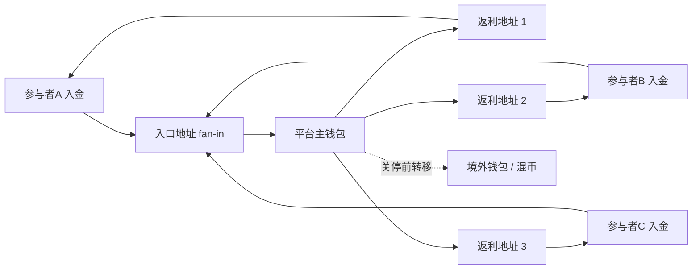

# 重点场景链路画像

  负责人：@梦幻居士
  状态：进行中

## 结论摘要

1. **五个场景不是并列的五类犯罪，而是五种可复用的"资金结构模板"。** 认出结构比认出罪名更有用，因为结构会重复。【推断】
2. **跑分是唯一能用一个价格数字辅助定性的场景**：USDT 正常买卖价差约 0.01–0.02 元，涉案普遍上浮到 0.04–0.1 元；明显异常价差是推定主观明知的核心事实之一。【事实】
3. **土狗币的风险在合约层，不在资金流层。** 事前读合约权限比事后追资金有效得多——多数 rug pull 发生在代币上线后第一小时内，中位存活时间 < 36 分钟。【事实】
4. **跨境赌博与 CMLN 共享"分散转入、集中转出"的骨架**，区别在于前者结算快、后者提供的是服务而非赌局。【推断】

## 一、跑分（第四方支付结算）

**链路**：兼职者提供银行卡 / 支付账户 / 交易所账户 → 接收受害人资金 → 按指令转出或兑换 USDT → 按流水抽成。

**特征组合**：[快转](./features/rapid-pass) + [小额拆分](./features/smurfing) + [多地址集散](./features/scatter-gather) + [标签交互](./features/risk-neighbor)。

**法律定性参考**：行为人通常对上游犯罪仅有概括认知 → 以帮助信息网络犯罪活动罪为主；明知系犯罪所得仍转账兑换 → 升格为掩饰、隐瞒犯罪所得罪。单纯提供支付宝账户及密码者可能仅构成帮信罪，同一链条可分层评价。【事实】来源：[黑灰产 USDT 变现模式分析](https://new.qq.com/rain/a/20261026A0EAF900)、[国内法规与司法解释](../policy/domestic-regulation)

**异常价格线索**：正常平台 USDT 买卖价差约 0.01–0.02 元，涉案行为普遍上浮至 **0.04–0.1 元**，甚至收取 4% 手续费。【事实】明显异常价差是推定主观明知的核心事实之一。【推断】

## 二、资金盘 / 庞氏

**包装话术**：区块链、智能合约、去中心化、套利机器人、量化交易、深海开采、外汇托管。

**链上特征**：内部以虚拟币作为结算、返利、分账工具；配合"拉人头""层级计酬"形成投资-拉新-获客-分利闭环；入口地址呈 fan-in，返利地址呈 fan-out；节假日或大额入金后突然停止提现。【推断】

**治理难点**：服务器境外、链上地址匿名、资金流向复杂、混币器/隐私币/分层转账增加溯源难度。

## 三、土狗币 / 貔貅盘（合约层风险）

| 类型 | 表面现象 | 背后机制 | 可提前发现 |
| --- | --- | --- | --- |
| 貔貅盘 | 价格只涨不跌，卖出失败 | 合约限制卖出（黑名单/白名单/极高卖出税/单笔上限/暂停交易） | 模拟买卖 + 读合约 |
| 撤池跑路 | 价格突然归零 | LP 未锁定，项目方撤走流动性 | 查 LP 锁定状态与期限 |
| 增发砸盘 | 供应量暴增、价格被砸穿 | `mint` 权限未撤销 | 查 mint 权限是否撤销 |
| 慢速出货 | 价格长期阴跌 | 内部人分散钱包持续卖出 | 查持币集中度与开发者钱包 |
| 刷量拉盘 | 交易量高、买入后无人接盘 | 机器人对敲、捆绑钱包制造假繁荣 | 看持币人数与交易结构 |

**EVM 链检查项**：合约是否开源验证；`mint` / `setFee` / `setTax` / `blacklist` / `pause` / `setMaxTx` 等函数权限；owner 是否归零；是否为代理合约（可升级合约即使放弃所有权也可能替换逻辑）。

**Solana 链检查项**：Mint Authority 是否撤销；Freeze Authority 是否撤销（未撤销即可能形成貔貅）；LP 是否烧毁或锁定；内部人钱包集中度；部署者历史。

**时效数据**：对约 640 万 Solana 代币的分析显示，多数 rug pull 发生在代币上线后**第一小时内**，中位存活时间 **< 36 分钟**——事前检查比事后反应更关键。【事实】

技术侧如何把这些检查项落成工具，见[检测模型与原型](../tech/detection-model)。

## 四、跨境赌博

**三种形态**：① 虚拟货币作充值提现工具；② 哈希值博彩（区块哈希开奖，猜大小/单双/庄闲）；③ 事件预测对赌平台。

**链上识别特征**（来自公开安全分析）：【事实】来源：[Bitrace 靓号地址分析](https://news.qq.com/rain/a/20231023A04C9L00)、[网赌平台虚拟货币结算的 4 种模式](https://news.qq.com/rain/a/20260323A02K2Y00)

- **快进快出**：资金停留极短，几乎不过夜，每日余额基本为零；
- **分散转入、集中转出**：大量小额从不同地址汇入，一次性大额转出；
- **地址聚类异常**：表面独立的地址在交易时间、金额分布、交互对手上高度一致；
- **Gas 费一致性**：同一团伙地址在 Gas 价格选择、交易时间分布、Gas 限额设置上呈"同一操作者"特征；
- **靓号地址**：哈希类博彩平台常用定制靓号作为投注/中转/结算地址，并与靓号生成服务商的固定收款地址交互，造成资金污染。

靓号、跑分、貔貅这些说法的准确含义见[涉诈行话速查](../glossary/slang)。

**四类结算模式**（技术人员 / 钱包公司如何被卷入）：自建系统（归集地址设计）、API 接入第三方钱包公司、OTC 承兑、普通炒币者被动卖出涉案币。参与者常只接触单一环节，难以认识全链条。【推断】

## 五、稳定币跨境洗钱（CMLN）

**运作**：以 USDT/USDC 为媒介，通过 Telegram"担保平台"撮合，提供 laundering-as-a-service；东南亚诈骗园区为基地；服务客户涵盖勒索、DPRK 赃款、制裁规避、恐怖融资。【事实】来源：[Chainalysis 2025 犯罪报告](https://www.chainalysis.com/blog/report-the-changing-nature-of-cryptocrime/)

**稳定币特有风险**：发行方可冻结地址 → 犯罪分子采取"分散持仓"策略降低单点损失，导致稳定币持仓集中度低于 BTC/ETH；同时倾向转换为法币或无许可资产（如 BTC）。【推断】

这一点对治理的含义：稳定币的"可冻结"是优势也是靶子，冻结能力越强，分散持仓动机越强——处置必须快，慢一步资金已换仓。【推断】

## 下一步

- [ ] 五个场景各补一张真实的五层结构图（可复用[链路可视化研究](./visualization)的方法与工具）。
- [ ] 与[公开通报案例库](../policy/cases)对齐案例编号，避免重复叙述。
- [ ] 跑分场景的"异常价差"可否量化成可采集指标，与[检测模型](../tech/detection-model)对接。

## 参考

1. [Chainalysis · The Changing Nature of Crypto Crime (2025)](https://www.chainalysis.com/blog/report-the-changing-nature-of-cryptocrime/)
2. [Bitrace · 波场靓号地址风险评估](https://news.qq.com/rain/a/20231023A04C9L00)
3. [网赌平台利用虚拟货币结算的 4 种模式](https://news.qq.com/rain/a/20260323A02K2Y00)
4. 站内：[公开通报案例库](../policy/cases)、[治理痛点提炼](../policy/pain-points)
