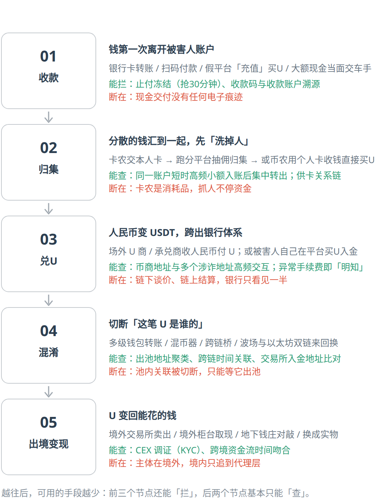

# 公开通报案例库

<div class="doc-meta">
  <span class="owner">负责人：@包胜宇（@0.0.0.26）</span>
  <span class="todo">状态：进行中（案例 38 例 = 15 判决书 + 23 官方通报，其中 7 例为超三年模式参考；九类模式全部达标；含全程图与涉案地址清单；待办已全部完成）</span>
</div>

## 本页要回答的问题

1. 公开通报里，虚拟币相关案件的**作案模式**有哪几类？各自的关键节点在哪？
2. 这些案子**是怎么破的**？是靠资金流、靠人供、靠技术溯源，还是靠群众举报？
3. 通报里披露的**资金链路**能细到什么程度？哪些环节公开信息永远拿不到？
4. 哪类模式**反复出现**、说明现有防控手段失效？
5. 通报口径与实际侦查手段之间有多大的**信息差**？

::: tip 本页的定位
不是新闻剪报。每个案例必须被**拆解成结构化字段**，最后横向对比出模式。只贴链接不做拆解的，一律不算完成。
:::

## 一、收录标准

只收符合以下条件的：

- [x] 来源是**官方**：公安部、省级公安厅、地市公安局、法院、检察院的正式通报或判决
- [x] 有**具体案情**：不是只有"破获一起案件"的一句话
- [x] 有**资金链描述**：至少能看出收款方式和转移方式
- [x] 时间在近三年内（更早的作为模式参考单列）

不收：媒体转述但无官方出处的、只有数字没有手法的、涉及未公开侦查细节的。

## 二、案例记录字段（每个案例都要填）

复制这段填进案例卡：

```markdown
### 案例：<简称>

| 字段 | 内容 |
| --- | --- |
| 通报单位 |  |
| 通报时间 |  |
| 原文出处 |  |
| 案件类型 | 跑分 / 资金盘 / 洗钱 / OTC 兑换 / 诈骗 / 赌博结算 |
| 涉案规模 | 金额、人数、层级 |
| 涉案币种 | USDT / BTC / 其他 |
| 收款环节 | 被害人通过什么方式付款（银行卡、收款码、平台充值、场外买币） |
| 转移环节 | 几级账户、是否用混币、是否跨链、是否走交易所 |
| 变现环节 | 怎么变成可用资金（OTC、境外取现、购买实物） |
| 技术特征 | 用到的工具、平台、App 类型 |
| 破案切入点 | 资金流 / 通信流 / 人供 / 举报 / 其他 |
| 可提炼特征 | 一句话说清这类案子的识别要点 |
```

「原文出处」填写规则：**判决书类填案号**（如`（2025）粤1303刑初1131号`，在裁判文书网按案号检索即可定位原文；文书网的页面链接会随平台改版失效，故不写链接）；**通报类填官方原文 URL**。

### 案例：惠州"黄金快递"洗钱案（9人）

| 字段 | 内容 |
| --- | --- |
| 通报单位 | 广东省惠州市中级人民法院（二审终审）；一审惠州市惠阳区人民法院，公诉机关惠阳区人民检察院 |
| 通报时间 | 2026年6月30日（二审判决）；一审判决 2026年2月9日，案号（2025）粤1303刑初1131号 |
| 原文出处 | （2026）粤13刑终234号 |
| 案件类型 | 实物变现型——赃款实物化：被害人自行购金寄快递，变卖兑 USDT 出境（掩饰、隐瞒犯罪所得罪） |
| 涉案规模 | 金额 219.82 万元；被告人 9 人；层级 4 层（李某甲介绍 → 廖某 → 陈某、黄某甲 → 王某、李某乙、张某、杨某、黄某乙 5 名取件人）；作案期 2024.11–2025.02；9人中 5人累犯、6人有前科 |
| 涉案币种 | USDT（向境外结算）＋ 黄金（实物载体，计价 219.82 万元） |
| 收款环节 | 不收钱、收地址：境外诈骗分子以"交易黄金"为名，诱骗被害人自行在深圳购金 / 在某平台App下单购黄金，快递寄至陈某、黄某甲提供的梅州收货地址和联系电话。被害人支出全程不经过任何银行账户 |
| 转移环节 | 无账户层级，改用人员层级：境外上游 → 地址提供者（陈某、黄某甲）→ 取件人在快递柜、幼儿园保安亭等代收点取件 → 上交归集。判决书未披露混币、跨链、交易所环节 |
| 变现环节 | 廖某按"当日黄金回收价 × 重量"核算，与陈某、黄某甲共同变卖黄金，兑换成 USDT 转给境外人员；回收商身份与兑换渠道均未披露 |
| 技术特征 | Telegram（"飞机"）多群派单/接单/反馈；快递代收点（快递柜、保安亭）作物理收款口；某平台App；OPPO A5 手机、电子秤（称重计价） |
| 破案切入点 | 举报（被害人2025-02-01报案）＋ 物流流 ＋ 人供：依快递单号与取件点锁定取件人，2月10日起逐级传唤（王某、李某乙 → 杨某、黄某乙 → 陈某、廖某、张某）→ 2月17日抓获李某甲 → 黄某甲上网追逃后投案。Telegram 群与资金流均未成为突破口 |
| 可提炼特征 | 诈骗款不走账户走实物：被害人自行购金寄往异地代收点，同一批人员多点高频取件、取件即上交、按当日金价折算分成。识别要点：同一地域、彼此熟识的一批取件人在多个快递代收点高频取黄金件 |

### 案例：枣庄"跑分车队"案（18人）

| 字段 | 内容 |
| --- | --- |
| 通报单位 | 山东省枣庄市中级人民法院（二审裁定驳回上诉）；一审枣庄市峄城区人民法院，公诉机关峄城区人民检察院 |
| 通报时间 | 2026年3月17日（二审终审）；一审判决 2025年11月25日，案号（2025）鲁0404刑初162号 |
| 原文出处 | （2026）鲁04刑终1号 |
| 案件类型 | 跑分（掩饰、隐瞒犯罪所得罪） |
| 涉案规模 | 曹某团伙 18 名被告人（另案处理 6 人以上）；接收和转移资金 45.48 万元，其中涉诈资金 19.23 万元；曹某获利至少 4.5 万元。另有耿某 2022–2023 年单案（8 张卡进账流水 1363 万余元）、王某甲 2024 年 10 月单案（3.8 万元现金送件，未遂）。层级 3 层：曹某（对接境外盘口）→ 王某甲、晁某甲（车队管理）→ 卡主 15 人 |
| 涉案币种 | 法币为主（银行卡/支付宝/某平台收款）；USDT 用于与境外结算——曹某经某平台向荣某购买 USDT（具体链路未披露） |
| 收款环节 | 境外电诈资金直接转入卡主提供的银行卡、支付宝、某平台账户。人均供卡 1–5 张，多卡多平台组合 |
| 转移环节 | 3 层人员结构，无混币、无跨链披露。卡主账户收款 → 管理者（王某甲、晁某甲）操作转账/看管卡主 → 部分经支付宝/某平台归集至曹某；大量资金以**ATM/柜台取现**方式洗白（王某甲帮高某取现 1.39 万元、帮李某甲取现 0.5 万元；陆某收款 3.05 万元全部取现）；曹某获利后经某平台购买 USDT |
| 变现环节 | 取现为主（多笔明确写明取现金额与取现人）；卡主直接消费赃款 1 例（陆某消费 1 万元）；另有现金送件变体——王某甲按飞机群指示以滴滴顺风车送件形式接收现金 3.8 万元（被现场抓获，未遂） |
| 技术特征 | Telegram（"飞机"）群对接境外"盘口"派单、上报卡主与卡号信息、指挥操作；银行卡 + 支付宝 + 某平台多通道收款；滴滴顺风车送现金；取现视频监控取证 |
| 破案切入点 | **资金流（银行/平台流水、取现视频）＋ 人供**。判决书未披露立案起点；可确认的证据形态：账户交易明细电子数据、取现视频、同案犯供述、关键录音（陆某与王某甲通话中曹某接电话自称"老板"）、Telegram 聊天记录。到案方式：3 人主动投案，其余均电话通知到案；王某甲一笔系接收现金时被现场抓获 |
| 可提炼特征 | 同一县域一批 2004–2006 年出生的无业/务工年轻人（含 1 名在校学生）集中供卡，"银行卡＋支付宝＋某平台"组合收款、短时高频进账后取现，Telegram 群派单。识别要点：**多名年轻卡主的开户行集中在当地同几家网点、账户间呈"收→归集→取现"同构流水** |

### 案例：宁乡孟某"闪兑"跑分案（1人）

| 字段 | 内容 |
| --- | --- |
| 通报单位 | 湖南省长沙市中级人民法院（二审裁定驳回上诉）；一审宁乡市人民法院，公诉机关宁乡市人民检察院 |
| 通报时间 | 2026年2月10日（二审终审）；一审判决 2025年12月16日，案号（2025）湘0182刑初486号 |
| 原文出处 | （2026）湘01刑终128号 |
| 案件类型 | 跑分——罪名是**帮助信息网络犯罪活动罪**（区别于案例2的组织化取现被定掩隐） |
| 涉案规模 | 1 人（孟某，1996年生，务工）；4 个银行账户（农行/农商/建行/中行）跑分进账流水 2100 万余元；获利 6 万余元；作案期长达 3 年（2022.6–2025.6）。层级：单层，无下线——王某（介绍人，另案）介绍进 LEST 软件对接上线 |
| 涉案币种 | USDT（在"闪兑"平台以买卖 USDT 名义跑分） |
| 收款环节 | 被害人被骗资金直接转入孟某名下 4 个银行账户。已查实样本：广州增城被害人邵某被骗 40,614 元于 2024年5月23日转入其农行账户 |
| 转移环节 | 在上线安排下经"闪兑"平台以买卖 USDT 方式转出：银行卡资金 → 闪兑平台换 U → 转给上游。无混币、无跨链、交易所环节未披露 |
| 变现环节 | 获利 6 万余元（约流水 0.3%）；具体结算方式未披露；家属代为退缴 6 万元 |
| 技术特征 | LEST 软件（境外通讯工具）联系上线；"闪兑"平台（USDT 兑换类跑分平台）；4 张本人银行卡 |
| 破案切入点 | **资金流为主**：卷内证据明确包含"止付、冻结记录表"（被害人一侧止付冻结触达孟某账户）；2025年9月9日在家中被民警传唤到案，到案后如实供述（构成坦白，非自首）。举报/技术溯源未见披露 |
| 可提炼特征 | 单人、居家、兼职式长期跑分：3 年流水 2100 万元但获利仅 6 万元，单笔小额分散、进账即经"闪兑"平台换U转出。识别要点：**个人名下多家银行账户长期高频进出、快进快出、余额常清零、无正常消费场景** |

### 案例：扎兰屯伍某某、陈某某"易优"OTC承兑案（2人）

| 字段 | 内容 |
| --- | --- |
| 通报单位 | 内蒙古自治区扎兰屯市人民法院（一审）；公诉机关扎兰屯市人民检察院 |
| 通报时间 | 2024年5月15日判决，案号（2024）内0783刑初46号，文书发布日期2024-09-10 |
| 原文出处 | （2024）内0783刑初46号 |
| 案件类型 | OTC 兑换（定罪为掩饰、隐瞒犯罪所得罪；法院明确不认定为帮信罪） |
| 涉案规模 | 2 人（伍某某 1999 年生、陈某某 1996 年生，均重庆籍无业）；名下 4 张银行卡；涉电信诈骗 3 起；涉案金额 192.7 万元；获利 2 万余元；作案期 2023年9—10月，仅 10 余天 |
| 涉案币种 | USDT（"易优"虚拟币交易平台挂单买卖） |
| 收款环节 | 诈骗平台"客服"把被害人指到交易所找 U 商 → 被害人加微信"阿甘" → 承兑商提供**本人银行卡**，要求被害人**取现金后现金存入**（明确拒绝银行转账）、手持存款小票录制本人视频确认 → 款项进入承兑商账户（被害人刘某一人存入 140 余万元；另两起 57.9 万元、其余为第三起） |
| 转移环节 | 承兑商把存入的现金**取出**（银行监控录像为证）→ 线下另找他人买入等值 USDT → 存入其"易优"账户 → 转给被害人提供的收币地址（实为诈骗平台客服给的地址）。账户系花 500 元购买的他人实名账户，用翻墙工具在境外浏览器登录，联系用盗拿的他人手机微信（昵称"阿甘"）。无混币、无跨链披露 |
| 变现环节 | 赚取 USDT 买卖差价，192.7 万元对应获利 2 万余元（约 1%）；现金取款 + 线下购币构成完整闭环，资金脱离交易所 |
| 技术特征 | "易优"交易所挂单（OTC 卖方模式）；翻墙工具 + 境外浏览器；购买他人实名账户；微信一对一沟通；现金存款 + 手持小票录视频 + 要求撕毁小票；作案工具苹果手机 2 部、三星手机 1 部、银行卡 1 张 |
| 破案切入点 | 举报（电诈被害人报案）＋ 资金流 ＋ 通信流：三起诈骗案的被害人陈述、微信聊天与转账记录、银行卡流水、银行取款监控录像互相印证；二人因涉诈骗罪被上网追逃后到派出所投案，但法院认定"未如实供述、不认罪不悔罪"，**不认定自首**。无技术溯源/链上分析披露 |
| 可提炼特征 | 承兑商主动**反常规支付**：只要现金存款、拒绝转账、要求手持小票录视频、事后让撕小票；10 余天内高频与不特定人交易；用买来的实名账户 + 翻墙登录境外交易所。识别要点：**OTC 卖方要求"现金存入本人卡"而非平台内划转，且交易对手全部由"客服"指定**。裁判要旨：取现后再线下购币，使资金脱离平台、性质改变，属"转移"而非帮信罪的"支付结算"帮助 |

### 案例：马鞍山"某云时代"传销案（6人）

| 字段 | 内容 |
| --- | --- |
| 通报单位 | 安徽省马鞍山市中级人民法院（二审终审）；一审马鞍山市花山区人民法院，公诉机关花山区人民检察院 |
| 通报时间 | 2025年9月23日（二审裁定）；一审判决 2025年6月9日，案号（2024）皖0503刑初447号；文书发布日期 2026-10-20 |
| 原文出处 | （2025）皖05刑终113号 |
| 案件类型 | 资金盘（组织、领导传销活动罪） |
| 涉案规模 | 6 名被告人（李某、王某某、祝某某、杨某、郭某某、朱某某）；马鞍山地区层级**超过 3 级**（平台内设 6 级：业务员→主任→店长→经理→总监→首席，6 人均为"首席"）；参与人 300 余人；累计投资 **3404.49 万元**（34,044,861.53 元）；深圳总部负责人王某杰另案处理、未受刑事处罚 |
| 涉案币种 | USDT（投资人在"欧易"交易所购 U 后充值进 APP） |
| 收款环节 | 投资人免费下载"某云时代"APP → 在账户内**购买充值 USDT** → 参与"抢购服务器基金"取得收益资格；资金汇入深圳总部指定账户 |
| 转移环节 | 无混币、无跨链披露。资金单向上归深圳总部账户；返利以虚拟货币形式打回投资人 APP 账户（静态：抢购基金成功得 13% 利息；动态：直推奖 2%、间推奖 1%；团队收益按层级 0.5%/1%/1.5%/2%/2.5%/3%） |
| 变现环节 | 判决未披露提币与变现路径，仅判追缴违法所得（6 人均已退缴） |
| 技术特征 | "某云时代"APP（内设 6 级 + 抢购基金模块）；"欧易"（OKX）交易所购 USDT；线下工作室 + 写字楼办公室；推介会宣讲视频、推广视频；注册无实际经营的安徽某科技有限公司作背书 |
| 破案切入点 | 举报（投资人报案单、受案登记表）＋ 司法审计 ＋ 电子数据鉴定：三永会计师事务所专项审计认定人数与金额，广东安证计算机司法鉴定所出具电子数据鉴定；6 人于 2023年5月22日—6月2日先后主动投案（均认定自首）。无链上溯源、无通信流突破披露 |
| 可提炼特征 | "买 U 入门 ＋ 静态高息 ＋ 拉人头返利 ＋ 六级层级"四件套，再加注册空壳公司、租写字楼、办推介会做实体背书（本案祝某某还借退休公职人员身份宣传）。识别要点：**必须用 USDT 充值才有资格、收益按层级从整个团队投资额中提成、层级名称成套固定（业务员/主任/店长/经理/总监/首席）**；APP 打不开之日即崩盘之时 |

### 案例：西安聚英"矿机挖FIL"传销案（14人）

| 字段 | 内容 |
| --- | --- |
| 通报单位 | 陕西省高级人民法院（二审终审）；一审西安市中级人民法院，公诉机关西安市人民检察院 |
| 通报时间 | 二审裁定 2024年12月3日；一审判决 2023年11月10日，案号（2022）陕01刑初69号；文书发布日期 2025-08-20 |
| 原文出处 | （2023）陕刑终226号 |
| 案件类型 | 资金盘（组织、领导传销活动罪）——"真矿机挖矿"变体（IPFS/FIL 币） |
| 涉案规模 | 14 名被告人（实际控制人温永宁等，多为公司各部门负责人）；三个项目（大陆金/金桔/超算3号）售出"矿机" 23246.42T；参与人数：大陆金 1236 人（层级最高 23 层）、金桔 3626 人（最高 44 层）、超算3号 713 人（最高 26 层）；聚英及关联公司账户银联入账 1739.6 万余元、与会员往来 931.5 万余元；扣押 FIL 币 115327.59 个。作案期 2020年5月—2021年4月（按判决时间口径收录） |
| 涉案币种 | FIL 币（Filecoin）为主；返佣与提现混用 USDT、GOLD、INTEGRAL 积分 |
| 收款环节 | 扫推荐码注册 APP → 购买"矿机"（大陆金每 T 1500—3980 元、金桔 1500—1800 元、超算3号 9 万/50T 合伙模式）→ 资金经银联/转账打入聚英公司、关联公司聚英星际及四个合伙企业（数创星瀚等）银行账户；金桔、超算3号还需另行充值 FIL 缴质押币和 GAS 费（576 名客户累计充 24736.65 个 FIL） |
| 转移环节 | 资金在聚英—星空节点—聚英星际—四个合伙企业之间流转混同（判决认定四企业并非独立运营）；客户充值的 FIL 只有一部分真正用于封装：15162.27 个交节点、2723.9 个团队分成、**19216.48 个流入未知地址**。无混币器、无跨链披露（"未知地址"即链上断点） |
| 变现环节 | 提现经 APP 完成，532 名用户累计提现 FIL 13243.45 个；公司按"管理费/上级提成费"名义截留 25% 挖矿收益；2021年4月参与人提不出币、聚集到公安机关要求处理，项目崩盘 |
| 技术特征 | 大陆金/金桔/超算3号三个 APP（显示推荐关系深度、购买量、挖矿收益、返佣）；真实 IPFS 矿机但**超卖算力**：购入 18752T 却卖出 23246.42T，宣称有效算力 22878T、实际封装仅 5361.6T；石榴矿池与天茹公司托管；扫码注册锁定上下线关系；微信群/朋友圈/现场会宣传 |
| 破案切入点 | 举报（2021年4月提现受阻、参与人到公安机关要求处理）＋ 资金流（银行交易流水司法鉴定，逐账户列明流入流出）＋ 电子数据鉴定（APP 数据库剔除重复/测试数据后认定层级人数）；2021年6月7—8日 14 人统一抓获，无投案 |
| 可提炼特征 | "真矿机 + 假算力"：设备真实存在、链上节点真实运行，但卖出算力是实际封装的 4 倍多，客户充的币近八成没用于承诺用途。识别要点：**凡"买设备挖币"项目，销售算力必须能和链上真实封装算力对上；提现一受阻即崩盘**。返佣结构：现金总返佣最高 48%、最多 6 级、每级 0.875%—43% |

### 案例：麻阳"酒店VOIP架设"诈骗案（2人）

| 字段 | 内容 |
| --- | --- |
| 通报单位 | 湖南省麻阳苗族自治县人民法院（一审）；公诉机关麻阳县人民检察院 |
| 通报时间 | 2026年10月9日判决，案号（2026）湘1226刑初91号；文书发布日期 2026-10-30 |
| 原文出处 | （2026）湘1226刑初91号 |
| 案件类型 | 通讯地推型——境外电诈集团境内 VOIP 地推环节（定诈骗罪从犯；USDT 仅用于上游报酬链结算） |
| 涉案规模 | 2 人（杨某 1990 年生、周某 1984 年生，武冈籍务工，在东莞打工时被老乡介绍入伙）；架设 3 天、两间客房共拨打诈骗电话 956 次（536+420）；已查实 1 名被害人被骗 9990 元；二被告人获利 4600 元（杨某 3400、周某 1200）；介绍人宋某、上线某甲与包某均另案处理 |
| 涉案币种 | USDT（境外上线经"欧易"向宋某虚拟币钱包发币，宋某兑换成支付平台余额后逐笔转付报酬） |
| 收款环节 | 被害人接到酒店座机来电（统一外呼号 0745-8676182）→"支付宝客服"话术（花呗学生信息需变更备案）→ 下载"瞩目"App 进视频会议 → 开通"打白条"、新办南京银行卡测试微粒贷 → 被告知需向"中国某银行保障中心"清算账户转账验证 → 先充 1 万元进某平台零钱、提现到本人卡、再转出 9990 元至对方指定"某公司"账户（尾号4626） |
| 转移环节 | 被害人资金转入"某公司"账户后去向判决未披露；二被告人报酬链路完整可查：境外上线（欧易发 USDT）→ 宋某兑换成某平台余额 → 分笔转杨某（125/600/1400/516/2600/435 元，含房费、日薪、生活费、跑路车费）→ 杨某分给周某。无混币、无跨链 |
| 变现环节 | 报酬以平台余额形式直接用于房费、生活费；USDT 兑换所用平台未具名；二人退赃 3400 元、1200 元，周某另全额退赔被害人 9990 元并取得谅解 |
| 技术特征 | VOIP 设备（光猫状盒子＋路由器＋信号接收器，拔掉酒店电话线接入即用）；"蝙蝠"加密聊天软件群派单、报联通、断线检查；随身 WiFi；酒店实名开房＋"人机分离"作业——装完即撤到酒店外草坪/公园盯梢，警察来了就跑，设备每日收取过夜 |
| 破案切入点 | 举报（酒店前台发现多间客房座机高频拨打陌生手机号后报警）＋ 通信流：运营商通话清单锁定统一外呼号码与拨打次数、酒店开房记录实名锁定杨某周某；2024年6月在东莞抓获。被害人报案（湖北天门公安立案）作旁证 |
| 可提炼特征 | 诈骗集团把"开电话线路"外包给拿日结工资的临时工：酒店开房架 VOIP、人不上房、境外上线用 USDT 按日结算。识别要点：**酒店座机突然高频外呼陌生手机号＋住客开房后几乎不待在房间**；报酬链上还有一道固定中转——上游先发 USDT 给介绍人、介绍人兑换成人民币余额再逐笔下发 |

### 案例：广德籍"妙瓦底KK园区"跨境电诈案（7人）

| 字段 | 内容 |
| --- | --- |
| 通报单位 | 安徽省宣城市中级人民法院（二审裁定驳回上诉）；一审广德市人民法院，公诉机关广德市人民检察院 |
| 通报时间 | 二审裁定 2026年7月28日；一审判决 2026年6月1日，案号（2026）皖1882刑初102号；文书发布日期 2026-10-30 |
| 原文出处 | （2026）皖18刑终82号 |
| 案件类型 | 虚假投资平台——境外电诈园区"杀猪盘"聊手（诈骗罪＋组织他人偷越国（边）境罪＋偷越国（边）境罪，数罪并罚） |
| 涉案规模 | 7 名被告人（5 名安徽广德籍＋2 名广东惠东籍，含 2 名 2004 年生、1 名女性彭某）＋另案处理何某乙；何某甲上网追逃；园区老板"叶某乙"、人事代理"表哥"身份不明；诈骗对象为在欧美生活的亚裔（含华人），判决按《跨境电诈意见》"一年内出境赴境外诈骗窝点累计 30 日以上"认定情节严重，不逐案查被害人；已查实个人业绩：林某甲组单笔骗 30 余万美元、彭某所添客户被骗 20 万 USDT，林某甲共获提成七八万元人民币；王某甲以人事代理身份预支 20 余万元、"表哥"月薪 5–10 万泰铢；作案期 2023.3–2025.3（妙瓦底某园区 → KK 园区某丙公司） |
| 涉案币种 | USDT／比特币（平台诱被害人充值"投资虚拟货币"；内部提成以 USDT 记账——林某甲单笔应得约 1 万 USDT，扣除机票食宿后到手 12000 元人民币） |
| 收款环节 | 境外社交平台（领英、脸书、IG、推特）养号包装"成功人士" → 添加在欧美生活的亚裔女性好友 → 引流至 WhatsApp/Line 谈感情 → 诱导到公司自建的虚假投资平台充值购买虚拟货币（比特币）——充值即被骗；公司刻意只挑境外华人/亚裔下手，组长明说"这样就不触犯中国的法律" |
| 转移环节 | 判决未披露被害人资金转移路径；可查的只有园区内部结算：提成以 USDT 记账、回国赎人经"园区钱庄"换泰铢赔付（彭某 4 万、谢某甲 4 万、林某甲累计约 11 万元人民币） |
| 变现环节 | 判决未披露；员工工资以泰铢发放且公司扣押一半作"来去路费"，从业者反而被园区反向抽血 |
| 技术特征 | 境外社交媒体养号＋人设包装；WhatsApp/Line 二段引流；公司自建虚假投资平台收币；园区层级：人事代理（按人头提成、二级代理占开单 20%–30%）→ 组长 → 团长 → 总监 → 老板；管理手段：收手机护照、体罚罚站、关小黑屋、赔付赎人 |
| 破案切入点 | 上级公安回流线索（受立案源头，2024-08-09 先以偷越国边境立案）＋ 出入境记录（逐人核对航班号、口岸、时间）＋ 人供：回国人员由惠东、惠阳、宁波机场等地公安分别抓获（2025年8–9月），谢某甲、彭某主动投案。资金流与平台溯源均未参与定罪 |
| 可提炼特征 | "园区化生产"杀猪盘：招募（人事代理按人头提成、谎称高薪）→ 教唆以"泰国旅游"骗领护照 → 每人身带 2000 元现金应付海关（被拦就转深圳机场二次出境）→ 偷渡进园区 → 流水线分工（狗推引流／组长精聊／平台收币）→ 提成 USDT 结算、离开须赔付赎人。识别要点：**骗领护照＋带现金过海关＋被拦后换口岸二次出境，是园区招工的固定剧本；此类案件定罪不依赖查清每个被害人，"出境赴窝点累计30日"即可入罪** |

### 案例：火币钱包开发者"后门窃币"案（1人）

| 字段 | 内容 |
| --- | --- |
| 通报单位 | 上海市徐汇区人民法院（一审）；公诉机关徐汇区人民检察院 |
| 通报时间 | 2024年4月24日判决，案号（2024）沪0104刑初74号；文书发布日期 2024-08-14 |
| 原文出处 | （2024）沪0104刑初74号 |
| 案件类型 | 监守自盗型——钱包客户端后门窃币＋混币器洗白（定非法获取计算机信息系统数据罪，刑法第285条第2款——不是盗窃罪也不是洗钱罪） |
| 涉案规模 | 1 人（张某1，1988年生，大学文化，火币客户端开发员工）；窃得用户私钥及助记词 6437 条（去重）、可转换钱包地址 5680 个；已实施窃币 1 起：100 个 ETH + 4.8 个 BTC + 5 万个 USDT + 2770 个 MDX + 1.98 个 BNB；作案期：2021年7—8月植入代码，潜伏约 20 个月后于 2023年4月动手窃币 |
| 涉案币种 | ETH、BTC、USDT、MDX、BNB（多币种）；检材中还检出符合 DOGE、TRON 地址规则的数据 |
| 收款环节 | 无被害人付款环节——加害入口是"钱包客户端本身"：利用开发上线火币钱包 iOS 客户端的职务便利，在客户端植入请求用户私钥和 RSA 加密算法的代码，用户私钥、助记词自动发送至其预设邮箱 |
| 转移环节 | 用窃得的私钥直接转走被害人钱包资产 → **经过混币** → 转入本人数字钱包。单人单地址、单次混币；跨链、分批、多跳细节均未披露 |
| 变现环节 | 未及变现：到案当日将混币后转入其钱包的虚拟币**全额退回被害人钱包地址**；审理期间家属另赔 13.17 万元并取得谅解 |
| 技术特征 | 钱包 iOS 客户端后门（私钥窃取代码）＋ RSA 加密外传 ＋ 预设邮箱收数；混币器洗白；弘连司法鉴定所对 apk/ipa 及扣押硬盘、手机、电脑固定取证，从硬盘"哈哈.rtf""案例分析.rtf"文件中检出私钥助记词 |
| 破案切入点 | 公安电话通知到案、当场供认（自首）——判决未披露初始线索来源；技术取证路径可查：远程勘验笔录＋司法鉴定（文件校验、一致性检验）；辩护人质疑鉴定资质与取证合规性，法院未采纳 |
| 可提炼特征 | 监守自盗型窃币：厂商内部开发者借上线权限在客户端埋"私钥后门"，潜伏近两年才挑目标动手，得手先过混币器再入个人钱包。识别要点：**持有私钥即持有资产，链上转账即盗窃既遂；客户端异常索要私钥/助记词、开发者个人邮箱异常外联是前置预警信号**——6437 条私钥只被动手用了 1 条，其余是尚未引爆的存量风险 |

### 案例：平陆"外贸档口收赃款"跑分案（1人）

| 字段 | 内容 |
| --- | --- |
| 通报单位 | 山西省平陆县人民法院（一审）；公诉机关平陆县人民检察院 |
| 通报时间 | 2025年4月2日判决，案号（2025）晋0829刑初12号；文书发布日期 2025-06-26 |
| 原文出处 | （2025）晋0829刑初12号 |
| 案件类型 | 跑分——"外贸收货款"贸易伪装变体（掩饰、隐瞒犯罪所得罪，从犯） |
| 涉案规模 | 1 名被告人（陈某1，广州旺角钟表城 A115 档口经营者，无前科）＋丈夫周某1及供货商李某1、赵某1、章某、麻海林、杨某1 等 5 人银行卡被征用收款；涉诈资金 22 万元，判决列举 10 名上游被害人证言（京东客服、贷款、虚假投资平台等多类型电诈）；作案期 2021.2–2023.6，持续两年多；境外下家"张妈妈"（自称印尼华侨）及一级卡户主身份均未查明 |
| 涉案币种 | 流转资金为人民币（银行卡/支付宝/微信）；上游电诈中有 1 起系"网上投资泰达币"诈骗（被害人王某被骗 179.7 万余元，其中一笔 7 万元经肖庭方账户流入陈某1卡）——本卡收录价值：USDT 投资盘赃款的境内贸易伪装洗白端 |
| 收款环节 | 境外"张妈妈"下手表订单 → 用**不特定他人银行卡**付"货款"（同一客户、每次户名账号都不同，系电诈一级卡直接付款）→ 转入陈某1及其征用的家属/供货商共 6 人银行卡。被害人被骗当日资金即到：如肖庭方账户收被害人 35.1 万余元后约 20 分钟即转陈某1 7 万元 |
| 转移环节 | 到账即动、怕冻结：余额宝提现、微信分 8 笔转出、当日转付供货商、单日现金取款 9 万元。卡被频繁冻结——商户圈内"冻结3天=洗过的钱、冻结半年=一级卡"已成公开经验；2021、2022 年公安三次询问陈某1 仍未停手 |
| 变现环节 | 借真实贸易流"消化"：赃款混入手表生意回款，正常支付货款给供货商即完成洗白；对外有营业执照、货单、收据、阳光仓库集装箱发货全套真单据。USDT/境外汇兑环节判决未披露（境外对冲由"张妈妈"一侧完成） |
| 技术特征 | 真实贸易作掩护（档口＋营业执照＋货单收据＋集装箱物流）；多名亲友/供货商私人卡轮换收款；微信下单；无对公账户；手机勘验固定微信聊天记录 |
| 破案切入点 | 被害人报案（李某2 2023-05-24 报案、4 天后立案）＋ 资金流：国家反诈大数据平台涉诈账户比对、逐笔资金穿透（被害人→一级卡→陈某1卡→流出，时间精确到秒）；电话通知到案、自首、全额退赔 22 万元并取得 3 名被害人谅解。链上分析未参与 |
| 可提炼特征 | "真货真单"跑分：境外下家用一张张不特定银行卡付"货款"，商户收钱即转即取，反复冻卡被当成做生意成本。识别要点：**商户无对公账户、长期用亲友和供应商的私人卡收境外关联货款、到账即转即取、卡被公安反复冻结仍继续收款**——冻卡记录本身就是免费的风险预警，却被全行业当成常态 |

### 案例：莱芜虚拟币管理公司"交易员对敲"侵占案（4人）

| 字段 | 内容 |
| --- | --- |
| 通报单位 | 山东省济南市中级人民法院（二审终审，改判量刑）；一审济南市莱芜区人民法院，案号（2023）鲁0116刑初681号 |
| 通报时间 | 二审判决 2025年8月6日；一审判决 2024年9月30日；文书发布日期 2026-09-12 |
| 原文出处 | （2024）鲁01刑终451号 |
| 案件类型 | 监守自盗型——虚拟币管理公司交易员"对敲交易"转移公司及客户持仓、场外回兑（王某甲、王某乙：职务侵占罪＋盗窃罪数罪并罚；张某、王某丙：掩饰、隐瞒犯罪所得罪） |
| 涉案规模 | 4 名被告人（王某甲系公司交易员、王某乙系前员工共谋、张某/王某丙出借账户收赃）＋甄某某（已判决）提供持仓手机、钱某某（另案）场外变现；某公司以自有资金炒币并受托管理客户虚拟币资产。一审按平台价格认定：职务侵占 1267.76 万元＋盗窃 1494.14 万元；二审不采信价格鉴定、改按销赃数额认定，量刑从 16.5 年/15.5 年改判为 11 年/10 年 3 个月。作案期 2021.7–10 |
| 涉案币种 | USDT 为主（单次最多转出 163.9 万个），另有 STC、ZKS、HUSD、CRV、CAKE；经 gate、币信、火币、币安四个平台流转 |
| 收款环节 | 无外部被害人付款——对象是"别人托管的钱"：公司总经理张某芸名下 gate/币信账户（公司自营持仓）和客户戴某某实名火币账户（含密码及谷歌验证码，委托公司管理） |
| 转移环节 | 核心手法**对敲交易**：同时掌握买卖双方账户，自己账户低买高卖、公司账户低卖高买，把币在"正常交易"外衣下转到自己账户；再经层级分散：张某/王某丙币信账户（面部活体识别转账）→ 王某乙币安账户 → 王某甲及其父王某丁币安账户混同藏匿。冒用吴某名义担任夜班交易员绕开盯盘报警。事发后公司联系交易所冻结了部分转入王某乙、张某账户的币 |
| 变现环节 | 场外换汇：钱某某变现 240.07 万元、尹某变现 86.89 万元；赃款用于还购房款、购房、购车（哈弗 15 万、二手宝骏 4.6 万）、付律师费，还有 50 万元经中间人"打点"试图解决北京立案；部分取现转移、部分赠与亲友购房（尹某 118 万购房产被全额追缴） |
| 技术特征 | gate/币信/火币/币安多平台；对敲自买自卖；借用他人身份注册账户＋面部活体识别转账；币信平台异常交易说明函＋平台电子数据作证；"套宝交易"藏匿 |
| 破案切入点 | 平台侧异常交易发现（币信出具异常交易说明函）＋ 被害单位报案（张某芸 2021-09-06 报案）＋ 交易所冻结；公安跨省（北京昌平移送济南莱芜）侦办。值得注意的是案发后公司多次通知深圳某技术公司更改戴某某账户密码未果，一个月后同一伙人离职再作案，二次盗走约 1494 万元 |
| 可提炼特征 | 交易员权限即风险：一手掌握公司/客户账户交易权限，一手用自己人账户对敲自买自卖"交易"走持仓，冒名夜班交易员让监控失明。识别要点：**同一控制人账户间高频对倒、夜间异常成交、托管方与密码持有方互相推诿不改密码**——事发后不改密码等于把门重新打开。裁判要旨：虚拟货币具有刑法财产属性、可成为财产犯罪对象；无资质机构的价格鉴定不予采信，按销赃数额认定犯罪数额、未销赃部分作犯罪情节 |

### 案例：临淄缅北"裸聊敲诈"USDT回流案（8人）

| 字段 | 内容 |
| --- | --- |
| 通报单位 | 山东省淄博市临淄区人民法院（一审；公安部对吴某等人裸聊敲诈案及关联犯罪案件指定管辖） |
| 通报时间 | 2023年12月26日判决，案号（2023）鲁0305刑初554号；文书发布日期 2024-09-03 |
| 原文出处 | （2023）鲁0305刑初554号 |
| 案件类型 | 跨境对敲/赃款回流——缅北裸聊敲诈集团以 USDT 结算、境内承兑换现（黄某锋：敲诈勒索罪；林某伟、林某峰、李某言、曾某茜、余某炜、游某辉：掩饰、隐瞒犯罪所得罪；林某煌：帮信罪；林某峰另犯偷越国（边）境罪） |
| 涉案规模 | 8 名被告人（福建籍为主，多人系集团亲属老乡）＋头目卢某古（在逃）、木马研发者孙某（另案）；敲诈犯罪已查实 31 名被害人（单笔损失 30 元至 29.9 万元，"敲干诈净"连网贷都不放过）；USDT 回流链路查实约 22.6 万个 U：林某伟收 169164 个（110.5 万）、林某峰收 45485 个（29 万）、李某言 4 万个（27.2 万）、游某辉 10540 个（7.2 万）、林某煌 3292 个（2.2 万）；作案期 2020.10–2022.9 |
| 涉案币种 | USDT（TRC20/TRON 链，判决逐个钱包地址列明，含集团收款地址与境内代理收款地址） |
| 收款环节 | 木马程序（伪装"私密视频""蜜爱""小海豚""悦动"等 APP）窃取手机通讯录、相册 → 诱导裸聊并录屏 → 以发给领导、家人威胁 → 被害人付款环节判决未展开（赃款归集为集团 USDT） |
| 转移环节 | 集团地址（黄某锋管理的 4 个地址＋组织地址）→ **USDT 跨境转给境内代理钱包**（链上明细逐笔列明）→ 境内换成人民币 → 按境外指示交黄某锋家人（经曾某茜转交 24.8 万元）、支付运营开支（QQ 号、虚拟摄像头）。典型对敲结构：人民币不出境、USDT 不结汇，两头不见面 |
| 变现环节 | 两类境内变现人：①亲属老乡型——林某伟/林某峰从缅北回国后专职收 U 换现、赚差价；②散单承兑型——游某辉/余某炜经介绍接单换 U，各获利仅 2100 元；李某言收 4 万 U 后按集团安排转给他人（分文未取）。变现平台含欧易（欧易交易流水列为证据） |
| 技术特征 | 木马 APP 窃取通讯录相册＋裸聊录屏；USDT 结算"工资"与赃款；连运营采购（QQ 号、虚拟摄像头）都用 U 支付（林某煌卖 QQ 号收 U 3292 个定帮信）；欧易＋链上钱包流转 |
| 破案切入点 | 技术溯源（木马程序服务器地址锁定犯罪集团）＋ 公安部指定管辖并案 ＋ 链上资金穿透（钱包地址交易明细、欧易流水逐笔取证）；2022 年 10 月起陆续到案，多人取保候审，林某峰系主动到案 |
| 可提炼特征 | 缅北集团"工资也用 U 发"：敲诈所得以 USDT 结算，经亲属/老乡承兑人在境内换人民币回流——连给敲诈者家人打钱、买 QQ 号的日常开支都走链上。识别要点：**个人钱包与境外涉诈地址高频交互＋小额多笔承兑换现＋人民币最终流向敲诈者家属**；本判决将 9 个 TRON 地址及流水逐笔列明，可直接用于地址关联分析 |

### 案例：株洲"科技手指"假投资平台案（2人）

| 字段 | 内容 |
| --- | --- |
| 通报单位 | 湖南省株洲市中级人民法院（二审裁定驳回上诉）；一审株洲市渌口区人民法院，案号（2025）湘0212刑初107号 |
| 通报时间 | 二审裁定 2026年3月5日；一审判决 2025年10月21日；文书发布日期 2026-03-30 |
| 原文出处 | （2026）湘02刑终13号 |
| 案件类型 | 虚假投资平台——"AI游戏搬砖"资金盘（诈骗罪；本案 2 名被告人均系平台技术运维/财务从犯，主犯孙某、陈某已判决，股东徐某某、运营陈某某在逃，坐镇泰国） |
| 涉案规模 | 注册账号 15068 个、投资人数千人；平台总充值 **2055.45 万 USDT**、提现支出 1581.18 万 U、团队备用金支出 328.6 万 U、结余仅 15.85 万 U；前期募集节点 128 个 × 1 万 U = 128 万 U；分红约定：团队长分底池 60%、徐某某 15%、陈某某 10%、孙某陈某 15%。本案 2 人获利极小（吕某某 2.7 万、李某某 3 万）却获刑 3 年/3 年 3 个月。作案期 2023.2–6.26，仅 3 个多月 |
| 涉案币种 | USDT（入会强制：开通 U 钱包或现金换 U，最低充值 100 U；节点费 1 万 U/个） |
| 收款环节 | "AI 智能游戏搬砖套利、七天一周期"噱头 → 邀请码注册锁定上下线 → 静态收益 4%–7%/7 天＋动态拉人头（V0–V6 七级：直推 20%、间推 15%、团队收益 10%–50%、V6 平级奖 10%）→ 会员必须换 USDT 充值 → 归集到 U 盾钱包。营销配置拉满：南京五星级酒店启动大会（实收 128 节点）、花重金承包"飞机"、聘外国演员在云南和泰国办宣传大会、团队长全国开工作室办酒会 |
| 转移环节 | **平台自建倒混体系**（判决书写得罕见地细）：孙某安排吕某某、李某某、李某晴每日将充值资金从主钱包手动转到 Bybit、Bitget、Lbank 等交易所，来回倒两到三次；倒混时**交叉使用波场链和币安链跨链**，把 USDT 隔离分开、打乱资金走向；单钱包 U 量超 10–15 万暂存 TP 钱包，多余转库神冷钱包分层藏匿 |
| 变现环节 | 平台方变现路径判决未披露；2023.6.26 以入金量下滑为由**关闭提现通道"收割"**（个案：胡某某被骗 99.1 万元、罗某被骗 32.4 万元、秦某被骗 2704 U）；提现申请需主犯孙某同意后才能在后台点"批准"——提现开关始终攥在平台手里 |
| 技术特征 | 自研"科技手指"APP（后台可查出入账、统计团队长业绩、升级 VIP、**审批提现开关**）；AntMessenger（蚂蚁）/飞机/电报阅后即焚通讯；U 盾钱包→TP 钱包→库神冷钱包三级存放；多交易所倒混＋波场/币安双链交叉 |
| 破案切入点 | 被害人报案＋同案已判决人员供述牵引（孙某、陈某、杨某某、刘德甫等已判决成案在先）；李某某 2025.4.9 在衡水被抓获，吕某某 4.27 主动投案。链上倒混体系未成为公开的侦破线索 |
| 可提炼特征 | "资金盘＋假投资平台"双皮：外层是传销式拉人头（节点 1 万 U、七级返利、静态 4%–7%/7 天），内核是假搬砖——资金从未产生任何真实套利，纯靠新会员本金贴返利。资金端用"每日倒混＋双链交叉＋多交易所＋冷钱包分层"防穿透。识别要点：**收益周期短到"7 天一结"＋入会强制买 U＋提现需平台人工审批**——提现通道一关就是收割日。裁判口径：运维/财务从犯的"明知"认定——通信方式异常（阅后即焚）＋交易货币违法（USDT）＋收益率反常（宣称 20%–50% vs 真实搬砖收益极低）三条综合即可认定"事实上知道"，"初期不知道"抗辩不成立 |

### 案例：独山"TFX"自发币传销案（4人）

| 字段 | 内容 |
| --- | --- |
| 通报单位 | 贵州省独山县人民法院（一审）；公诉机关独山县人民检察院 |
| 通报时间 | 2025年9月10日判决，案号（2025）黔2726刑初85号；文书发布日期 2025-11-12 |
| 原文出处 | （2025）黔2726刑初85号 |
| 案件类型 | 资金盘——自发币"TFX"质押挖矿传销（组织、领导传销活动罪；4 名被告人均系从犯各判 1 年，主犯涂某乙在逃、曾联系美国技术团队开发项目） |
| 涉案规模 | 4 名被告人（李某/华某/常某/涂某甲，均为前"太希"项目参与人）＋头目涂某乙（在逃）；最大层级 **6 层**、总人数至少 **723 人**；设 16 个社区（华耀、博越、飞鸿、致远等）各自带 LP 资金池；扣押资金池 **1786354 枚 USDT 折合 957.49 万元全额没收**；作案期 2022.4–2024.3 |
| 涉案币种 | TFX 币（自发行链上代币，空投分发）＋ USDT（入金与结算）；LP 公钥、合约地址、社区层级图均在卷 |
| 收款环节 | "空投补偿"噱头：把 TFX 币免费赠送给"太希"传销（已被江苏警方打击）的**受损人员** → 宣称"帮太希人挽回亏损、TFX 将涨百倍" → 参与者购买/质押 TFX 挖矿 → 团队长需 2 万枚 TFX 质押业绩、拿团队新增质押业绩 2% → 各社区 LP 资金池归集；线上腾讯会议/飞语群讲课＋线下昆明、广州、桂林、西安、重庆、武汉等地沙龙会宣讲 |
| 转移环节 | 资金池**多签钱包**由华某、常某二人共管；核心成员**出资护盘、操纵 TFX 币价**防崩盘（"价格要走低时由华某和凯旋操作"）；涂某甲负责**跨链闪兑**变现——USDT 在币安与波场链交互（0.002% 手续费＋随机 GAS），有时提到自己币安账户赚手续费；变现资金转入银行共管账户 |
| 变现环节 | 跨链闪兑变现为现金，累计 957.49 万元存入共管账户——尚未私分即被公安机关扣押没收；涂某甲另为"飞语"聊天软件召集技术开发，实现**无痕聊天**增强隐匿 |
| 技术特征 | 自发 TFX 币＋LP 资金池＋质押挖矿；多签钱包共管（二人以上才能动资金池）；币安↔波场跨链闪兑；出资护盘控币价；飞语无痕聊天＋电报/飞机群宣传；16 社区 LP 公钥、合约地址、层级图电子数据在卷（常某电脑鉴定 15.33GB） |
| 破案切入点 | 被害人报案（熊某 2024 年 1 月经"电报"接触 TFX 购买后报警，2 月 28 日受案、3 月 1 日立案）＋ 前科项目关联排查（"太希"被江苏打击后的余脉网络）＋ 电子数据鉴定（LP 公钥、合约地址、社区层级图逐层锁定）；2024 年 3 月陆续到案，配合扣押涉案资产 |
| 可提炼特征 | "废墟再生"型资金盘：拿已被打击传销项目的**受损人员**当种子用户——"空投补偿币"是钩子，"回本"执念是被害人转投新盘的燃料；自发币＋LP 池＋护盘控价让"币价上涨"的承诺看起来在自证。识别要点：**免费空投老盘"补偿币"＋质押挖矿＋团队自己出钱护盘撑币价**；曾参与其他虚拟币项目亏损、急于回本的人是这类盘的首要目标人群 |

### 案例：孝感毒品赃款"自洗钱"换U案（2人）

| 字段 | 内容 |
| --- | --- |
| 通报单位 | 湖北省孝感市中级人民法院（二审裁定驳回上诉）；一审安陆市人民法院，案号（2026）鄂0982刑初71号 |
| 通报时间 | 二审裁定 2026年8月19日；一审判决 2026年7月7日；文书发布日期 2026-10-08 |
| 原文出处 | （2026）鄂09刑终217号 |
| 案件类型 | 洗钱——**"自洗钱"变体**：把本人贩卖毒品所得换成 USDT（洗钱罪，刑法第191条；与已判的贩卖、运输毒品罪数罪并罚，各加刑 7 个月/6 个月） |
| 涉案规模 | 2 人（黄某 1994 年生、严某 2000 年生，均因贩卖、运输依托咪酯毒品已另案判 15 年）；换 U 两笔：11700 元现金 → 1643 个 USDT、48383 元支付宝转账 → 6478.5 个 USDT，合计约 6 万元；换 U 人许某甲另案处理；作案期 2024 年 11 月，共两周 |
| 涉案币种 | USDT（TRC20，比特派钱包；链上转账地址在判决中逐笔列明） |
| 收款环节 | 毒资归集：下线买家扫码严某的支付宝收款码（昵称化"书某"）支付购毒款（依托咪酯电子烟弹），11 天内单一代收码收进数万元 |
| 转移环节 | 现金/支付宝毒资 → 交给固定"换 U 人"许某甲 → 许某甲经欧易、比特派按市价兑换（汇率 7.12–7.19，与当日美元中间价基本一致）→ **链上直接转回黄某、严某指定的钱包地址**。收款人自己全程不碰交易所，规避实名留痕 |
| 变现环节 | 换 U 本身就是"洗"的目的：资产从银行/支付体系转入链上即脱离监管视野，用于个人消费和再购毒；未披露进一步变现路径 |
| 技术特征 | 支付宝收款码昵称化收毒资；"飞机"软件传输钱包地址；欧易＋比特派双平台配合；换 U 汇率刻意贴住官方中间价以降低可疑度 |
| 破案切入点 | 毒品案侦办延伸（2026.1 毒品案判决后，2026.2.26 对洗钱罪立案——"先毒后钱"追诉路径）＋ 支付宝/欧易交易流水 ＋ 链上转账记录 ＋ 聊天记录三方互相印证；二人前罪在押，黄某上诉称"是买U不是卖U""不知情"均被链上流水驳回 |
| 可提炼特征 | "自洗钱"入罪样本：毒贩把自己的毒资拿去换 U，不是帮别人洗也是独立犯罪——洗钱罪与前罪并罚。识别要点：**收款码收赃款 → 交给固定换 U 人 → U 商链上转回指定钱包**，资金在链上"洗"一遍再回到自己手里；换 U 汇率刻意贴当日美元中间价。洗钱罪没有金额门槛，两周两笔共 6 万元即构成犯罪 |

### 案例：粤港跨境地下钱庄"多通道混合"案（170余人）【通报来源】

| 字段 | 内容 |
| --- | --- |
| 通报单位 | 中华人民共和国公安部（官网"各地动态"发布，公安部微信公众号同步）——经济犯罪侦查局专案 |
| 通报时间 | 2026年9月30日（通报发布）；统一收网行动为 2026年5月，线索起点 2025年9月 |
| 原文出处 | https://m.mps.gov.cn/n6935718/n6936559/c10625276/content.html |
| 案件类型 | 跨境对敲——地下钱庄（**通报来源，非判决书**：罪名、判决结果、虚拟币具体环节均未披露） |
| 涉案规模 | 抓获犯罪嫌疑人 170 余名（内地为主，香港警方抓首犯谢某某及 2 名骨干）；冻结涉案资金 1500 余万元人民币；扣押各类涉案财物价值约 1.7 亿元港币；涉案金额通报口径为"巨大"，未披露具体数额 |
| 涉案币种 | 虚拟货币（币种、数量、链上地址均未披露——与"对敲""虚假贸易""现金黄金走私"并列为其通道之一） |
| 收款环节 | 团伙在内地及香港成立空壳公司，为涉赌涉诈等犯罪提供跨境资金转移服务；收款端细节未披露 |
| 转移环节 | 四类通道并行搭建非法资金转移通道：①境内外"对敲"；②虚假贸易；③现金黄金走私；④虚拟货币交易。按客户需求组合使用，单一团伙提供全部通道 |
| 变现环节 | 未披露 |
| 技术特征 | 内地＋香港两地空壳公司作主体伪装；利用广东毗邻香港的区位；多通道混合运营；香港侧银行账户跨境资金数据监测是发现端 |
| 破案切入点 | **金融数据监测（境外发起）**：香港警方发现部分香港银行账户跨境资金数据异常（2025年9月）→ 港方主动向内地提请协查 → 公安部经侦局抽调精干力量组专案组攻坚 → 2026年5月内地统一收网＋香港同步抓捕。资金流具体穿透手段未披露 |
| 可提炼特征 | "多通道混合"型地下钱庄：对敲、虚假贸易、黄金走私、虚拟币四类通道由同一团伙打包提供。识别要点：**通报层级越高、金额口径越粗——公安部通报只给"巨大"和扣押总值，不给链路细节；虚拟币在这类案子里是工具箱中的一件而非独立案由**。跨境协作的起点是境外一侧的资金数据异常，而不是境内报案 |

### 案例：沈阳佟某某非法经营案（跨境对敲标准型·美方通报线索）【通报来源】

| 字段 | 内容 |
| --- | --- |
| 通报单位 | 中华人民共和国公安部（官网"媒体聚焦"转载人民日报）；侦办单位沈阳市公安局，判决沈阳市皇姑区人民法院 |
| 通报时间 | 2025年12月20日（通报发布）；判决 2025年9月；线索起点 2024年4月 |
| 原文出处 | https://www.mps.gov.cn/n2255079/n4242954/n4841045/n4841050/c10338449/content.html |
| 案件类型 | 跨境对敲——**非法经营罪（外汇）标准型**：境内收人民币、境外付美元现金，两头不见面（佟某某、陈某某各判有期徒刑一年七个月/一年四个月并处罚金） |
| 涉案规模 | 非法买卖外汇 1600 余万元人民币（经境内银行卡对敲部分）；侦查覆盖 2000 余名涉案人员、数百家公司 4.9 万个账户、1056 万条交易记录；作案期 2017 年起（美国车行换汇起家），对敲主作案期 2020.1–2021.6 |
| 涉案币种 | 虚拟货币作变现出口：比特币、泰达币（USDT）——指使境内陈某某多渠道购入后卖给墨西哥商人 JC 换取美元现金 |
| 收款环节 | 客户（美国有换汇需求的留学生、商人、赌客）把人民币转入佟某某指使陈某某等人用境内多张银行卡开立的收款账户 |
| 转移环节 | "对敲"：境内人民币账不动，佟某某在美国直接向换汇人或其亲属支付美元现金，收 1%–2% 手续费；虚拟币分支：境内购 BTC/USDT → 卖给 JC 换美元现金，形成"人民币→虚拟币→美元现金"出口 |
| 变现环节 | 美元现金在境外直接交付；警方同时发现不法分子在大额现金存取、虚拟货币交易上规避美方监管，已通过中美反洗钱合作渠道反馈美方 |
| 技术特征 | 美国车行作业务外壳；境内多张银行卡对敲收款；海外购币卖给固定买家换现；无披露具体链上地址与交易所 |
| 破案切入点 | **境外通报（美方通报涉嫌为毒贩洗钱线索）**＋公安部部署辽宁省公安厅核实立案＋落地核查（25 个取证小组赴 16 省 43 市）；2024.5.20 在武汉将企图潜逃出境的佟某某、陈某某当场抓获 |
| 可提炼特征 | 跨境对敲标准型的完整官方口径：**境外接单＋境内卡收人民币＋境外付现金，虚拟币是给"美元现金来源"接盘的出口**。识别要点：换汇"手续费 1%–2%"明码标价、收款卡分散在全国多地、业务外壳是境外实体店铺（车行）；本案还确立了"美方通报线索→国内非法经营立案"的追诉路径 |

### 案例：上海特大跨境非法经营地下钱庄案（19人·近200亿）【通报来源】

| 字段 | 内容 |
| --- | --- |
| 通报单位 | 中华人民共和国公安部（官网"各地动态"，人民日报 2026-08-31 刊发）；侦办单位上海市公安局经侦部门 |
| 通报时间 | 2026年8月27日—31日（通报发布）；线索起点 2026年1月，2026年4月起波次收网 |
| 原文出处 | https://www.mps.gov.cn/n2255079/n4242954/n4841045/n4841055/c10593474/content.html |
| 案件类型 | 跨境对敲——以虚拟货币为结算载体的非法跨境汇兑地下钱庄（非法经营罪＋帮信罪，刘某、徐某等 5 人已批捕，案件侦办中） |
| 涉案规模 | 抓获 19 人、涉案金额近 200 亿元；作案期 2024.8 起；团伙分工：刘某对接客户、联系币商、下达转账指令；徐某、高某招募社会人员批量开设银行账户供归集流转；王某专职操作涉案账户划转资金 |
| 涉案币种 | 虚拟货币（币种数量未披露）作结算载体，对接专职"币商"购入 |
| 收款环节 | 线上线下招揽有换汇需求客户（网络平台推广换汇业务即本案线索源头），客户人民币转入团伙控制账户 |
| 转移环节 | **"人民币—虚拟货币—外币"闭环**：团伙账户 → 对接币商购入虚拟货币 → 境外渠道抛售兑换为外币 → 交付客户指定境外账户；全程按比例收服务费 |
| 变现环节 | 境外抛币兑外币即完成变现；具体交易所与币商身份未披露 |
| 技术特征 | 虚拟货币匿名化、跨境流转难监管被当作核心工具；批量开设银行账户作归集层；专人操作账户 |
| 破案切入点 | **网络巡查主动发现**（经侦部门在网络巡查中发现推广换汇业务，研判后立案）＋资金流穿透＋多波次收网 |
| 可提炼特征 | "币商中转"型换汇钱庄：客户人民币 → 团伙账户 → 币商购币 → 境外抛售付外币。识别要点：**网络平台公开推广"无额度限制""快速到账"换汇业务＋团伙内部有专职开卡、专职操作账户的分工**；通报明确把虚拟币定性为"非法跨境资金汇兑和洗钱犯罪的新型工具" |

### 案例：兰州安宁"军官男友"虚拟币洗钱诈骗系列案（15人·15起）【通报来源】

| 字段 | 内容 |
| --- | --- |
| 通报单位 | 中华人民共和国公安部（官网"执法一线"转载）；侦办单位兰州市公安局安宁分局 |
| 通报时间 | 2024年7月（通报发布）；案发 2024年5月5日被害人报案，两周内串并收网 |
| 原文出处 | https://www.mps.gov.cn/n2255079/n4242954/n4841045/n4841074/c9651957/content.html |
| 案件类型 | 虚假投资平台——杀猪盘＋**线下现金换 U 入金**变体（虚假投资理财诈骗＋虚拟币洗钱，系列案 15 起，涉案 3500 余万元） |
| 涉案规模 | 打掉犯罪团伙 1 个、抓获 15 人、扣押作案手机 30 余部、查破案件 15 起、初查涉案资金 3500 余万元；个案：廖女士被分两次线下交割 200 万元现金 |
| 涉案币种 | USDT（泰达币，"U 币"） |
| 收款环节 | 社交平台虚构"军官男友"＋"海南能源国际交易中心内部平台、利息 15%、身份特殊无法开户"话术 → 先垫 15 万"开户费"再如约返还建立信任 → 诱被害人在指定虚拟数字平台充值；**充值方式特殊：要求被害人银行取现金，线下与"背包客"当面交割**（廖女士两次提现共 200 万元，现场清点现金换 U 充入平台） |
| 转移环节 | 角色流水线：诈骗者（"军官男友"）→ 背包客（毛某、吴某，异地乘机/驾车赴约收现金）→ 中间人马某（现金到手后在上线杨某处兑现 U 币）→ 上游杨某（代充至假平台、控制洗白与分赃）；资金进入高频流动混合资金池，多账户多平台掩盖流向 |
| 变现环节 | 经虚拟货币平台交易洗钱转换为其他资金形式；具体变现路径通报未完整披露 |
| 技术特征 | 杀猪盘情感诱导＋15% 高息假平台；**现金线下交割规避银行转账留痕**（背包客买行李箱装现金、交易完即返回）；租赁车辆移动作案 |
| 破案切入点 | 被害人报案（转账受阻 5 天后醒悟）＋车辆轨迹追踪（"川G"牌车开往四川，民警连夜驱车跟控）＋被害人辨认＋**链上追踪虚拟货币流向**＋串并案（兰州、天津、西安同类案件并侦）跨省抓捕；毛某在赴银川兑换 35 万 U 途中被西安铁路公安抓获 |
| 可提炼特征 | 杀猪盘的"现金版"：不走转账走**当面现金交割换 U**——专挑大额被害人，用"身份特殊"话术把银行风控绕开。识别要点：**网恋对象推荐内部理财平台＋要求取现金线下交给陌生人＋现金装行李箱当面清点**；受害者侧的资金出口（取现）与团伙侧的入金口（背包客）在物理空间对接，是本案链条上最易被监控捕捉的环节 |

### 案例：全国"断卡"第五轮集中收网（"币农"洗钱）【通报来源·模式参考】

> 注：通报时间为 2021年6月，超出本页"近三年"口径，按收录标准作为**模式参考**单列。

| 字段 | 内容 |
| --- | --- |
| 通报单位 | 公安部（国务院打击治理电信网络新型违法犯罪工作部际联席会议办公室统一指挥） |
| 通报时间 | 2021年6月9日集中收网（23 省区市同步）；通报 2021年6月10日 |
| 原文出处 | https://m.mps.gov.cn/n6935718/n6936554/c7925517/content.html |
| 案件类型 | 跑分——**"币农"洗钱模式官方首次系统披露**（利用虚拟货币为电诈提供转账洗钱服务） |
| 涉案规模 | 单轮收网：打掉团伙 170 余个、抓获 1100 余名；前期专案攻坚（杭州、绍兴、合肥、长沙）查明近千人线索；"断卡"行动累计打掉"两卡"团伙 1.5 万个、抓获 31.1 万人 |
| 涉案币种 | 虚拟货币（各交易平台购币，反复兑换不同币种） |
| 收款环节 | 电诈赃款立即转入"币农"银行卡——币农即用个人银行卡和信息在各类虚拟货币交易平台注册、按诈骗团伙要求购币的洗钱人员 |
| 转移环节 | 币农在交易平台购币 → **反复兑换不同的币种 → 层层划转** → 最终转入诈骗团伙指定的虚拟货币钱包地址（官方口径的"多层兑换＋划转"，即混币跨链的跑分版） |
| 变现环节 | 币农完成洗钱流程后获 1.5%–5% "佣金" |
| 技术特征 | 各类虚拟货币交易平台注册；多币种反复兑换；指定钱包归集 |
| 破案切入点 | "断卡"行动前期战果压缩电诈资金通道，诈骗分子被迫转向虚拟币 → 公安部专题研究规律＋指定四地专案攻坚＋全国集群收网 |
| 可提炼特征 | "币农"是跑分型向链上的延伸：个人实名银行卡接赃款 → 交易所购币 → 换币层层划转 → 归集到团伙钱包。识别要点：**佣金 1.5%–5% 明码招揽＋个人卡接诈款后立即购币**；这轮通报确立了"卡农（法币端）—币农（链上端）"的产业分工口径 |

### 案例：惠州"U付"USDT跑分平台跨境赌博案（77人·全国首例）【通报来源·模式参考】

> 注：案发与收网为 2020 年，超出本页"近三年"口径，按收录标准作为**模式参考**单列。

| 字段 | 内容 |
| --- | --- |
| 通报单位 | 中华人民共和国公安部（官网"媒体聚焦"转载人民日报）；侦办单位惠州市公安局（广东省公安厅指导） |
| 通报时间 | 2020年—2021年（人民日报《打断跨境网络赌博的黑色链条》刊发期间）；收网 2020年6月8日 |
| 原文出处 | https://www.mps.gov.cn/n2255079/n4242954/n4841045/n4841050/c7473761/content.html |
| 案件类型 | 跑分——**全国首例利用 USDT 经营第四方支付/跑分平台**为跨境赌博提供结算（非法经营，团伙兼营赌博网站） |
| 涉案规模 | 抓获 77 人（巫某平、曾某培等）；打掉赌博网站 3 个（"恒大贵宾会""俄罗斯娱乐城""意大利贵宾会"）、摧毁工作室 5 个（赌博工作室 3＋跑分平台工作室 2）；查明涉案资金上亿元、查扣冻结涉赌资金 200 多万元 |
| 涉案币种 | USDT（泰达币，1:1 锚定美元，币值稳定＋匿名性被当作"卖点"） |
| 收款环节 | 赌客在境外赌博网站充值 → 扫平台整合的 **USDT 充值码** → 实为用人民币向跑分平台购入 USDT，人民币流转至跑分平台 |
| 转移环节 | 跑分人员在"U付"平台购 USDT 作保证金参与抢单 → 各自充值码汇成充值码池 → 以充值接口供给赌博平台；抢单机制类网约车，USDT 池金额始终覆盖赌资，"细水长流"规避资金监管 |
| 变现环节 | 平台抽佣 1.8%–3%、跑分人员抽 0.3%–0.6%，余款结算至境外赌博网站 |
| 技术特征 | "U付"USDT 跑分平台 APP（境外服务器）；3 个赌博网站＋5 个工作室分工（推广/刷单洗钱）；头目巫某平曾电诈团伙"从业"，自称好赌被"黑"100 余万后"创业" |
| 破案切入点 | **工作发现**（2020年4月警方在境内外社交群发现推广"U付"涉赌线索）＋专案侦查；2020年6月8日得悉团伙即将迁往境外，当日收网 |
| 可提炼特征 | "充值码池"式 USDT 跑分：跑分人员先自购 U 作保证金、平台把充值码池接口化卖给赌博网站，赌客人民币买 U 即完成入金。识别要点：**社交群公开推广"U 付/跑分接单"APP＋要求先购币交保证金抢单**——保证金模式让平台零资金风险，风险全部转嫁给跑分人员和赌客 |

### 案例：PlusToken 跨国网络传销案（200余万人·400余亿）【通报来源·模式参考】

> 注：案发与判决为 2020 年，超出本页"近三年"口径，按收录标准作为**模式参考**单列。

| 字段 | 内容 |
| --- | --- |
| 通报单位 | 中华人民共和国公安部（官网通报，人民网 2020-07-30 发布）；侦办单位江苏盐城公安机关；判决盐城市中级人民法院（2020-11-26 二审维持原判） |
| 通报时间 | 2020年7月30日（通报）；二审判决 2020年11月26日 |
| 原文出处 | https://www.mps.gov.cn/n2253534/n2253535/c7293348/content.html |
| 案件类型 | 资金盘——**全国首起以数字货币为交易媒介的特大跨国网络传销**（组织、领导传销活动罪：陈波等 14 人判 2–11 年，陈波 11 年＋罚金 600 万；另有陈滔犯掩隐罪；扣押数字货币没收上缴国库） |
| 涉案规模 | 会员 200 余万人、层级最多 3000 余层（判决书认定 3293 层）、涉案数字货币总值逾 400 亿元（以案发时行情计）；27 名境外主要犯罪嫌疑人＋82 名骨干全部到案；作案期 2018.5 起 |
| 涉案币种 | 比特币、以太坊等主流币（入金）＋自创"Plus"币（记账返利）；自称"智能搬砖钱包""币圈余额宝"，宣称 13 个月涨幅 348 倍 |
| 收款环节 | 上线推荐＋缴纳价值 500 美元以上数字货币作"门槛费"获会员资格 → 数字货币被换成平台"Plus"币记账 → 按加入顺序形成层级；会员/大户/大咖/大神/创世五等级按级发"Plus"币返利 |
| 转移环节 | 平台设技术组、市场推广组、客服组、**拨币组**（审核提币）分工；大部分币用于发"拉人头"奖励，部分变现供主犯挥霍（购豪车豪宅、办外国籍跑路） |
| 变现环节 | 部分数字货币变现用于个人挥霍；案发后扣押的数字货币依法处理、所得及收益没收上缴国库 |
| 技术特征 | 自建 APP＋域名网站；雇佣外籍人员冒充创始人包装"国际平台"背景；重金在境外开千人规模推广大会、组织会议演唱会旅游造势 |
| 破案切入点 | 工作发现（盐城公安 2019 年初发现线索）＋公安部经侦局指导深度研判＋国际执法合作（赴瓦努阿图、柬埔寨、越南、马来西亚配合当地警方抓 27 名主犯）＋2020年3月全国集群战役收 82 名骨干 |
| 可提炼特征 | 数字货币版"资金盘天花板"：入金只收币不收钱（绕开银行风控）、记账用自创币（定价权在平台）、层级 3000 层（远超传统资金盘）。识别要点：**钱包类 APP 承诺"智能搬砖/存币生息"固定高收益＋提币需平台审核（拨币组）**——提币权在平台手里，与案例13"审批提现"手法同源 |

### 案例：通辽"7·15"特大虚拟货币洗钱案（63人·120亿）【通报来源·模式参考】

> 注：通报时间为 2022年12月，略超本页"近三年"口径，作为**模式参考**单列；来源系地方公安通报（平安内蒙古）经内蒙古长安网刊发，非公安部官网。

| 字段 | 内容 |
| --- | --- |
| 通报单位 | 通辽市公安局科尔沁分局（自治区公安厅经侦总队、通辽市局经侦支队指导）；通报经"平安内蒙古"发布、内蒙古长安网 2022-12-15 刊发 |
| 通报时间 | 2022年12月15日；线索下发 2022年7月15日，历时三个月收网 |
| 原文出处 | https://www.nmgcaw.gov.cn/news/details/60806.html |
| 案件类型 | **混币跨链——本案例库目前唯一的链上洗钱标准型通报**（利用区块链兑换虚拟货币为网络传销、诈骗、赌博集团洗钱，63 人已被采取刑事强制措施） |
| 涉案规模 | 洗钱金额高达 **120 亿元**；抓捕 63 人（含从泰国曼谷劝返的主犯张某、技术运维张某阳）；捣毁洗钱跑分窝点 10 余个；扣押涉案现金 3200 万元、固定资产 1800 余万元、区块链数字货币 7500 余万元、冻结 500 余万元，共收缴违法所得约 1.3 亿元；作案期 2021.5 起 |
| 涉案币种 | USDT（泰达币）——**经波场链（USDT-TRC20）与以太坊链双链转换** |
| 收款环节 | 境内外犯罪集团把涉传销、诈骗、赌博资金交由该团伙清洗；团伙经境外聊天软件"飞机"（Telegram）串联发展下线接单 |
| 转移环节 | 涉案资金 → **波场链/以太坊链双链转换为 USDT** → 招募众多人员注册**匿名区块链账户地址** → 兑换成人民币付给上游金主；全国多地设窝点，"接单"后分配到各地洗钱小组，小组长再招募底层洗钱人员，头目/小组长/取款手/底层人员按比例抽成 |
| 变现环节 | 匿名地址持有人把 USDT 兑换成人民币交上游；通报明确"匿名购买虚拟货币再卖出，等于设置了一个物理隔离，没办法通过传统手段查询资金流或找到收款人" |
| 技术特征 | Telegram 串联派单；双链（TRC20/以太坊）转换隔离；匿名区块链账户；多地窝点分层作业 |
| 破案切入点 | **人民银行反洗钱预警**（呼和浩特中心支行监测到石某园通辽银行卡月流水 1000 余万元异常，经侦联勤中心下发）＋涉案银行卡穿透＋**境外数字货币交易所调证＋数字货币区块链追踪**＋审讯突破——通报明确传统手段失效，靠链上追踪与交易所调证破局 |
| 可提炼特征 | 目前公开通报里链路最完整的链上洗钱标准型：**法币→双链换 U→匿名地址→回兑人民币**，分层抽成的"洗钱小组"工业化作业。识别要点：①侦破靠"反洗钱预警＋交易所调证＋链上追踪"三件套，传统资金查询失效；②匿名地址隔离是主观设计的对抗手段；③窝点多地分布、小组长招募底层人员的结构与卡农车队同构 |

### 案例：鄂尔多斯东胜"代买代卖"币商混币换U案（1人）【通报来源】

| 字段 | 内容 |
| --- | --- |
| 通报单位 | 鄂尔多斯市东胜区人民检察院（官网"案件聚焦·以案释法"栏目发布；案件由该院公诉至东胜区人民法院，法院已作出有罪判决） |
| 通报时间 | 2025年4月21日（通报发布）；作案起点 2024年9月 |
| 原文出处 | http://www.ordosds.jcy.gov.cn/ajjj/202504/t20250421_6923008.shtml |
| 案件类型 | **混币跨链——OTC"代买代卖"职业币商为诈骗团伙洗钱**（掩饰、隐瞒犯罪所得罪，刑法第312条） |
| 涉案规模 | 1 人（王某）；涉案资金 270 万余元；判决刑期通报未披露 |
| 涉案币种 | USDT（泰达币；通报原文写作"USTD"，系笔误） |
| 收款环节 | 诈骗团伙把赃款交由王某兑换。王某并非诈骗团伙成员，而是长期在虚拟币交易平台从事"代买代卖"业务的币商——接单时已发现资金来路不明，仍提供兑换服务并收取高额手续费 |
| 转移环节 | 赃款兑换为 USDT → **多次转账＋混币**掩盖资金来源 → 提现至境外账户。混币具体手法（混币器还是多地址拆分）、是否跨链、所用平台通报均未披露 |
| 变现环节 | 境外账户提现 |
| 技术特征 | 虚拟币交易平台"代买代卖"业务作外壳；多次转账＋混币切断资金溯源；境外账户提现出口 |
| 破案切入点 | 通报未披露（未写明线索来源与侦破过程）；可确认的是检方以刑法312条起诉、法院已作出有罪判决 |
| 可提炼特征 | "职业币商"型混币洗钱：不是临时招募的卡农，而是长期在交易平台做代买代卖生意的承兑商——**高额手续费本身就是"明知"的铁证**。识别要点：代买代卖币商对来路不明资金收高价手续费换 U，资金去向是"多次转账＋混币＋境外提现"三件套；通报还确认了"上游诈骗犯未到案不影响掩隐罪认定"的追诉口径（两高一部法发〔2016〕32号第五条） |

### 案例：福州晋安"白酒套现＋USDT转移"洗钱案（2人）【通报来源】

| 字段 | 内容 |
| --- | --- |
| 通报单位 | 福建省人民检察院官网"法治福建"栏目（福州市晋安区检察院办理，法院已判决） |
| 通报时间 | 2026年9月29日（通报发布）；作案起点 2023年11月；判决 2024年12月 |
| 原文出处 | https://www.fj.jcy.gov.cn/fzfj/202609/t20260929_7909208.shtml |
| 案件类型 | **OTC 币商型变体——"实体购酒套现＋USDT转移"洗白通道**（掩饰、隐瞒犯罪所得罪） |
| 涉案规模 | 2 人（刘某甲、刘某乙）；累计协助转移诈骗资金 21 万元；判决：刘某甲有期徒刑三年七个月、刘某乙一年五个月 |
| 涉案币种 | USDT（按指令转出交付上游诈骗人员）＋ 五粮液白酒（套现载体） |
| 收款环节 | 团伙分头到福州多家烟酒商行，每次出资 3 万元批量购进五粮液——**让诈骗赃款直接流入商户银行卡**（商户不知情，收款即"洗白"第一步） |
| 转移环节 | 线下收回所购白酒 → 刘某乙按照上游指令转出大量 USDT 交付境外诈骗人员，掩盖赃款真实流向。多层资金转换链路系主动设计；无混币、无跨链披露 |
| 变现环节 | 白酒回收后处置方式与 USDT 获得渠道通报未披露 |
| 技术特征 | 实体商户银行卡作赃款"落地口"；白酒作价值载体；USDT 作境外交付工具 |
| 破案切入点 | 通报未披露（未写明线索来源与侦破过程） |
| 可提炼特征 | 与案例1（黄金快递）同构的"实物化洗钱"：**用真实商品交易把赃款洗进无关商户的银行卡，再换 U 交付上游**。识别要点：同一团伙短时间内多点批量购入同一种高价商品（白酒/黄金）、商户收款后团伙立即取货、下游固定换 U 人按指令转账 |

### 案例：福州晋安虚拟币线下交易"黑吃黑"抢劫案（5人）【通报来源】

| 字段 | 内容 |
| --- | --- |
| 通报单位 | 福建省人民检察院官网"法治福建"栏目（福州市晋安区检察院办理，法院已宣判） |
| 通报时间 | 2026年9月29日（通报发布）；作案时间 2025年3月；宣判 2026年2月 |
| 原文出处 | https://www.fj.jcy.gov.cn/fzfj/202609/t20260929_7909208.shtml |
| 案件类型 | **OTC 币商型生态风险——线下场外交易"黑吃黑"抢劫**（抢劫罪，非洗钱） |
| 涉案规模 | 5 名被告人（团伙共 6 人分赃）；抢劫 4 万余个 USDT；团伙共同筹措 34 万余元作诱饵；判决：5 人各有期徒刑五年七个月至十年四个月 |
| 涉案币种 | USDT（线下场外交易标的） |
| 收款环节 | 团伙假扮买方邀约虚拟币商户线下交易，待商户按约将 4 万余个 USDT 转入团伙控制的虚拟钱包——**收款环节即作案环节** |
| 转移环节 | 无洗钱环节：郑某乙当场用辣椒水喷射商户眼部，同伙暴力劫取全部交易资金，事后 6 人瓜分赃款；案发次日全部到案，大部分赃款追缴返还 |
| 变现环节 | 通报未披露（赃款大部分已追缴返还被害人） |
| 技术特征 | 利用线下场外交易"监管薄弱、偏僻无监管区域、取证难"的漏洞；先付人民币诱商户转币再动手 |
| 破案切入点 | 案发次日公安机关迅速抓获全部涉案人员（具体线索来源通报未披露） |
| 可提炼特征 | 揭示 U 商生态的暗面：**线下兑换属非法金融活动、无第三方保护，交易双方互为猎物**——本库其余案例讲"U 商帮人洗钱"，这张卡讲"U 商被人抢"。识别要点：偏僻场所约见的线下 U 交易本身就是高危场景，易衍生抢劫、敲诈勒索、非法拘禁 |

### 案例：福州晋安"IPFS矿机挖矿"非法集资案（1人）【通报来源】

| 字段 | 内容 |
| --- | --- |
| 通报单位 | 福建省人民检察院官网"法治福建"栏目（福州市晋安区检察院办理，法院已判决） |
| 通报时间 | 2026年9月29日（通报发布）；作案期 2021年4月—2023年5月；判决 2026年7月 |
| 原文出处 | https://www.fj.jcy.gov.cn/fzfj/202609/t20260929_7909208.shtml |
| 案件类型 | **资金盘型变体——炒"IPFS 矿机/FIL 挖矿"非法吸收公众存款**（非吸罪；与案例6 FIL 传销同题材，本案无层级返利结构，定非吸） |
| 涉案规模 | 1 人（李某某，伙同他人）；向 30 余名不特定公众吸收投资款 628 万余元，造成直接损失 348 万余元；判决：有期徒刑三年四个月 |
| 涉案币种 | FIL / 云算力（投资标的）；吸收的为法定货币投资款 |
| 收款环节 | 注册两家科技公司 → 线下授课宣讲、微信朋友圈推广 → 虚假宣传"算力挖矿短期回本、保本高收益" → 以**租赁云算力、认购公司股份**名义收取投资款 |
| 转移环节 | 通报未披露资金去向 |
| 变现环节 | 通报未披露；投资人直接损失 348 万余元 |
| 技术特征 | "矿机托管、算力增值、虚拟币分红、算力躺赚"话术；公司化运作（两家科技公司） |
| 破案切入点 | 通报未披露（案发后检察院提起公诉） |
| 可提炼特征 | 挖矿概念盘：我国已全面整治清退虚拟货币挖矿，**凡以"矿机托管、保本高收益"公开募资均属变相非法集资**。与案例6（西安FIL传销）对照：同样炒 IPFS/FIL，有层级返利定传销罪、无层级返利定非吸罪——罪名随结构变化，套路同源 |

### 案例：重庆大足毒资"换U"跨境转移洗钱案（1人）【通报来源】

| 字段 | 内容 |
| --- | --- |
| 通报单位 | 重庆市大足区人民法院官网"以案说法"栏目（大足区检察院公诉，判决已生效；区人大代表、川渝两地人民银行反洗钱处工作人员旁听） |
| 通报时间 | 2026年4月（通报发布）；作案期 2022年6月 |
| 原文出处 | http://cqdzfy.cqfygzfw.gov.cn/article/detail/2026/04/id/9273921.shtml |
| 案件类型 | **OTC 币商型变体——毒资换U跨境转移（洗钱罪从犯）**；与案例15同构，但本案系**帮助他人**（毒贩肖某德）洗钱，非自洗钱，定洗钱罪共犯 |
| 涉案规模 | 1 人（熊某）；已遂 208.5 万元毒资兑换 303,915 个 USDT；另 7.8 万元现场被查获（未遂）；判决：有期徒刑二年，罚金 7 万元 |
| 涉案币种 | USDT（通报原文写作"USTD币"，系笔误） |
| 收款环节 | 明知系毒品犯罪所得，接受毒贩肖某德指示安排接收毒资；其中 7.8 万元在大足一酒店内现金交接 |
| 转移环节 | 多次通过王某江以"虚拟资产"交易方式把毒资兑换为 USDT → **转移支付给身居境外的毒犯李某波**，完成跨境转移 |
| 变现环节 | 无回兑环节——赃款以 USDT 形式直接交付境外毒犯 |
| 技术特征 | 现金交接＋中间人（王某江）兑换＋境外交付，三层隔离；7.8 万元现金酒店交割时被公安现场查获 |
| 破案切入点 | 7.8 万元交接现场被公安机关查获（直接突破口）；通报未披露其余线索来源 |
| 可提炼特征 | "现金交接＋找人换U＋交付境外"的毒资出口标准型：**换U人是整条链的技术核心，交接现场（酒店、现金）是侦查突破口**。与案例15对照：同为毒资换U，本人洗自己的赃款定自洗钱（191条并罚）、帮别人洗定洗钱罪共犯 |

### 案例：北京东城"搬砖"跑分平台案（4人）【通报来源·模式参考】

| 字段 | 内容 |
| --- | --- |
| 通报单位 | 最高人民检察院官网（检察日报办案报道；北京市东城区检察院办理，二审北京市第二中级人民法院 2022年8月17日裁定维持原判） |
| 通报时间 | 2022年9月6日（通报发布）——**超三年，作模式参考** |
| 原文出处 | https://www.spp.gov.cn/zdgz/202209/t20220906_576070.shtml |
| 案件类型 | **跑分型——"搬砖"套利外衣的虚拟币跑分平台**（掩饰、隐瞒犯罪所得罪＋帮助信息网络犯罪活动罪） |
| 涉案规模 | 4 名被告人：卢某（电商）、刘某（技术经理，建平台）指挥，顾某（提供银行卡）、高某（操作买卖）执行；已查实 40 余万元涉诈资金；判决：有期徒刑七个月至四年六个月不等 |
| 涉案币种 | USDT（"搬砖"标的） |
| 收款环节 | 湖北、山东、福建等地多名电诈被害人的资金直接转入顾某多个银行卡账户——**入账即在虚拟货币交易平台兑换成 USDT 并提出平台** |
| 转移环节 | 顾某、高某按卢某、刘某指挥"搬砖"：人民币买 U → 提至**刘某自建平台**出售 → 平台收购价始终高于公开市场价 1% → 资金归集至平台控制人；两个月"搬砖"赚 20 余万元（异常收益本身即明知证据） |
| 变现环节 | 平台侧变现去向通报未披露（后续去向不明） |
| 技术特征 | 自建交易平台作"收购口"，用 1% 固定溢价把跑分伪装成搬砖套利；分工：供卡／操作买卖／建平台收币 |
| 破案切入点 | 公安部打击"两卡"犯罪专项行动＋外省特大跨国网络诈骗案牵出（资金比对发现多名被害人资金流入顾某卡后即被换U提走） |
| 可提炼特征 | "搬砖"伪装型跑分：**正常搬砖赚差价微薄，凡是"稳赚不赔、收购价恒高于市场价"的平台都是收赃口**——异常收益即"明知"。识别要点：个人卡进账即换U提币、交易对手为固定平台；该案同时示范了掩隐罪与帮信罪按角色分定（供卡/操作 vs 建平台组织） |

### 案例：绍兴新昌"假U商"线下取现案（1人）【通报来源】

| 字段 | 内容 |
| --- | --- |
| 通报单位 | 绍兴市人民检察院官网"说法时分"栏目（新昌县检察院公诉，法院一审判决） |
| 通报时间 | 2026年6月4日（通报发布）；作案起点 2024年7月 |
| 原文出处 | http://www.shaoxing.jcy.gov.cn/yasf/202506/t20250604_6983241.shtml |
| 案件类型 | **OTC 币商型变体——"线上联络＋虚假投资＋线下取现换U币"套路：被害人当面现金买U、收到的却是假U**（掩饰、隐瞒犯罪所得罪） |
| 涉案规模 | 1 人（唐某）；转移 20 万元现金；判决：有期徒刑一年二个月、缓刑一年八个月，并处罚金；已退缴全部违法所得、赔偿被害人并取得谅解 |
| 涉案币种 | USDT（上线"丘山"用虚假虚拟币账户给被害人转 U） |
| 收款环节 | 被害人汤某按"丘山"安排与唐某线下见面：丘山先向汤某虚拟币账户转入 U（实为假账户、无法提现）→ 汤某把 20 万元现金当面交给唐某——**"收款环节"即诈骗得手环节** |
| 转移环节 | 唐某身穿长袖、头戴面罩赴约 → 取走现金 → 当场交给上家"丘山" → 现金去向通报未披露 |
| 变现环节 | 唐某佣金至少 5%；全部退缴 |
| 技术特征 | 微信招募＋"入职培训"（卖U话术、对接取现流程）＋伪装见面（长袖面罩夏装出行） |
| 破案切入点 | 被害人次日发现 U 无法提现、报警；唐某被公安机关抓获后如实供述 |
| 可提炼特征 | "现金买U"双向收割：被害人以为按市价买了U，**实际U是假的、现金当场被车手取走**——线下交易两头都没有保障。识别要点：夏装出行却长袖面罩、交易地点由"上家"指定、买家先收到"币"再付现金的线下 U 交易；上游"丘山"等仍在侦查中 |

### 案例：赣州赣县"借QQ过流水＋买U"跑分案（1人）【通报来源】

| 字段 | 内容 |
| --- | --- |
| 通报单位 | 赣州市赣县区人民检察院官网（案件移送审查起诉中，尚无判决） |
| 通报时间 | 2026年4月30日（通报发布）；作案起点 2025年8月 |
| 原文出处 | https://www.jxganxian.jcy.gov.cn/jcdt/202604/t20260430_7711194.shtml |
| 案件类型 | **跑分型变体——借社交账号过赌博流水＋换U**（涉嫌掩饰、隐瞒犯罪所得罪，审查起诉中） |
| 涉案规模 | 1 人（林某）；本人名下＋所借 7 个 QQ 合计转移资金 19.88 万元，关联案件 4 起；获利 8400 元 |
| 涉案币种 | USDT（用流水资金帮上线买卖 U 币） |
| 收款环节 | 游戏结识吴某 → 借出本人 QQ、又帮吴某借来 7 个 QQ 用于**接收境外赌博网站流水** |
| 转移环节 | QQ 收款后立即提现转入自己银行卡 → 再用流水资金帮吴某进行 U 币买卖 |
| 变现环节 | 按流水 2% 好处费＋另付报酬，合计 8400 元 |
| 技术特征 | QQ 账号作"收款卡"替代通道；本人卡提现归集；换U环节 |
| 破案切入点 | 林某 QQ 被封起疑、追问后吴某自认替境外赌博网站周转流水；后续侦办移送审查起诉 |
| 可提炼特征 | 银行卡风控收紧后的替代通道：**社交账号（QQ）也能被当成"卡"过流水**——账号租借＋提现进本人卡＋换U三步，与银行卡跑分同构，只是载体从卡换成号 |

### 案例：鄂尔多斯东胜"跨省取现"三青年案（3人）【通报来源】

| 字段 | 内容 |
| --- | --- |
| 通报单位 | 鄂尔多斯市东胜区人民检察院官网"案件聚焦·以案释法"栏目（该院公诉，法院已作出有罪判决） |
| 通报时间 | 2025年11月28日（通报发布）；作案时间 2025年5月 |
| 原文出处 | http://www.ordosds.jcy.gov.cn/ajjj/202511/t20251128_7272057.shtml |
| 案件类型 | **跑分型变体——驾车跨省收取被害人黄金、现金交上线**（掩饰、隐瞒犯罪所得罪） |
| 涉案规模 | 3 名被告人（乙某、丙某、丁某，均系被"高佣金"招募的年轻人）＋上线甲某组织；取走黄金、现金总价值 70 万元；已作出有罪判决（刑罚通报未披露） |
| 涉案币种 | USDT（上线以"买卖 U 币取东西"名义招募；本案收取物为黄金＋现金） |
| 收款环节 | 上线甲某驾车带三人跨省流窜多个省市，从不同被害人处取走被诈骗的黄金、现金——**被害人一侧被话术诱导取出大额现金/购买黄金线下交付** |
| 转移环节 | 收取后驾车返回，由甲某将财物交付上线；换U环节在本案人员之外完成 |
| 变现环节 | 三人按约定获取好处费（金额未披露） |
| 技术特征 | 一车多人、单次跨多省市流窜取现；招募话术"买卖U币取东西" |
| 破案切入点 | 被害人报案 → 公安机关顺藤摸瓜抓获三人 |
| 可提炼特征 | "取现车队"小型化版本：**一车人一天跨多省市、现金与实物黄金混收**；与案例25-29共同印证"线上诈骗＋线下取现"已成为电诈资金出口的标配，取现人自认"跑腿"但构成掩隐罪 |

### 案例：南城"军官男友"现金出金洗钱案（1人）【通报来源】

| 字段 | 内容 |
| --- | --- |
| 通报单位 | 江西省南城县人民检察院官网"盱江案鉴"栏目（该院公诉，法院已判决） |
| 通报时间 | 2026年10月30日（通报发布） |
| 原文出处 | https://www.jxnancheng.jcy.gov.cn/yasf/202610/t20261030_7943244.shtml |
| 案件类型 | **虚假投资平台型变体——"军官男友"杀猪盘不收转账专收现金，换U车手当面取金**（掩饰、隐瞒犯罪所得罪，已判决；与案例19兰州案同构） |
| 涉案规模 | 1 人（廖某）；多次跨地协助上线转移诈骗资金 80 余万元，非法获利 1 万余元；判决有期徒刑并处罚金（刑期通报未披露） |
| 涉案币种 | USDT（上线自述"从事现金兑换U币业务"，赃款经其兑换） |
| 收款环节 | 被害人聂女士在聊天软件结识自称现役边防官兵的"刘某" → 谎称转业返乡、前妻车祸离世骗取信任 →"内部投资渠道、稳赚不赔、军人身份不便操作"诱导代操作并追加投入 → 按指示**在某学校旁把 50 万元现金当面交给前来取钱的廖某** |
| 转移环节 | 廖某按上线（境外聊天软件招募、按取现金额提成）安排多次跨地协助转移 80 余万元现金 |
| 变现环节 | 提成获利 1 万余元；换U环节由上线完成，判决未披露细节 |
| 技术特征 | 境外聊天软件招募车手＋按取现额提成；杀猪盘一侧"军人身份不便操作＋代操作＋持续盈利假象" |
| 破案切入点 | 被害人多次提现失败、"刘某"失联后报案 → 民警研判线索抓获廖某 |
| 可提炼特征 | 案例19兰州案的同构翻版：**杀猪盘不收线上转账、专收现金，车手在偏僻场所（学校旁）当面取金后换U交上线**——平台假盈利、提现必失败、收款人永远换人，三点齐了就是盘 |

### 案例：三明沙县"取现车队"洗钱案（11人）【通报来源】

| 字段 | 内容 |
| --- | --- |
| 通报单位 | 三明市公安局沙县分局官方微信公众号"沙县公安"（三明日报 2026年10月13日刊发同稿） |
| 通报时间 | 2026年9月（公众号发布）；作案起点 2026年8月；9月4日集中收网 |
| 原文出处 | http://mp.weixin.qq.com/s?__biz=MzkzNzI0OTU3NA==&mid=2247518586&idx=1&sn=3469cec051ed2331fb90c089f68f0c15&chksm=c3e5c08598418a249445df0dad67b6677d7201ea75d7039bafc7761da5c5fe5ff07404d6b7aa#rd |
| 案件类型 | **跑分型——组织化"取现车队"现金换U洗白**（侦办阶段，11人全部抓获，判决未披露） |
| 涉案规模 | 11 人：洪某某统筹全盘对接上游；叶某某、李某某网络发布兼职信息招募车手；欧某某、黄某某居间介绍人员入伙赚介绍费；王某某任客服财务，经加密聊天软件对接上游盘口、敲定金额地点后指令车手取现；车手流窜福建、江西、广东作案 20 余次；追回涉案资金 30 万余元 |
| 涉案币种 | 虚拟货币（车手收现金后按团伙指令兑换，币种未披露） |
| 收款环节 | 上游电诈（刷单返利、虚假投资、冒充客服）哄骗受害人**取出大额现金** → 线下交接、上门取货、网约车运送交给车手 |
| 转移环节 | 车手收现金 → 按指令兑换成虚拟货币 → 交付上游平台，完成洗钱闭环 |
| 变现环节 | 团伙从中抽成获利（比例未披露） |
| 技术特征 | 五类分工（统筹/招募/介绍/客服财务/车手）；跨省流窜；加密聊天软件对接盘口 |
| 破案切入点 | 上级下发案件线索 → 刑侦专班研判资金流向、人员轨迹与通讯记录 → 固定完整证据链后 9 月 4 日集中收网，11 人全部到案 |
| 可提炼特征 | 组织化"取现车队"标准型：**招募→介绍→客服对接→车手执行四级流水线＋跨省流窜**，是案例2枣庄车队（2025判决）与案例32（2025判决）的团伙化升级版；受害人一侧"大额取现、购买黄金、线下交付陌生人员"已成统一话术 |

### 案例：阳春"收现金卖U"掩隐案（1人）【通报来源】

| 字段 | 内容 |
| --- | --- |
| 通报单位 | 阳江市中级人民法院官方微信公众号（阳春市人民法院一审，阳江中院二审裁定维持） |
| 通报时间 | 2026年1月（公众号发布）；作案时间 2025年3月31日 |
| 原文出处 | http://mp.weixin.qq.com/s?__biz=MzU5OTQ2NzI0NA==&mid=2247504088&idx=1&sn=144c069715b734d5cd96d3527ad322f0&chksm=ff54cc120e4825acad4d843b6caada8b5feda9732401e8e0b682726a8f6f77aa5d0aec7f207b#rd |
| 案件类型 | **OTC 币商型变体——明知是赃款仍"收现金卖U"**（掩饰、隐瞒犯罪所得罪，生效判决） |
| 涉案规模 | 1 人（李某）；32 万元现金 / 4.38 万个 USDT；判决：有期徒刑九个月，罚金 1 万元；自首＋全额退还 32 万元＋取得被害人谅解 |
| 涉案币种 | USDT（按买家指示经某平台转入指定地址） |
| 收款环节 | WhatsApp 上身份不明男子提出以 32 万元买 U → 李某明知交易非法且款项大概率是赃款，凌晨指使妻子刘某到深圳福田某小区门口**代收 32 万元现金** |
| 转移环节 | 李某按对方指示将 4.38 万个 U 经平台转入指定地址——币一转出即脱离控制 |
| 变现环节 | 无回兑环节；32 万现金系被害人林某被"冒充公检法"诈骗款，已全额退还 |
| 技术特征 | 境外软件联系＋凌晨交易＋指使配偶代收现金，三重异常叠加 |
| 破案切入点 | 李某主动到公安机关投案（初始线索通报未披露） |
| 可提炼特征 | 币商"明知"认定的又一标本：与案例24（收高额手续费换U）方向相反——**本案是"买家给现金、币商转U"**，但"明知"逻辑一致：交易时间反常（凌晨）、收款人隔离（配偶代收）、渠道隐蔽（境外软件、线下现金）。法官说法明确：代为兑换虚拟货币类"躺赚快钱"广告即洗钱陷阱 |

### 案例：白银"飞机对接＋取现＋U币代理商"洗钱团伙案（6人以上）【通报来源·模式参考】

| 字段 | 内容 |
| --- | --- |
| 通报单位 | 白银区人民检察院官网 |
| 通报时间 | 2023年5月29日（通报发布）——**超三年，作模式参考**；作案起点 2023年4月 |
| 原文出处 | http://www.baiyinqu.jcy.gov.cn/info/1009/3235.htm |
| 案件类型 | **跑分型——"取现帮手＋U币代理商线下交易"完整洗钱链**（掩饰、隐瞒犯罪所得罪，批捕阶段，判决未披露） |
| 涉案规模 | 史某（把控 U 币交易渠道、对接诈骗团伙）、郭某（以办卡取现高额利润招募）＋取现帮手刘某、于某、王某等；一周转移赃款 60 余万元 |
| 涉案币种 | USDT 等虚拟货币（经 U 币代理商线下交易） |
| 收款环节 | 飞机（Telegram）与诈骗团伙成员商议"洗钱" → 招募帮手 → 诈骗资金进入帮手银行账户 → 各自取现转账 |
| 转移环节 | 资金汇集史某 → 联系 U 币代理商线下交易 → 换成 U 转至诈骗团伙成员账户，完成洗白 |
| 变现环节 | 团伙抽取高额利润（金额未披露） |
| 技术特征 | Telegram 对接；办卡取现利诱招募；U 币代理商线下交易 |
| 破案切入点 | 通报未披露（批捕通报） |
| 可提炼特征 | 通报原文按"**注入（上游资金购U）—混淆（多次交易混淆来源流向）—融合（汇集/分散多地址提现）**"三步讲解虚拟币洗钱，是最教科书式的链条描述；与案例20（币农）、案例29（搬砖平台）、案例34（取现车队）构成跑分型四年演进序列 |

### 案例：湖北阳新"黄金洗钱车队"案（3人判决）【通报来源】

| 字段 | 内容 |
| --- | --- |
| 通报单位 | 湖北省阳新县人民检察院官网"阳检说案"栏目（该院提前介入并公诉，法院 2026年6月16日判决）；《湖北日报》刊发、湖北省检察院官网转载 |
| 通报时间 | 2026年7月6日（县检察院官网发布）；作案期 2025年11月—12月 |
| 原文出处 | https://yx.hs.hbjc.gov.cn/yxjx/yxjx_69299/202607/t20260706_1893305.shtml |
| 案件类型 | **实物变现型——"黄金实物兑换"洗钱车队：被害人代付货款买金 → 取件 → 典当 → 换U出境**（掩饰、隐瞒犯罪所得罪） |
| 涉案规模 | 3 名被告人判决（田某·老板兼对接境外、余某·二把手、柯某建·车手，另有同乡熟人若干入伙）；流转资金 30 万余元（其中 15 万余元可追溯至电诈被害人）；判决：有期徒刑六个月至八个月，罚金一千元至五千元；获利：田某 1.5 万、余某 1 万余、柯某建 1000 元（参与 4 次） |
| 涉案币种 | 黄金饰品（实物载体）＋ USDT（变现后交割境外） |
| 收款环节 | 团伙收集亲友手机号在多家购物平台批量注册账户 → 田某下单购黄金、收件填阳新多个快递网点 → **账号权限移交境外人员远程操控** → 境外诈骗团伙以刷单返利、虚假投资诱导被害人登录账号**代付黄金货款**——被害人支出全程不过自己账户，赃款直接变黄金实物 |
| 转移环节 | 团伙实时跟踪物流 → "车手"到快递点取件 → 线下典当行按**低于当日金价 5–10 元**快速变卖 → 现金归集 |
| 变现环节 | 余某对接虚拟货币交易商，现金换 USDT 经境外通讯软件交割给境外上线；结算：境外按成交总额 10% 返利，田某抽 2% 返还上游、田余平分 6–6.5% 纯利，车手拿 300–400 元/单固定劳务费 |
| 技术特征 | 购物平台账号池＋快递网点收件＋典当行变现＋境外通讯软件交割，五步闭环 |
| 破案切入点 | 2025年12月4日柯某建在某快递点取件时被公安当场抓获，当晚在某酒店远程指挥的田某、余某落网；现场查获未取涉案包裹 5 件、核查完成交易 7 件。检察提前介入：逐条核对数百条购物订单、快递物流、典当流水与 USDT 转账记录，技术恢复境外聊天记录完整还原接单—派单—取件—结算—分赃链条 |
| 可提炼特征 | 案例1（惠州黄金快递）的工业化升级版：**被害人连买金都不用自己操作，"代付货款"即可**——账号是团伙的、金是团伙买的、被害人只是付款人，隐蔽性更强。识别要点：多人手机号注册的购物账号、收货集中在同一县域快递网点、典当行折价变现、固定取件人；代收陌生黄金包裹、协助黄金变现、USDT 转账均为高危信号 |

### 案例：四川兴文酒店架设 VOIP 案（4人）【通报来源·模式参考】

| 字段 | 内容 |
| --- | --- |
| 通报单位 | 中国法院网（最高人民法院主办；四川省兴文县人民法院一审宣判） |
| 通报时间 | 2023年9月（法院网发布）——**超三年，作模式参考**；作案期 2023年2月下旬—3月14日（20 余天） |
| 原文出处 | https://www.chinacourt.cn/article/detail/2023/09/id/7518247.shtml |
| 案件类型 | **通讯地推型——酒店架设运行 VOIP 虚拟拨号设备**（帮助信息网络犯罪活动罪） |
| 涉案规模 | 4 名被告人；先后在贵州、四川两省 **16 家酒店**开房架设 VOIP，利用酒店固定电话线路接入电话网络；违法所得合计 24,329.65 元；判决：有期徒刑六个月至十一个月，罚金六千元至一万元，追缴违法所得 |
| 涉案币种 | USDT（与上家约定**每套设备每运行 1 小时收费 30 个 USDT**，1 USDT ≈ 1 美元，按运行时长结算） |
| 收款环节 | 无被害人付款环节——加害入口是通讯线路：上家（境外电诈）借该线路拨打诈骗电话，一名内蒙古被害人被骗 29,000 元 |
| 转移环节 | 报酬以 USDT 计价收取；具体兑换路径通报未披露 |
| 变现环节 | 违法所得合计 24,329.65 元（已追缴） |
| 技术特征 | VOIP 设备＋酒店固话线路；两省 16 家酒店高频转场 |
| 破案切入点 | 2023年3月14日内蒙古被害人被骗报警，民警接到线索当天将四人在兴文某酒店抓获 |
| 可提炼特征 | 与案例7（麻阳VOIP）同型但规模化：**16 家酒店对 2 间客房、按小时计费对按日结薪**——"每套设备每小时 30U"说明设备与境外盘口实时在线、按量计价已成行价；麻阳案利用酒店固话线路拨号、本案同为固话线路，与 GOIP（手机卡）路线并行存在 |

## 三、案例清单

| # | 简称 | 类型 | 通报时间 | 涉案规模 | 关键手法 | 拆解状态 |
| --- | --- | --- | --- | --- | --- | --- |
| 1 | 惠州"黄金快递"洗钱案（9人） | 实物变现 | 2026-06-30（二审终审） | 219.82万元 / 9人 / 4层 | 被害人购金寄快递 → 代收点取件 → 变卖 → 兑USDT出境 | ✅ 已拆（判决书） |
| 2 | 枣庄"跑分车队"案（18人） | 跑分 | 2026-03-17（二审终审） | 曹某团伙流转45.48万元（涉诈19.23万元） / 18人 / 3层 | 卡农多卡多平台收款 → 取现/归集 → 车队头目购USDT对接境外 | ✅ 已拆（判决书） |
| 3 | 宁乡孟某"闪兑"跑分案（1人） | 跑分（帮信） | 2026-02-10（二审终审） | 流水2100万元（涉诈已查实4.06万元） / 1人 / 单层 | 个人4卡收款 → "闪兑"平台买USDT转出 | ✅ 已拆（判决书） |
| 4 | 扎兰屯伍某某、陈某某"易优"OTC承兑案（2人） | OTC 兑换 | 2024-05-15（一审生效） | 192.7万元 / 2人 / 2层 | 被害人现金存入U商本人卡 → U商取现 → 线下购U → 转至"客服"给的地址 | ✅ 已拆（判决书） |
| 5 | 马鞍山"某云时代"传销案（6人） | 资金盘 | 2025-09-23（二审终审） | 累计投资3404.49万元 / 6人 / 层级超3级 / 参与人300余人 | 买U入场 → 抢购"服务器基金"静态13% → 拉人头直推2%/间推1% → 六级层级团队收益 | ✅ 已拆（判决书） |
| 6 | 西安聚英"矿机挖FIL"传销案（14人） | 资金盘 | 2024-12-03（二审终审） | 售出矿机23246.42T、参与人数5575人、层级最高44层 / 14人 / 3个APP | 买"矿机"入场 → 扫码锁层级 → 双返利（线性+六级返佣）→ 超卖算力、币流入未知地址 | ✅ 已拆（判决书） |
| 7 | 麻阳"酒店VOIP架设"诈骗案（2人） | 通讯地推 | 2026-10-09（一审） | 拨打诈骗电话956次、已查实被骗9990元 / 2人 / 上线另案 | 酒店开房架VOIP → "蝙蝠"群接指令、人机分离盯梢 → 境外上线用USDT经介绍人逐日结薪 | ✅ 已拆（判决书） |
| 8 | 广德籍"妙瓦底KK园区"跨境电诈案（7人） | 虚假投资平台 | 2026-07-28（二审终审） | 7人赴境外窝点、已查实单笔骗30余万美元及20万USDT / 7人 / 园区5级 | 社媒养号引流 → WhatsApp精聊 → 自建假平台充值虚拟币 → 提成USDT记账、赔付赎人 | ✅ 已拆（判决书） |
| 9 | 火币钱包开发者"后门窃币"案（1人） | 监守自盗 | 2024-04-24（一审生效） | 窃取私钥/助记词6437条、窃走100 ETH+4.8 BTC+5万USDT等 / 1人 | 客户端埋私钥后门 → 潜伏20个月 → 转走资产 → 混币后入个人钱包 | ✅ 已拆（判决书） |
| 10 | 平陆"外贸档口收赃款"跑分案（1人） | 跑分 | 2025-04-02（一审生效） | 涉诈资金22万元、上游10起电诈、作案期2年余 / 1人 / 6张卡轮换 | 境外"张妈妈"用不特定银行卡付"货款" → 档口到账即转即取 → 借真实贸易流洗白 | ✅ 已拆（判决书） |
| 11 | 莱芜虚拟币管理公司"交易员对敲"侵占案（4人） | 监守自盗 | 2025-08-06（二审终审） | 一审认定职务侵占1267.76万+盗窃1494.14万、二审按销赃数额改判 / 4人 / 多层级账户链 | 交易员权限对敲自买自卖转持仓 → 他人账户刷脸分散 → 场外变现、买楼买车 | ✅ 已拆（判决书） |
| 12 | 临淄缅北"裸聊敲诈"USDT回流案（8人） | 跨境对敲 | 2023-12-26（一审生效） | 敲诈31名被害人、USDT回流22.6万个U约149万元 / 8人 / 两类承兑人 | 木马裸聊敲诈 → 境外U转境内承兑人 → 换人民币回流家人、付运营开支 | ✅ 已拆（判决书） |
| 13 | 株洲"科技手指"假投资平台案（2人） | 虚假投资平台 | 2026-03-05（二审终审） | 充值2055万USDT、注册账号15068个、经营3个多月 / 2人（从犯）/ 7级会员 | 假搬砖噱头强制买U → 七级拉人头返利 → 每日多交易所倒混+双链交叉 → 关提现收割 | ✅ 已拆（判决书） |
| 14 | 独山"TFX"自发币传销案（4人） | 资金盘 | 2025-09-10（一审生效） | 层级6层、723人、扣押178.6万USDT折合957.49万元 / 4人（从犯）/ 16社区 | 空投"补偿币"钓老盘受损者 → 质押挖矿、护盘控价 → 跨链闪兑变现被一锅端 | ✅ 已拆（判决书） |
| 15 | 孝感毒品赃款"自洗钱"换U案（2人） | OTC 兑换（自洗钱变体） | 2026-08-19（二审终审） | 毒资约6万元换U两笔 / 2人 / 单一换U人 | 收款码收毒资 → 固定换U人经欧易/比特派兑换 → 链上转回自己钱包，与贩毒罪并罚 | ✅ 已拆（判决书） |
| 16 | 粤港跨境地下钱庄"多通道混合"案（170余人） | 跨境对敲 | 2026-09-30（公安部通报） | 抓获170余人、冻结1500余万元人民币、扣押财物约1.7亿港币 / 罪名与判决未披露 | 空壳公司＋"对敲、虚假贸易、黄金走私、虚拟货币"四通道混合转移涉赌涉诈资金 | ✅ 已拆（公安部通报） |
| 17 | 沈阳佟某某非法经营案（美方通报线索） | 跨境对敲 | 2025-12-20（公安部通报） | 境内对敲换汇1600余万元、侦查覆盖4.9万账户1056万条记录 / 2人 / 境内收款卡多张 | 美方通报毒赃线索 → 境内卡收人民币境外付美元现金 → 购BTC/USDT卖给固定买家换美元现金 | ✅ 已拆（公安部通报） |
| 18 | 上海特大跨境非法经营地下钱庄案（19人） | 跨境对敲 | 2026-08-31（公安部通报） | 涉案近200亿元 / 19人（5人批捕）/ 开卡·操作·对接币商分工 | 客户人民币 → 团伙账户 → 币商购虚拟货币 → 境外抛售兑外币交付 | ✅ 已拆（公安部通报） |
| 19 | 兰州安宁"军官男友"虚拟币洗钱诈骗系列案（15人） | 虚假投资平台 | 2024-07（公安部通报） | 系列案15起、3500余万元 / 15人 / 诈骗者-背包客-中间人-上游流水线 | 杀猪盘话术 → 被害人取现金线下交"背包客" → 上游兑现U币代充假平台 → 链上追踪串并收网 | ✅ 已拆（公安部通报） |
| 20 | 全国"断卡"第五轮集中收网（"币农"洗钱） | 跑分 | 2021-06-10（公安部通报·模式参考） | 单轮打掉团伙170余个、抓获1100余名；佣金1.5%-5% | 币农个人卡接赃款 → 交易平台购币 → 反复兑换币种层层划转 → 归集团伙钱包 | ✅ 已拆（公安部通报·模式参考） |
| 21 | 惠州"U付"USDT跑分平台跨境赌博案（77人） | 跑分 | 2020年（公安部通报·模式参考） | 全国首例USDT第四方支付、涉案上亿元 / 77人 / 3赌博网站+5工作室 | 跑分人员购U作保证金抢单 → 充值码池接口化 → 赌客扫码人民币买U | ✅ 已拆（公安部通报·模式参考） |
| 22 | PlusToken跨国网络传销案（200余万人） | 资金盘 | 2020-07-30（公安部通报·模式参考） | 会员200余万人、层级3000余层、涉案400余亿元 / 27境外主犯+82骨干 | 500美元门槛费入金 → 自创Plus币记账五等级返利 → 拨币组控提币 → 二审判11年 | ✅ 已拆（公安部通报·模式参考） |
| 23 | 通辽"7·15"特大虚拟货币洗钱案（63人） | 混币跨链 | 2022-12-15（平安内蒙古·模式参考） | 洗钱120亿元、收缴1.3亿元 / 63人 / 多地窝点分层作业 | 飞机派单 → 波场/以太坊双链换USDT → 匿名地址隔离 → 兑人民币付金主 | ✅ 已拆（地方公安通报·模式参考） |
| 24 | 鄂尔多斯东胜"代买代卖"币商混币换U案（1人） | 混币跨链 | 2025-04-21（东胜区检察院通报） | 270万余元 / 1人 / 判决结果通报未披露刑期 | 代买代卖币商收高额手续费换U → 多次转账＋混币 → 境外提现 | ✅ 已拆（检察院通报） |
| 25 | 福州晋安"白酒套现＋USDT转移"洗钱案（2人） | OTC 兑换（购酒套现变体） | 2026-09-29（福建省检察院通报） | 转移诈骗资金21万元 / 2人 / 判3年7个月、1年5个月 | 批量购五粮液让赃款流入商户卡 → 收回白酒 → 换USDT交上游 | ✅ 已拆（检察院通报） |
| 26 | 福州晋安虚拟币线下交易"黑吃黑"抢劫案（5人） | OTC 兑换（场外交易生态风险） | 2026-09-29（福建省检察院通报） | 劫取4万余个USDT / 5人 / 判5年7个月至10年4个月 | 假扮买方约线下交易 → 商户转U入团伙钱包 → 当场辣椒水＋暴力劫币瓜分 | ✅ 已拆（检察院通报） |
| 27 | 福州晋安"IPFS矿机挖矿"非法集资案（1人） | 资金盘（挖矿非吸变体） | 2026-09-29（福建省检察院通报） | 吸收628万余元、损失348万余元 / 1人 / 判3年4个月 | 线下授课＋朋友圈炒"算力挖矿保本高收益" → 租云算力/认购股份收钱 | ✅ 已拆（检察院通报） |
| 28 | 重庆大足毒资"换U"跨境转移洗钱案（1人） | OTC 兑换（换U跨境转移·洗钱罪） | 2026-04（大足区法院通报） | 208.5万元兑30.39万个USDT、另7.8万元未遂 / 1人 / 判2年罚金7万 | 酒店现金交接毒资 → 经中间人换U → 转移给境外毒犯 | ✅ 已拆（法院通报） |
| 29 | 北京东城"搬砖"跑分平台案（4人） | 跑分（搬砖平台变体） | 2022-09-06（最高检网站·模式参考） | 已查实涉诈资金40余万元 / 4人 / 判7个月至4年6个月 | 被害人资金入卡即换U → 提至自建平台 → 1%固定溢价收购归集 | ✅ 已拆（最高检网站·模式参考） |
| 30 | 绍兴新昌"假U商"线下取现案（1人） | OTC 兑换（现金买U收假U变体） | 2026-06-04（绍兴市检察院通报） | 20万元现金 / 1人 / 判1年2个月缓1年8个月 | 假U商线下交易 → 被害人付20万现金收假U → 车手长袖面罩取现金交上家 | ✅ 已拆（检察院通报） |
| 31 | 赣州赣县"借QQ过流水＋买U"跑分案（1人） | 跑分（社交账号过流水变体） | 2026-04-30（赣县区检察院通报） | 8个QQ转移19.88万元、关联4起 / 1人 / 审查起诉中 | 借QQ收赌博流水 → 提现入本人卡 → 帮上线买U | ✅ 已拆（检察院通报） |
| 32 | 鄂尔多斯东胜"跨省取现"三青年案（3人） | 跑分（跨省取现变体） | 2025-11-28（东胜区检察院通报） | 黄金现金共70万元 / 3人+上线 / 有罪判决 | 上线驾车带三人跨省流窜 → 取被害人的黄金现金 → 返程交上线 | ✅ 已拆（检察院通报） |
| 33 | 南城"军官男友"现金出金洗钱案（1人） | 虚假投资平台（现金出金变体） | 2026-10-30（南城县检察院通报） | 转移80余万元、获利1万余 / 1人 / 判有期徒刑+罚金 | 杀猪盘"军官男友" → 学校旁交50万现金给车手 → 跨地转移80余万 | ✅ 已拆（检察院通报） |
| 34 | 三明沙县"取现车队"洗钱案（11人） | 跑分（取现车队标准型） | 2026-09（沙县公安公众号通报） | 取现20余次、追回30万余元 / 11人 / 侦办阶段 | 上游哄骗受害人取现金 → 网约车/上门交接车手 → 兑虚拟货币交上游 | ✅ 已拆（公安公众号通报） |
| 35 | 阳春"收现金卖U"掩隐案（1人） | OTC 兑换（收现金卖U变体） | 2026-01（阳江中院公众号通报） | 32万元现金 / 4.38万个USDT / 1人 / 判9个月罚金1万 | 凌晨指使妻子代收32万现金 → 经平台转4.38万个U给买家 | ✅ 已拆（法院公众号通报） |
| 36 | 白银"飞机＋取现＋U币代理商"洗钱团伙案（6人以上） | 跑分（取现换U团伙·模式参考） | 2023-05-29（白银区检察院通报·模式参考） | 一周转移60余万元 / 6人以上 / 批捕阶段 | 飞机对接诈骗团伙 → 帮手取现汇集 → U币代理商线下换U交回 | ✅ 已拆（检察院通报·模式参考） |
| 37 | 湖北阳新"黄金洗钱车队"案（3人判决） | 实物变现（代付货款买金变体） | 2026-07-06（阳新县检察院通报） | 流转30万余元（15万余可溯诈骗被害人）/ 3人判决 / 判6-8个月 | 被害人代付黄金货款 → 车手快递点取件 → 典当折价变卖 → 换USDT交境外 | ✅ 已拆（检察院通报） |
| 38 | 四川兴文酒店架设VOIP案（4人） | 通讯地推（VOIP·模式参考） | 2023-09（中国法院网·模式参考） | 16家酒店、违法所得24329.65元 / 4人 / 判6-11个月 | 两省16家酒店架VOIP → 按每套设备每小时30 USDT结算 → 内蒙古被害人被骗2.9万报警当天抓获 | ✅ 已拆（中国法院网·模式参考） |

<!-- @包胜宇：已 38 例 = 15 判决书 + 23 官方通报（其中 7 例为超三年模式参考：断卡五轮、惠州U付、PlusToken、通辽、北京东城、白银区、兴文VOIP）。九类模式全部达标（≥2 例）：跑分 3判决＋8通报、OTC 1判决＋8变体（15/25/26/28/30/35）＋1生态风险（26）、资金盘 3判决＋2通报、虚假投资平台 2判决＋1变体（33）＋1通报、跨境对敲 1判决＋3通报、混币跨链 1判决＋2通报、实物变现 2（1/37）、通讯地推 2（7/38）、监守自盗 2（9/11） -->

## 四、作案模式矩阵

这是本页的**最终产出**。案例是原料，模式才是能复用的东西。

| 模式 | 资金路径 | 关键节点 | 常见币种 | 识别切入点 | 对应罪名（见法规页） |
| --- | --- | --- | --- | --- | --- |
| **跑分型** | 被害人 → 收款码/银行卡（卡农）→ 跑分平台归集 → 上游；演进序列：币农个人卡购币层层划转（案例20）→ 自建平台溢价收购伪装"搬砖"（案例29）→ 社交账号过流水（案例31）→ 跨省取现车队现金换U（案例32、34、36） | 卡农/车手招募、平台抽佣、四方支付对接、加密群派单 | 法币为主，末端换U | 同一收款账户短时间高频小额入账后集中转出；取现车队跨省流窜 | 帮信 / 掩隐——案例2、3、10；通报：案例20（币农）、案例21（USDT充值码池跑分平台）、案例29（搬砖平台·模式参考）、案例31（借QQ过流水）、案例32（跨省取现）、案例34（取现车队）、案例36（取现＋U币代理商·模式参考） |
| **OTC 币商型** | 被害人 → 平台充值 → 平台向币商买 U → 币商场外变现 | 币商报价、承兑商担保、钱包归集 | USDT | 币商地址与多个涉诈地址高频交互 | 非法经营 / 掩隐 / 洗钱——案例4；变体：案例15（毒品赃款"自洗钱"，经换U人走U通道，定洗钱罪）、案例25（购酒套现＋USDT交付上游）、案例28（毒资换U交境外毒犯，洗钱罪从犯）、案例30（现金买U收假U，车手取现）、案例35（收现金卖U，凌晨＋配偶代收）、案例26（场外线下交易"黑吃黑"生态风险） |
| **资金盘型** | 投资人入金 → 平台币/钱包记账 → 层级返利 → 崩盘 | 拉人头计酬、静态+动态收益、锁仓机制 | USDT / 平台币 | 入金地址集中、出金极少、层级分明 | 组织领导传销 / 集资诈骗 / 非吸——案例5、6、14；通报：案例22（PlusToken，首例数字货币传销，3000余层400余亿）、案例27（IPFS挖矿非吸变体） |
| **混币跨链型** | 涉案资金 → 混币器/多链转换 → 匿名地址 → 交易所或场外回兑 | 混币池、跨链桥、双链转换、CEX 入金地址、匿名区块链账户 | USDT（TRC20/以太坊双链）/ BTC / ETH | 大额入池 + 出池地址聚类 + 跨链时间关联；传统资金查询失效 | 洗钱 / 掩隐——案例23（通报口径：通辽"7·15"，波场/以太坊双链换U＋匿名地址，120亿）、案例24（东胜检察院通报：代买代卖币商"多次转账＋混币＋境外提现"，270万）；手法参考：案例13（平台自建倒混）、案例14（跨链闪兑） |
| **虚假投资平台型** | 被害人 → 假 App 充值 → 后台控盘 → 无法提现；现金出金变体：平台假盈利 → 哄骗受害人取现金 → 偏僻场所当面交车手（案例19、33） | 假交易所、假行情、客服话术、军人/成功人士人设 | USDT | 充值地址单一、提现通道时开时关 | 诈骗——案例8、13；变体：案例33（杀猪盘现金出金＋换U车手）；通报：案例19（兰州"军官男友"，现金线下交割换U入金变体） |
| **跨境对敲型** | 境内人民币 ↔ 境外外币，两头不见面 | 境外账户、地下钱庄、虚假贸易 | 法币 + USDT 计价 | 资金出境与境外入账时间高度吻合 | 非法经营 / 洗钱——案例12（赃款回流变体，掩隐罪）；通报：案例16（粤港地下钱庄四通道）、案例17（佟某某标准型：境内收人民币境外付美元现金）、案例18（上海"人民币—虚拟货币—外币"闭环，近200亿） |
| **实物变现型** | 被害人不走账户：自行购金寄快递（案例1）或代付货款买金（案例37）→ 快递网点取件 → 典当/变卖 → 兑 USDT 出境 | 购金/代付话术、购物账号池、快递代收点、典当行折价结算、U 商出境 | 实物黄金（载体）＋ USDT（变现后） | 同一地域一批取件人在多个快递代收点高频取贵重物品快递；购物账号异常代付 | 洗钱（掩隐）——案例1（被害人自行购金寄快递）、案例37（"黄金洗钱车队"：被害人代付货款→车手取件→典当变卖→换U交境外） |
| **通讯地推型** | 被害人经话术转入指定"清算/验证"账户；上游报酬链：境外上线发 USDT → 介绍人兑换 → 地推人员结算 | VOIP/GOIP 设备、酒店实名开房、加密通讯群（蝙蝠/飞机）派单、USDT 结薪 | USDT（上游结薪） | 酒店座机高频外呼陌生手机号＋住客开房后几乎不待在房间 | 诈骗（从犯）/ 帮信——案例7（VOIP·酒店固话，诈骗从犯，逐日结薪）、案例38（VOIP·16家酒店，帮信·模式参考，按小时计U） |
| **监守自盗型** | 公司/客户托管币 → 内部权限（交易权限/客户端后门）→ 对敲转移或直接转出 → 他人账户分散 → 场外变现藏匿 | 权限隔离缺失、对倒自买自卖、他人身份账户+刷脸、场外换汇人 | USDT 等多币种 | 同一控制人账户间高频对倒、夜间异常成交、托管方与密码持有方互不认账；事发后密码长期不改 | 职务侵占 / 盗窃 / 非法获取计算机信息系统数据——案例9（客户端后门窃币＋混币器）、案例11（交易员对敲＋场外变现） |

<!-- 这张表需要每个模式至少对应 2 个实际案例支撑，否则标【待补案例】：跑分（3判决＋8通报）、OTC 币商（1判决＋8变体）、资金盘（3判决＋2通报）、虚假投资平台（2判决＋1变体＋1通报）、跨境对敲（1判决＋3通报）、混币跨链（1判决＋2通报）、实物变现（案例1、37）、通讯地推（案例7、38）、监守自盗（案例9、11）——九类全部达标 -->

## 五、反复出现的漏洞

横向看案例，能看出防控体系的固定缺口。这一节的价值高于单个案例。

### 5.1 缺口清单

| 缺口 | 对应痛点 | 表现 | 案例依据 | 可缓解手段 |
| --- | --- | --- | --- | --- |
| 卡农供给源源不断 | B1／C2 | 打击一批又冒一批，多为学生、务工人员 | 案例2：高某因出借账户被行拘三日后仍继续供卡、杨某丙被行拘十日后继续供卡；18人中至少10人出生于2004–2006年，含1名在校学生 | 开户侧风险提示 ＋ 惩戒（案例2显示行拘惩戒未能阻断） |
| 平台方境外注册 | B1／C1 | 主体不可达，只能打境内代理和推广 | 案例4：交易平台"易优"系境外站点（判决载明需翻墙用境外浏览器登录），判决只追究境内 2 名承兑商各 5 年，平台侧无任何处理记录；承兑商甚至用 500 元买来的他人实名账户即可入驻挂单。案例5：平台方深圳总部负责人王某杰另案处理、始终未受刑事处罚，二审明确"总部处理结果不影响本案"，只判马鞍山地区 6 名推广者 | 链上归集 ＋ 推广端打击（案例4 显示平台连实名门槛都没守住；案例5 显示总部未到案不影响下游定罪，但追赃只能到推广层） |
| 变现环节滞后发现 | C2 | 资金已出境外才立案 | 案例3：孟某单人跑分持续 3 年（2022.6–2025.6）、流水 2100 万元，期间无主动发现，因被害人止付/冻结线索才案发 | 止付时效前置 |
| 土狗币无法定价 | 未覆盖 | 涉案金额认定困难，影响追赃 | 案例11：一审采信的虚拟币价格鉴定被二审推翻——鉴定机构不具备虚拟货币价值鉴定资质、国内无合法定价平台，改按**销赃数额**认定犯罪数额、未销赃部分仅作犯罪情节，量刑因此从 16.5 年/15.5 年改判为 11 年/10 年 3 个月 | 按被害人取得成本或销赃数额认定（案例11二审口径）；判决同步确认虚拟货币具有刑法财产属性、可成为财产犯罪对象 |
| 赃款不走账户，走现金与实物 | B1／C2 变体 | 止付、冻结、流水查询在现金交割和实物收件面前一起失效 | 案例1（购金寄快递 219.82 万元）、案例25（购五粮液让赃款进商户卡）、案例32（跨省取黄金与现金 70 万元）、案例34（取现 20 余次）、案例37（代付黄金货款 30 万元）、案例28（酒店现金交接 208.5 万元）、案例19／33（杀猪盘现金交车手）——38 例中至少 9 例 | 取现侧与实物侧监控：大额取现预警、贵重物品快递异常、金店与典当行收购登记 |
| 上游主体境外不可达 | C1 | 上游诈骗团伙、平台总部、境外钱庄都在境外，境内只能打到代理、推广、承兑层 | 案例24（上游未到案仍定掩隐，依两高一部法发〔2016〕32号第五条）、案例5（总部负责人未受刑罚）、案例4（境外平台只判境内承兑商）、案例16／17／18 | 下游独立定罪 ＋ 追赃止于可触达层；对外不宜承诺全额追赃 |

### 5.2 八类痛点与案例实证

把八类痛点逐条对回本库案例，看每一条在真实案件里长什么样、案例侧能补什么判断。

| 编码 | 痛点 | 本库案例实证 | 案例侧能补充的判断 |
| --- | --- | --- | --- |
| A1 | 混币器 | 案例23（通辽：波场／以太坊双链换U＋匿名地址，120 亿元）、案例24（多次转账＋混币＋境外提现，270 万余元）、案例9（窃币后先过混币器）、案例13（每日多交易所倒混 2–3 次） | 池内关联确实被切断，但案例23 的 63 人是靠"反洗钱预警＋交易所调证＋链上追踪"三件套锁定并采取刑事强制措施的——出口仍在 CEX，与"池内无解、转向出池"的判断一致 |
| A2 | 跨链跳转 | 案例23（双链转换隔离）、案例13（波场链与币安链交叉使用、打乱走向）、案例14（币安↔波场跨链闪兑） | 跨链不是黑箱：案例14 的跨链闪兑变现动作本身成为查扣 178.6 万 USDT 的节点——"变现时点"比"跨链路径"更好抓 |
| A3 | 假名地址 | 案例23（注册匿名区块链账户，通报原话"物理隔离"）、案例4（花 500 元买他人实名账户＋翻墙登录）、案例10（6 张卡轮换用 2 年）、案例3（名下 4 卡跑分 3 年） | 假名≠不可归集：买来的实名账户、多卡轮换最终都被并案，验证"账户与地址的复用模式是稳定特征" |
| B1 | OTC 场外交易 | 案例4（只要现金存入本人卡、拒绝转账）、案例25（购酒套现）、案例26（线下交易被"黑吃黑"劫 4 万余个U）、案例28（现金交接 208.5 万元）、案例30（假U商骗 20 万现金）、案例35（收 32 万现金卖U）、案例37（黄金折价变卖） | 这是全链条里唯一"人可识别"的环节；7 例说明币商行为高度重复。案例26、30 另说明线下交割已无信用基础，可直接用于劝阻话术 |
| B2 | 非托管钱包 | 案例9（私钥后门→混币→个人钱包）、案例14（多签钱包共管资金池）、案例23（匿名地址持有人回兑人民币） | 风险不在钱包工具，在私钥与托管权限：案例9 是厂商客户端留后门、案例11 是托管公司交易员对敲——"工具中性、治理对象是行为"在案例侧成立 |
| B3 | 本地土狗盘 | 案例5（马鞍山，300 余人、3404 万元）、案例6（5575 人、44 层）、案例14（723 人、6 层、扣押 957 万元）、案例27（628 万元、损失 348 万元） | 定性分野有实证：有层级返利定组织、领导传销（5／6／14），无层级只承诺收益定非法吸收公众存款（27）——支撑"定性标准是治理前提" |
| C1 | 跨境资金穿透 | 案例16（粤港 170 余人、1.7 亿港币）、案例17（美方通报线索→境内 4.9 万账户、1056 万条记录）、案例18（近 200 亿元闭环）、案例12（缅北敲诈U回流 149 万元）、案例23（120 亿元） | 案例17 是唯一"境外发现、境内收网"的完整样本：破口不在追出去，而在境内收款卡与购币环节，印证"战场前移" |
| C2 | 变现滞后 | 案例3（单人跑分 3 年、流水 2100 万元，靠被害人止付线索才案发）、案例2（行拘三日后继续供卡）、案例34（侦办阶段追回 30 万元） | 案例3 是"无主动发现"的极端样本；案例34 说明早介入能追回，支持"自动化预警优于事后溯源" |

## 六、一次典型资金流转全程图

把 38 个案例的资金路径叠起来，主干其实是同一条：**被害人付款 → 归集 → 换 U → 混淆 → 出境变现**。下面这张图按这条主干排，每一环标出「现在能查什么」（绿）和「卡在哪」（红）。



配合看：三个「能拦」的节点是止付、供卡链、币商地址；两个「只能查」的节点对应第五节「反复出现的漏洞」里的「平台方境外注册」和「变现环节滞后发现」两行。

| 节点 | 本库对应的案例 | 这一环最实际的断点 |
| --- | --- | --- |
| 01 收款 | 案例19、33（现金交车手）、案例3（银行卡转账）、案例8、13（假平台充值地址） | 现金交付纯线下，止付、冻结、流水查询同时失效 |
| 02 归集 | 案例2（卡农供卡）、案例20（币农）、案例29（搬砖平台）、案例34（取现车队） | 人抓了，账户和车队第二天就补上 |
| 03 兑U | 案例4（承兑商）、案例24（代买代卖币商）、案例30、35（线下收现金卖U） | 链下谈价、链上结算，银行流水只看到人民币那一半 |
| 04 混淆 | 案例23（双链换U）、案例9（混币器）、案例12（上下游分层地址）、案例15（多次转账） | 混币池内关联不可逆，只能靠出池端 CEX 调证 |
| 05 出境变现 | 案例16、17、18（地下钱庄对敲）、案例4（平台在境外，只判境内承兑商） | 主体在境外，境内只能追到代理与推广层 |

## 七、涉案地址清单

判决书原文载明的涉案地址，共 14 条，全部为 TRON（USDT-TRC20）。

### 7.1 案例12 临淄缅北"裸聊敲诈"USDT 回流案（（2023）鲁0305刑初554号）

| # | 地址 | 角色 | 判决书金额 | 校验 |
| --- | --- | --- | --- | --- |
| 1 | TWwcvvLD3eoDSSyjTQSUj8tPxjYCrbh9Pe | 林某伟（缅甸回流，境内接收） | 收 169164 个U，折合 110 万余元 | 不通过 |
| 2 | TVoUxVA29obJSx83pVFqcwrd5SDYYm6TJG | 林某峰钱包 A | 收 32977 个U，折合 21 万余元 | 通过 |
| 3 | TLEZm7f66prQgKuVgX7guPSnpQszz79okm | 林某峰钱包 B（并列取证） | 同上 | 通过 |
| 4 | TNqZzNjuui17yVJ7qSb1TLnBHPfYouhXeQ | 黄某锋（境外敲诈组织者）钱包 1 | 上游转出方 | 通过 |
| 5 | TRHepChqPhrDLXx332Dpjq8BF2ENBPd5NQ | 黄某锋钱包 2 | 上游转出方 | 通过 |
| 6 | TLTpsuqazew3Mpdrest2R5eLXLXsehAtMy | 黄某锋钱包 3 | 上游转出方 | 通过 |
| 7 | TBTrRwLs7PXXWm8QG2m5LhM5SfnMNnzSCp | 黄某锋钱包 4 | 向林某煌付 3292 个U，折合 2.2 万余元 | 通过 |
| 8 | TRE8GLtTp5BXPk8dkBf5qhwXwbEQyFMZDN | 卢某古组织钱包 | 转出 12508 个U（8 万余元）；向李某言转 4 万个 | 通过 |
| 9 | THZAvKPDePbmm1AD4XHyfdt32QJqsFDpPP | 李某言钱包 | 收 4 万个U，折合 27 万余元 | 通过 |
| 10 | TPv8RKGBQ1EboQPqwXcceQT8rQGCQ3T8sR | 游某辉钱包（境内承兑） | 收 10540 个U，折合 7 万余元 | 通过 |
| 11 | TWnJBThW2wr7U21ZaAwyTM6V9TL9AoW1sX | 林某煌钱包（卖QQ号、虚拟摄像头） | 收 3292 个U，折合 2.2 万余元 | 通过 |

### 7.2 案例15 孝感毒品赃款"自洗钱"换U案（（2026）鄂09刑终217号）

| # | 地址 | 角色 | 判决书金额 | 校验 |
| --- | --- | --- | --- | --- |
| 12 | TEyVU6rpYPjEf3V5U8DguQgkSuJycZh5K9 | 许某甲（固定换U人）比特派账户 | 2024-11-04 转 1643 个U；2024-11-17 转 6478.517378 个U | 通过 |
| 13 | THgSbhHC8c51Sht9c6EJ96mhv5GQNVde4A | 黄某、严某提供的收款钱包 | 收 1643 个U（源自 11700 元毒资） | 通过 |
| 14 | TLLssnAdGRMnH9ZCRdBry9wQYoW6WBdQDW | 严某钱包 | 收 6478.517378 个U（源自 48383 元毒资） | 通过 |

## 八、待办

- [x] 补齐 5 个完整拆解案例（已完成 38 例 = 15 判决书 + 23 官方通报；检察院/法院官网渠道入库 25-28、30-33、36-37，公安/法院公众号入库 34-35，最高检网站 29，中国法院网 38）
- [x] 每个模式至少挂 2 个案例（九类全部达标：跑分 11、OTC 9、资金盘 6、虚假投资平台 4、跨境对敲 4、混币跨链 3（含2手法参考）、实物变现 2、通讯地推 2、监守自盗 2）
- [x] 把本页「反复出现的漏洞」对接到[治理痛点提炼](./pain-points)页的八类编码（已完成，见 5.1–5.2）
- [x] 把本页案例里的涉案地址整理成清单，供链上特征验证（已完成，见第七节）
- [x] 输出「一次典型资金流转全程图」——从被害人付款到境外变现，标注每个节点的可控手段（已完成：第六节，五段主干「收款→归集→兑U→混淆→出境变现」，每段标「能查/断在」，配节点—案例对照表）

## 参考

1. 公安部官网 · 通报公告
2. 国家反诈中心 · 典型案例
3. 中国裁判文书网 · 涉虚拟货币刑事判决
4. 各省公安厅 / 反诈中心公众号通报（需截图存档 + 原文链接）
