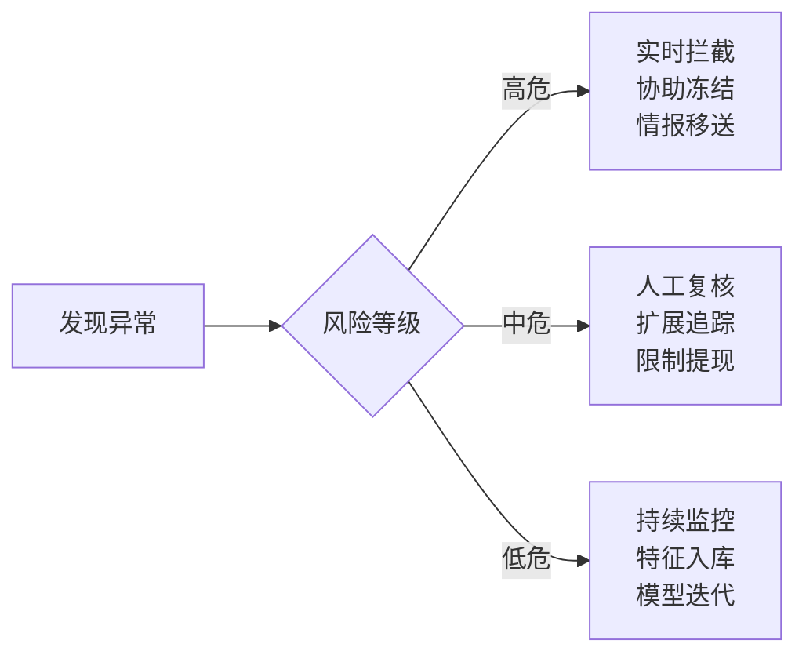

# 治理难点与防控对策

  负责人：@梦幻居士
  状态：进行中

## 结论摘要

1. **十个难点里，真正卡住案子的是三个：跨链/跨层断裂、标签质量、主观明知认定。** 其余七项或已有工具、或属背景条件。【推断】
2. **对策必须分主体写。** 机构侧能立刻做的是 KYT 与 Gas 来源检查；监管侧要动的是"桥与 L2 是否算 VASP"这一条制度缺口；技术侧的核心是带时间戳的标签库与跨链补单能力。【推断】
3. **稳定币的"可冻结"是双刃剑。** 冻结能力越强，对方分散持仓的动机越强，处置窗口越短。【推断】
4. **本页所有对策均为建议，未经试点验证。**【待验证】

## 一、十个治理难点

| # | 难点 | 具体表现 |
| --- | --- | --- |
| 1 | 地址 ≠ 身份 | 地址是伪匿名标识符，聚类到实体需依赖标签与启发式，存在误聚与漏聚 |
| 2 | 跨链 / 跨层断裂 | 单链分析在桥、Rollup、L2 处失效；各国仍以 L1 语义定义申报义务，Travel Rule 不覆盖跨链转移 |
| 3 | 匿名增强工具 | 混币器、隐私币、去中心化钱包、Tor/加密通讯增加溯源难度 |
| 4 | 司法管辖冲突 | 服务器境外、诈骗园区位于法律薄弱地区、资金多国流转、证据分散在多个主体 |
| 5 | 标签数据质量 | 官方标签覆盖有限；社区举报误报多、时效差；历史命中不能等同于当前风险 |
| 6 | 稳定币双刃剑 | 可冻结但也可通过分散持仓规避；发行方冻结权本身引发中心化争议 |
| 7 | 主观明知认定难 | 跑分参与者常辩称"仅赚佣金"，帮信罪与掩隐罪界限需结合价差、行为模式等客观事实推定 |
| 8 | 合约权限可变 | 土狗币的 `mint` / 税率 / 黑名单权限可随时变更，链上快照只能证明当时状态 |
| 9 | 数据稀缺与时效差 | 带标注的真实链上公开数据集以 BTC 为主且时间较早（2009–2018），稳定币与多链场景标注不足 |
| 10 | 产业链专业化 | "全栈式"非法基础设施（域名注册、防弹主机、担保平台）支撑犯罪规模化 |

口径说明：本表是"按阻断环节"的横切分类，与[治理痛点提炼](./pain-points)的 A1–C2 结构（按手法与环节纵向展开）互补而非重复。前者回答"卡在哪一环"，后者回答"某个手法为什么打不动"。【推断】

## 二、防控对策

### 2.1 机构侧（交易所 / 钱包 / 支付 / 承兑商）

- **KYT 实时监控**：对入金地址做制裁筛查与风险评分，异常入金延迟到账并人工复核。
- **Gas 费来源检查**：地址初始手续费来自非法实体或匿名渠道 → 提升风险等级。
- **风险资金占比监控**：设置来自标签地址的资金占比阈值，超限触发尽调。
- **充值地址聚类**：识别同一实体的多充值地址，防止"分散转入、集中转出"绕过单地址阈值。
- **OTC 风控**：对异常价差（如 USDT 价差 > 0.04 元）、异常手续费（4%）保持警觉。
- **合约上架审核**：对 Meme / 土狗币执行权限扫描、LP 锁定验证、持仓集中度检查，并要求模拟买卖测试。

### 2.2 行业与监管侧

- **桥与 L2 纳入监测**：推动将跨链桥、Rollup 运营方纳入 VASP 定义（FATF 2024–2025 已朝功能化、技术中立的解释演进）。
- **Travel Rule 跨链扩展**：解决跨链转移中交易双方信息断链问题。
- **稳定币冻结协作**：建立发行方 - 执法 - 交易所的快速冻结与情报共享机制（Tether / Circle 已有实践）。
- **制裁清单实时同步**：机构系统对接实时 SDN，避免引用历史快照。
- **跨部门 / 跨国协作**：公安、央行、外汇、网信、司法协同；加强国际执法合作（参考 DOJ 引渡案例）。

### 2.3 技术侧

- 建设行业共享的**带时间戳标签库**，降低社区举报误报。
- 部署**跨链追踪能力**，补单单链分析盲区。
- 用**全节点 + 标准化机器可读记录**固化证据，支撑 FIU 报告与案件移送。
- 对**本地设备痕迹**（浏览器历史、钱包扩展缓存）做取证，延续因跨链中断的资金流。

### 2.4 处置分层

分层标准与评分权重见[异常地址特征](../onchain/address-features)的"综合评分与决策流程"。【推断】

## 三、每类对策对应哪个难点

| 对策 | 主要缓解的难点 |
| --- | --- |
| KYT 实时监控、风险资金占比、制裁清单实时同步 | 5（标签质量） |
| Gas 费来源检查、充值地址聚类 | 1（地址≠身份）、3（匿名工具） |
| 桥与 L2 纳入监测、Travel Rule 跨链扩展、跨链追踪能力 | 2（跨链断裂） |
| 稳定币冻结协作 | 6（双刃剑）、4（管辖冲突） |
| 合约上架审核、权限扫描 | 8（合约权限可变） |
| 带时间戳标签库、全节点证据固化 | 5、9（数据稀缺） |
| 异常价差与手续费线索 | 7（主观明知） |

对应关系为本文分析所得，非官方口径。【推断】

## 局限与待验证

- 【待验证】全部对策未做试点，效果与成本均无实测数据。
- 【推断】"十个难点"的排序按阻断程度判断，换地域或换案件类型需重排。
- 【事实】监管口径以现行有效文件为准，本页引用的 FATF 表述以 2024–2025 更新为限，后续可能变化。
- 边界：只讨论治理技术路径，不涉及具体执法程序与量刑。

## 下一步

- [ ] 挑一条对策（建议"带时间戳标签库"）做最小试点设计，写清成本、数据来源、验收标准。
- [ ] 与[治理痛点提炼](./pain-points)做一次口径对齐，把两套编号互相标注。
- [ ] 补 FATF 2024–2025 相关文件的原文链接与条文位置。

## 参考

1. FATF · *Virtual Assets Red Flag Indicators*、*Targeted Update on VASP implementation*（2024–2025）
2. [Chainalysis · Crypto Sanctions 2026](https://www.chainalysis.com/blog/crypto-sanctions-2026/)
3. 站内：[治理痛点提炼](./pain-points)、[异常地址特征](../onchain/address-features)、[技术研判方法](../tech/forensic-methods)
